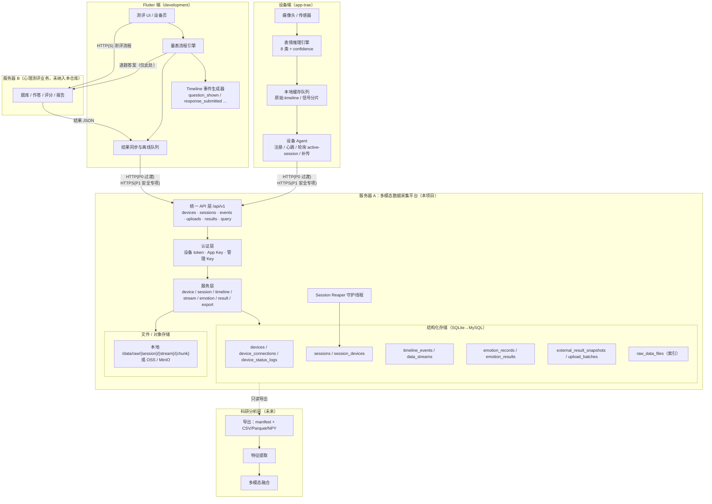
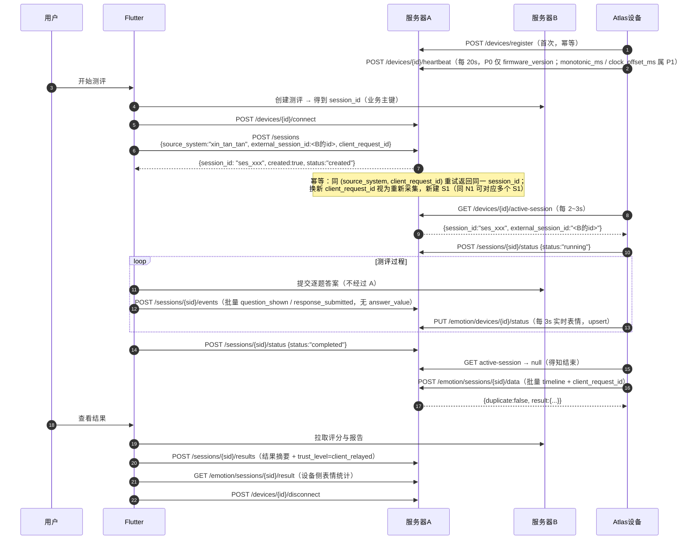
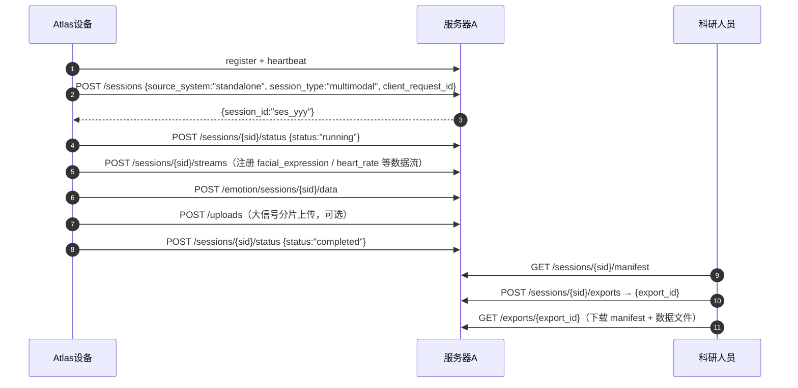
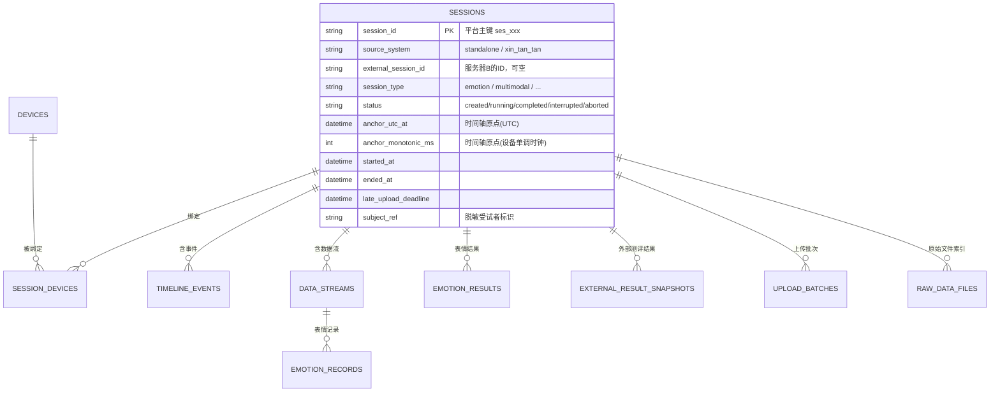
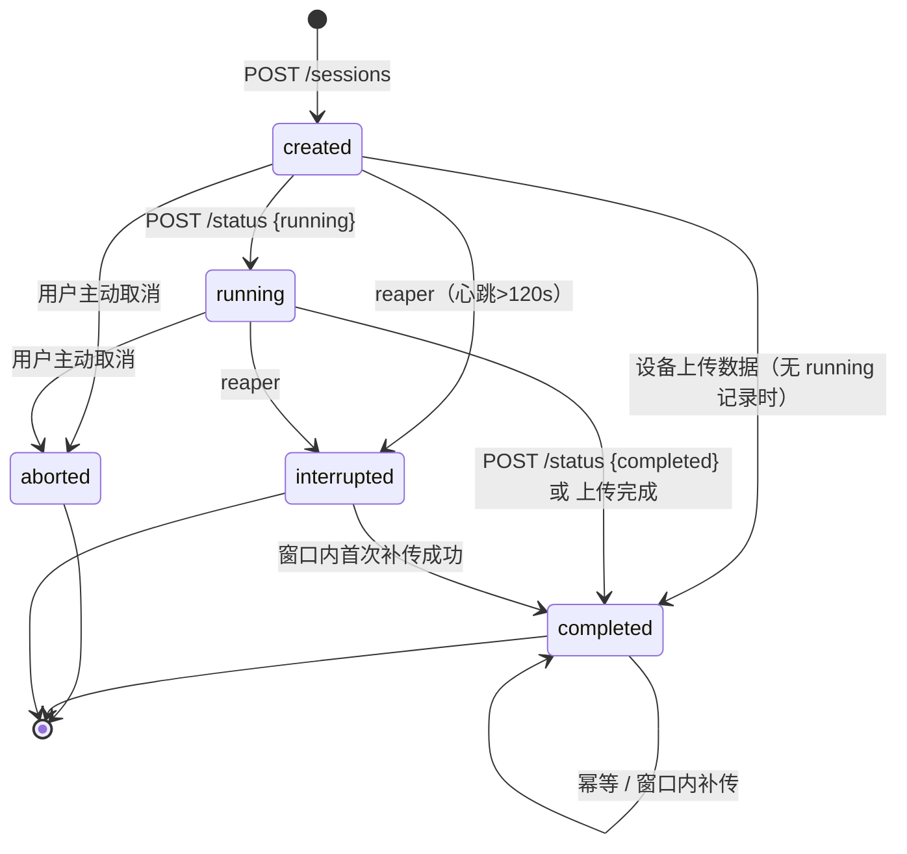
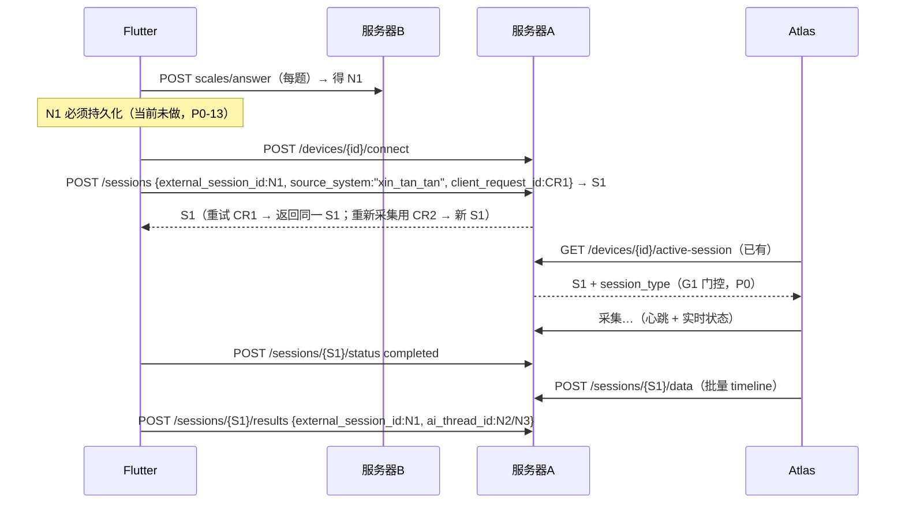
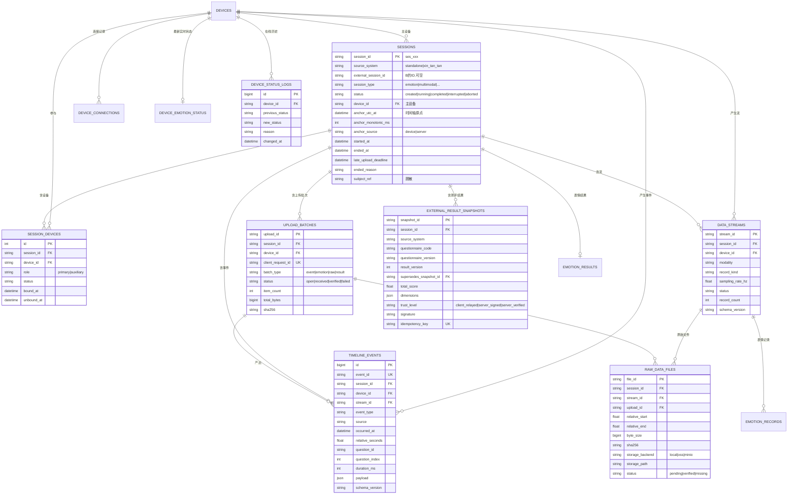
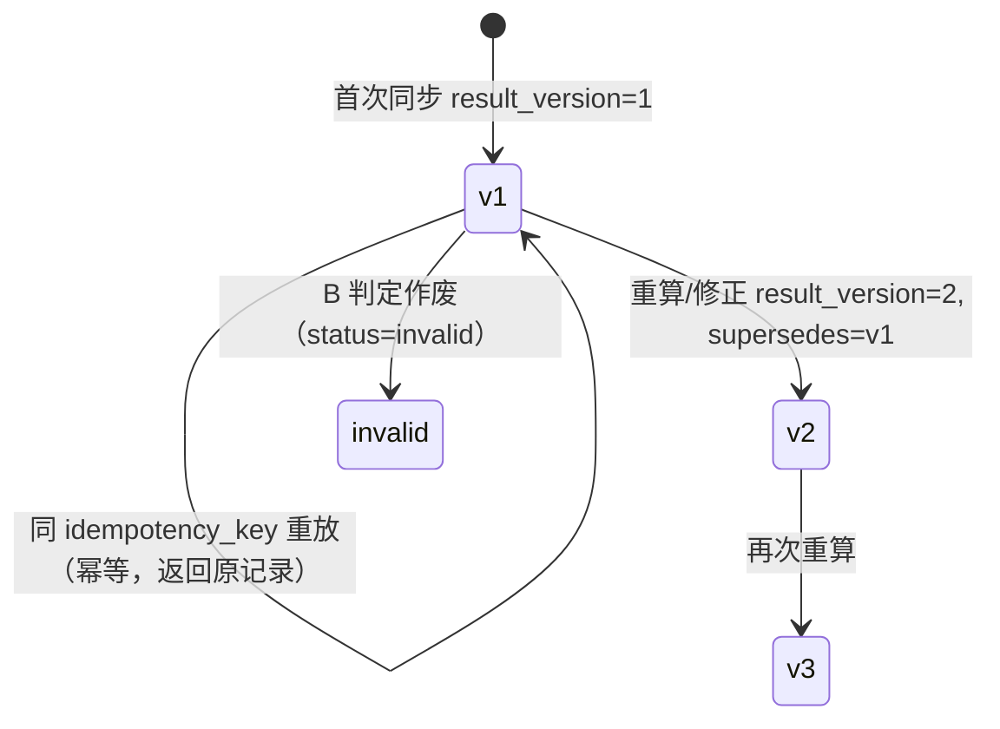
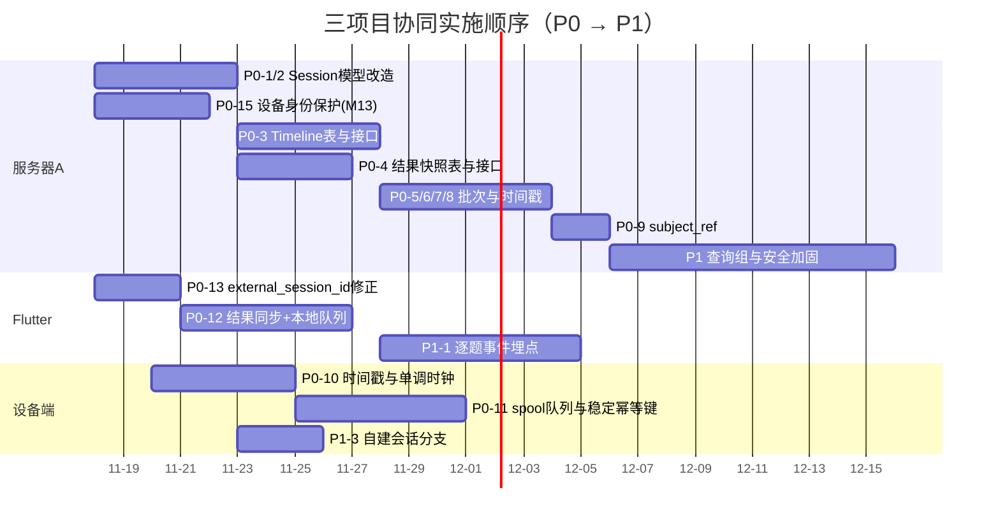

# AI 心探探多模态数据采集平台总体架构设计说明书

| 项目 | 内容 |
| --- | --- |
| 文档版本 | **v1.3（阶段调整版）**：在 v1.2 基础上把 HTTPS/TLS、证书、设备校时与 HTTP 过渡入口从 P0 移出，改为**后续安全加固专项（P1）**；P0 只做业务功能开发与端到端联调 |
| 编写日期 | 2026-11-17 |
| 主控项目 | `hardware-aliyun` / `psychology-server`（服务器 A） |
| 文档状态 | **P0 业务功能开发与联调阶段暂不实施 HTTPS/TLS 改造，优先完成端云业务链路。安全加固作为后续独立专项实施，不代表取消安全要求。** 本文档不含任何代码、数据库、服务器配置修改；批准后方可进入实施 |
| 审计基线 | Git `12a084e`（feat: 允许设备对已completed/interrupted但无结果的会话收尾补传一次） |
| 审计范围 | `psychology-server/app`、`tests`、`scripts`、`README.md`、`运维手册.md`、`.env.example`；另读取 `app-trae/docs/设备端审计报告.md`（§10 字段核对、§11 AD 核实）、`development/docs/multimodal-platform/客户端审计结论.md`（第 9 章 FD/X 核实、第 10 章服务器 B 真实 PHQ-9 样本）、`serverB-phq9-result-raw.json`、`serverB-phq9-trace.json` |

> **本轮只读声明**
> 本文档对服务器 A 的全部结论来自仓库内真实源码的逐文件阅读；对设备端与 Flutter 端的结论来自两份**已完成的并行只读审计报告**（本文档未直接读取这两个项目的源码）。
> 对服务器 B 的结果字段结论来自 **2026-11-17 的一次真实实测**（PHQ-9，`session_id=1742`，原始响应与全链路 trace 见 §14.1 引用），不再是「仅客户端解析模型推断」。
> 审计期间：未修改任何源码、未改动数据库结构、未执行迁移、未重启服务、未访问生产服务器 `8.140.240.43`、
> 未运行任何测试或脚本（工作区处于未信任状态，且只读约束禁止执行）。
> 因此文中所有「已实现」判断均为**代码级判断**，不代表生产环境实测通过；
> 凡两项目审计报告未覆盖、且本文档无法直接确认的事实，均标注「待核实」并列入 §23，**不作推测**。

---

## 0. 阅读指引

| 章节 | 内容 | 读者 |
| --- | --- | --- |
| §1 | 项目背景与建设目标 | 全体 |
| §2 | 服务器 A 只读审计（代码级） | 后端 / 架构 |
| §2.11 | **三项目交叉核对（第二阶段）—— 10 条逐项对撞** | 全体（**先读**） |
| §3 | 三项目职责边界 | 全体 |
| §4–5 | 总体架构图、协同数据流图 | 全体 |
| §6 | 统一 Session 设计（`session_id` 与 `external_session_id` 合并论证；**§6.5.1 同一 N1 的三种情形、§6.7 会话类型门控、§6.8 N1/N2/N3 与采集时序**） | 后端 / Flutter / 硬件 |
| §7–8 | Timeline 事件模型、时间戳与时间同步；**§8.1 设备时间能力分层、§8.4 时间校验单一策略（三层 L1/L2/L3）、§8.5 统一质量模型、§8.6 分级兼容、§8.7 协议版本演进** | 后端 / 硬件 / Flutter |
| §9–11 | 多模态数据模型、ER 图、数据字典（**§11.2 sessions 字典、§11.4 迁移 M1–M13**） | 后端 |
| §12–13 | 统一 API 规范、统一 JSON 协议（含字段必填/选填矩阵） | 全体 |
| §14 | 测评结果同步方案（**§14.2.1 真实样本背书白名单、§14.3 radar 归一化**、幂等键、唯一约束、`trust_level`） | 后端 / Flutter |
| §15–17 | 文件存储、断网补传、安全与隐私（**§17.4 设备身份保护 D3；§17.5 TLS 方案——P0 不实施，归 P1 安全专项**） | 后端 / 硬件 |
| §18 | 开源平台规划 | 产品 / 架构 |
| §19–21 | 实施计划、备份迁移回滚、测试与验收（含 D1/D3/D5/D12 对 P0/P1/P2 的影响） | 全体 |
| §22 | 关键决策（**D1/D2/D3/D5/D9/D10/D11/D12 已定**；D4/D6/D7/D8 待确认） | **用户决策项** |
| §23 | 需另两个项目补充核实的清单（AD/FD/X 全套核实状态） | 交叉核对 |
| 附录 C | 变更记录（v0.2 → v1.2 改了什么） | 全体 |
| 附录 D | **关键设计决策追踪表**（决策编号 / 最终规则 / 章节 / 数据库影响 / API 影响 / 阶段） | 全体（**开发前必读**） |

---

## 1. 项目背景与建设目标

### 1.1 三个项目的真实定位

| 项目 | 定位 | 本文档中的称谓 |
| --- | --- | --- |
| `hardware-aliyun` | 阿里云上的 FastAPI 设备数据采集服务器 | **服务器 A** |
| `app-trae` | 华为 Atlas 200I DK A2（Ascend 310B4）+ 摄像头 + 表情识别程序 | **设备端 / Atlas** |
| `development` | Flutter 移动端 App，承载量表测评流程，协调两个服务器 | **Flutter 端** |
| （未纳入本仓库） | 现有心理测评业务服务器（题库、作答、评分、报告） | **服务器 B** |

### 1.2 服务器 A 的定位修正（本次架构最重要的前提）

当前代码库的包名、README、OpenAPI 标题均为 `psychology-server`「心理测评云平台」。
但**从代码实际承担的职责看，它已经是一个通用设备数据采集服务器**：

- `devices` / `device_connections` / `device_emotion_status` 三张表与「心理测评」无任何业务耦合；
- `sessions` 表只有 `session_type` 一个业务字段，当前取值被硬编码为 `emotion`；
- 唯一的业务表 `emotion_records` / `emotion_results` 属于**设备识别记录**，不属于量表业务。

因此本次架构将其重新定位为：

> **服务器 A = 通用多模态数据采集平台（Multimodal Data Acquisition Platform, MDAP）**
> 心理测评结果同步只是它的一个**可选集成模块**，不是它的内核。

### 1.3 建设目标

1. **独立性**：服务器 B（心理测评业务）完全不可用时，Atlas 的注册、心跳、Session、表情数据采集与上传、结果查询必须全部可用。
2. **统一关联**：量表过程事件与设备采集数据必须能落到同一条时间轴、同一个 Session 上。
3. **不重复承担职责**：硬件端只采集与识别；Flutter 只做流程编排与结果转发；服务器 A 只做采集、存储、索引与查询；评分与报告永远属于服务器 B。
4. **可扩展**：新增心率 / PPG / ECG / 语音 / EEG / fNIRS / 眼动时，只新增独立业务表与独立 API，不修改通用层，不新增「万能数据接口」。
5. **可复现**：任何一份采集数据都能导出为带完整性校验、带时间轴、带协议版本的科研数据集。
6. **可开源**：核心平台与心理测评业务解耦，具备开源所需的最小治理件（文档、迁移、测试、部署）。

### 1.4 本阶段明确不做

- 不做实时流（WebSocket / MQTT / Kafka / Redis）；
- 不做特征提取、情绪融合、心理状态推断算法；
- 不做 LLM 心理报告；
- 不做 Docker 生产部署、Nginx、HTTPS 终结（**P0 不实施，方案与专项清单见 §17.5 与《后续安全加固专项清单》**）；
- 不做复杂 RBAC、支付、多租户计费；
- 不迁移、不修改、不重启生产环境。

---

## 2. 服务器 A 只读审计（代码级）

### 2.1 技术栈与实际依赖

| 项 | 实际值 | 文件位置 |
| --- | --- | --- |
| Web 框架 | FastAPI（`>=0.115`） | [requirements.txt](file:///F:/software_self/%E5%8D%8E%E4%B8%BA%E5%BC%80%E5%8F%91/hardware-aiLiYun/psychology-server/requirements.txt) |
| ASGI 服务器 | uvicorn[standard] | 同上 |
| ORM | SQLAlchemy 2.0（`Mapped` / `mapped_column` 声明式） | [database.py](file:///F:/software_self/%E5%8D%8E%E4%B8%BA%E5%BC%80%E5%8F%91/hardware-aiLiYun/psychology-server/app/db/database.py) |
| 校验 | Pydantic v2 + pydantic-settings | [schemas/](file:///F:/software_self/%E5%8D%8E%E4%B8%BA%E5%BC%80%E5%8F%91/hardware-aiLiYun/psychology-server/app/schemas) |
| 数据库 | SQLite（`sqlite:///./psychology.db`），预留 pymysql | [config.py](file:///F:/software_self/%E5%8D%8E%E4%B8%BA%E5%BC%80%E5%8F%91/hardware-aiLiYun/psychology-server/app/core/config.py#L14) |
| 迁移工具 | **无**（无 Alembic，仅 `Base.metadata.create_all()`） | [database.py](file:///F:/software_self/%E5%8D%8E%E4%B8%BA%E5%BC%80%E5%8F%91/hardware-aiLiYun/psychology-server/app/db/database.py#L42-L53) |
| 进程托管 | systemd，`Restart=always`，`User=root`，端口 8000 | [psychology-server.service](file:///F:/software_self/%E5%8D%8E%E4%B8%BA%E5%BC%80%E5%8F%91/hardware-aiLiYun/psychology-server/scripts/psychology-server.service) |

### 2.2 目录结构（真实）

```text
psychology-server/
├── app/
│   ├── main.py                  # 应用组装、统一异常处理、路由挂载、生命周期启动 reaper
│   ├── api/
│   │   ├── health.py            # GET /health
│   │   ├── devices.py           # 设备注册/列表/详情/活跃会话/心跳/连接/断开
│   │   ├── sessions.py          # 创建/查询/状态流转
│   │   ├── emotion.py           # 表情上传/结果查询/实时状态上报与查询
│   │   └── docs_page.py         # GET / 自建 HTML 使用说明页（含接口表）
│   ├── core/
│   │   ├── config.py            # Settings（.env）
│   │   ├── security.py          # 设备 token 生成与校验、认证依赖
│   │   ├── logging.py           # 控制台 + RotatingFileHandler
│   │   └── reaper.py            # 僵尸会话回收守护线程
│   ├── db/database.py           # engine / SessionLocal / Base / utcnow / init_db
│   ├── models/                  # 6 张 ORM 表
│   ├── schemas/                 # device / session / emotion 三组出入参
│   └── services/                # device_service / session_service / emotion_service
├── tests/                       # 9 个 pytest 文件
├── scripts/                     # check_db / ensure_index / server_setup / run_setup / live_test / .service
├── .env.example
├── README.md
└── 运维手册.md
```

**结论**：分层（api / schemas / services / models）已建立且被遵守——API 路由层没有直接写 SQL，`emotion_service.py` 封装了全部算法。这一分层是后续扩展的良好基础，**不需要重构**。

### 2.3 数据库实际表结构（6 张表，以 ORM 定义为准）

> 注意：`运维手册.md` 第 199–213 行写「4 张表」，实际为 6 张（漏掉 `device_connections`、`device_emotion_status`）。属文档滞后，非代码缺陷。

#### 2.3.1 `devices`

| 字段 | 类型 | 约束 | 说明 |
| --- | --- | --- | --- |
| `id` | INTEGER | PK, autoincrement | 内部主键 |
| `device_id` | VARCHAR(64) | **UNIQUE, INDEX** | 业务设备标识（如 `atlas_001`），由设备自行上报 |
| `device_name` | VARCHAR(128) | NOT NULL | 展示名 |
| `device_type` | VARCHAR(64) | NOT NULL | 如 `edge_ai_device` |
| `manufacturer` | VARCHAR(64) | NULL | |
| `model` | VARCHAR(128) | NULL | |
| `firmware_version` | VARCHAR(64) | NULL | 心跳可更新 |
| `status` | VARCHAR(16) | default `offline` | **冗余字段**，权威值由 `last_seen` 惰性推导 |
| `last_seen` | DATETIME | NULL | 最后一次心跳（naive UTC） |
| `device_token` | VARCHAR(128) | **UNIQUE** | 明文存储，64 hex 字符 |
| `capabilities` | JSON | default `[]` | 如 `["emotion"]` |
| `created_at` / `updated_at` | DATETIME | NOT NULL | |

#### 2.3.2 `sessions`

| 字段 | 类型 | 约束 | 说明 |
| --- | --- | --- | --- |
| `id` | INTEGER | PK | |
| `session_id` | VARCHAR(64) | **UNIQUE, INDEX** | `uuid4().hex`，**由服务器 A 生成** |
| `device_id` | VARCHAR(64) | **FK → devices.device_id, INDEX** | **单设备**，一个会话只能挂一台设备 |
| `user_id` | VARCHAR(64) | NULL | 自由字符串，**无 users 表、无身份校验** |
| `session_type` | VARCHAR(32) | default `emotion` | Schema 层用 `Literal["emotion"]` 硬限 |
| `status` | VARCHAR(16) | INDEX, default `created` | `created/running/completed/interrupted` |
| `started_at` / `ended_at` | DATETIME | NULL | 服务器时间 |
| `created_at` / `updated_at` | DATETIME | NOT NULL | |

#### 2.3.3 `emotion_records`（原始 timeline）

| 字段 | 类型 | 约束 | 说明 |
| --- | --- | --- | --- |
| `id` | INTEGER | PK | |
| `session_id` | VARCHAR(64) | **FK → sessions.session_id, INDEX** | |
| `relative_seconds` | FLOAT | NOT NULL | 相对会话开始秒数，**由设备提供，服务器不校验单调性与上界** |
| `expression` | VARCHAR(32) | INDEX | 8 类之一（Schema 层校验） |
| `confidence` | FLOAT | NOT NULL | 0~1（Schema 层校验） |
| `created_at` | DATETIME | NOT NULL | **服务器接收时间**，非设备采集时间 |

#### 2.3.4 `emotion_results`（服务器重算结果）

| 字段 | 类型 | 约束 | 说明 |
| --- | --- | --- | --- |
| `id` | INTEGER | PK | |
| `session_id` | VARCHAR(64) | **FK, UNIQUE, INDEX** | **一个会话只能有一份结果** |
| `client_request_id` | VARCHAR(128) | INDEX | 幂等键 |
| `valid_expression_seconds` | FLOAT | default 0 | |
| `dominant_expression` | VARCHAR(32) | NOT NULL | |
| `average_confidence` | FLOAT | default 0 | |
| `face_coverage_percent` | FLOAT | default 0 | 服务器按帧数重算 |
| `result_json` | JSON | NOT NULL | 明细统计（expressions / quality / session_start / session_end） |
| `created_at` / `updated_at` | DATETIME | NOT NULL | |
| — | — | **UNIQUE(session_id, client_request_id)** | 与 `session_id UNIQUE` 语义重复（见 §2.8 问题 A6） |

#### 2.3.5 `device_connections`

| 字段 | 类型 | 约束 | 说明 |
| --- | --- | --- | --- |
| `id` | INTEGER | PK | |
| `connection_id` | VARCHAR(64) | **UNIQUE, INDEX** | `uuid4().hex` |
| `device_id` | VARCHAR(64) | **FK, INDEX** | |
| `app_client_id` | VARCHAR(128) | INDEX | 手机端安装实例 ID，**无校验、无归属证明** |
| `user_id` | VARCHAR(64) | NULL | |
| `status` | VARCHAR(16) | INDEX, default `connected` | 见问题 A10：设备离线时也写 `connected` |
| `connected_at` / `disconnected_at` | DATETIME | | |
| `created_at` / `updated_at` | DATETIME | NOT NULL | |

#### 2.3.6 `device_emotion_status`

| 字段 | 类型 | 约束 | 说明 |
| --- | --- | --- | --- |
| `id` | INTEGER | PK | |
| `device_id` | VARCHAR(64) | **FK, UNIQUE, INDEX** | 与设备 1:1，只保留最新一行 |
| `face_detected` | BOOLEAN | default false | |
| `expression_detected` | BOOLEAN | default false | |
| `current_expression` | VARCHAR(16) | NULL | ⚠ 长度 16，与 `emotion_records.expression` 的 32 不一致 |
| `confidence` | FLOAT | NULL | |
| `created_at` / `updated_at` | DATETIME | NOT NULL | `updated_at` 即服务器最后一次收到时间 |

### 2.4 实际 API 清单（16 个业务路由 + 4 个文档路由）

所有业务路由前缀 `/api/v1`；统一返回 `{"code","message","data"}`（正常响应用 `response_model` 直接返回数据体，不套 `code` 外壳）。

| # | 方法 | 路径 | 认证 | 用途 | 代码位置 |
| --- | --- | --- | --- | --- | --- |
| 1 | GET | `/api/v1/health` | 无 | 探活 | [health.py](file:///F:/software_self/%E5%8D%8E%E4%B8%BA%E5%BC%80%E5%8F%91/hardware-aiLiYun/psychology-server/app/api/health.py) |
| 2 | POST | `/api/v1/devices/register` | 无 | 注册设备，返回 token，重复注册幂等 | [devices.py#L27-L44](file:///F:/software_self/%E5%8D%8E%E4%B8%BA%E5%BC%80%E5%8F%91/hardware-aiLiYun/psychology-server/app/api/devices.py#L27-L44) |
| 3 | GET | `/api/v1/devices` | **无** | 列出全部设备 | [devices.py#L47-L57](file:///F:/software_self/%E5%8D%8E%E4%B8%BA%E5%BC%80%E5%8F%91/hardware-aiLiYun/psychology-server/app/api/devices.py#L47-L57) |
| 4 | GET | `/api/v1/devices/{device_id}` | 无 | 设备详情 + 惰性在线判断 | [devices.py#L60-L72](file:///F:/software_self/%E5%8D%8E%E4%B8%BA%E5%BC%80%E5%8F%91/hardware-aiLiYun/psychology-server/app/api/devices.py#L60-L72) |
| 5 | GET | `/api/v1/devices/{device_id}/active-session` | 无 | Atlas 轮询当前未完成会话 | [devices.py#L75-L95](file:///F:/software_self/%E5%8D%8E%E4%B8%BA%E5%BC%80%E5%8F%91/hardware-aiLiYun/psychology-server/app/api/devices.py#L75-L95) |
| 6 | POST | `/api/v1/devices/{device_id}/heartbeat` | 设备 token | 心跳 | [devices.py#L98-L123](file:///F:/software_self/%E5%8D%8E%E4%B8%BA%E5%BC%80%E5%8F%91/hardware-aiLiYun/psychology-server/app/api/devices.py#L98-L123) |
| 7 | POST | `/api/v1/devices/{device_id}/connect` | 无 | 手机连接设备（记录） | [devices.py#L126-L159](file:///F:/software_self/%E5%8D%8E%E4%B8%BA%E5%BC%80%E5%8F%91/hardware-aiLiYun/psychology-server/app/api/devices.py#L126-L159) |
| 8 | POST | `/api/v1/devices/{device_id}/disconnect` | 无 | 手机断开 | [devices.py#L162-L185](file:///F:/software_self/%E5%8D%8E%E4%B8%BA%E5%BC%80%E5%8F%91/hardware-aiLiYun/psychology-server/app/api/devices.py#L162-L185) |
| 9 | POST | `/api/v1/sessions` | 设备 token **或** `connection_id` | 创建会话（设备必须在线否则 409） | [sessions.py#L29-L88](file:///F:/software_self/%E5%8D%8E%E4%B8%BA%E5%BC%80%E5%8F%91/hardware-aiLiYun/psychology-server/app/api/sessions.py#L29-L88) |
| 10 | GET | `/api/v1/sessions/{session_id}` | 无 | 会话详情 | [sessions.py#L91-L98](file:///F:/software_self/%E5%8D%8E%E4%B8%BA%E5%BC%80%E5%8F%91/hardware-aiLiYun/psychology-server/app/api/sessions.py#L91-L98) |
| 11 | POST | `/api/v1/sessions/{session_id}/status` | 无（带 token 则校验归属） | `running` / `completed` | [sessions.py#L101-L126](file:///F:/software_self/%E5%8D%8E%E4%B8%BA%E5%BC%80%E5%8F%91/hardware-aiLiYun/psychology-server/app/api/sessions.py#L101-L126) |
| 12 | POST | `/api/v1/emotion/sessions/{session_id}/data` | 设备 token | 批量上传 timeline，服务器重算 | [emotion.py#L27-L79](file:///F:/software_self/%E5%8D%8E%E4%B8%BA%E5%BC%80%E5%8F%91/hardware-aiLiYun/psychology-server/app/api/emotion.py#L27-L79) |
| 13 | GET | `/api/v1/emotion/sessions/{session_id}/result` | 无 | 获取重算结果 | [emotion.py#L82-L107](file:///F:/software_self/%E5%8D%8E%E4%B8%BA%E5%BC%80%E5%8F%91/hardware-aiLiYun/psychology-server/app/api/emotion.py#L82-L107) |
| 14 | PUT | `/api/v1/emotion/devices/{device_id}/status` | 设备 token | 上报实时表情状态（upsert） | [emotion.py#L110-L142](file:///F:/software_self/%E5%8D%8E%E4%B8%BA%E5%BC%80%E5%8F%91/hardware-aiLiYun/psychology-server/app/api/emotion.py#L110-L142) |
| 15 | GET | `/api/v1/emotion/devices/{device_id}/status` | 无 | 查询实时表情状态（含 `stale`） | [emotion.py#L145-L171](file:///F:/software_self/%E5%8D%8E%E4%B8%BA%E5%BC%80%E5%8F%91/hardware-aiLiYun/psychology-server/app/api/emotion.py#L145-L171) |
| 16 | GET | `/` | 无 | 自建 HTML 使用说明页 | [docs_page.py](file:///F:/software_self/%E5%8D%8E%E4%B8%BA%E5%BC%80%E5%8F%91/hardware-aiLiYun/psychology-server/app/api/docs_page.py) |

另有 `/docs`、`/redoc`、`/openapi.json`（FastAPI 自动）。

### 2.5 认证机制（真实实现）

| 机制 | 实现 | 评价 |
| --- | --- | --- |
| 设备认证 | 请求头 `X-Device-Id` + `X-Device-Token`，`hmac.compare_digest` 比对明文 token | 常量时间比较正确；但 token 明文入库、无过期、无轮换、无吊销 |
| 手机端认证 | **无**。仅凭 `app_client_id`（客户端自定义字符串）或 `session_id`/`device_id`（可枚举 UUID/固定名） | 任何知道 `device_id` 的人都能 connect、创建会话、改会话状态、读结果 |
| 管理/科研查询 | **无** | 全部查询接口开放 |
| `SECRET_KEY` | 配置存在，但**全仓库无任何代码引用** | 无效配置（`config.py:16`），易误导运维以为已启用签名机制 |

相关代码：[security.py](file:///F:/software_self/%E5%8D%8E%E4%B8%BA%E5%BC%80%E5%8F%91/hardware-aiLiYun/psychology-server/app/core/security.py)

### 2.6 心跳与在线状态

- 阈值：`DEVICE_OFFLINE_AFTER_SECONDS = 30`（[config.py#L22](file:///F:/software_self/%E5%8D%8E%E4%B8%BA%E5%BC%80%E5%8F%91/hardware-aiLiYun/psychology-server/app/core/config.py#L22)）。
- 在线判断是**惰性**的：`effective_status()` 每次按 `utcnow() - last_seen` 计算，不写库（[device_service.py#L70-L77](file:///F:/software_self/%E5%8D%8E%E4%B8%BA%E5%BC%80%E5%8F%91/hardware-aiLiYun/psychology-server/app/services/device_service.py#L70-L77)）。
- `devices.status` 列因此是冗余快照，只有心跳时才写 `online`，**永远不会被写回 `offline`**。
- 心跳 body 可选，仅携带 `firmware_version`；**不携带设备本地时间、单调时钟、时钟偏移**。

### 2.7 Session 生命周期

```text
创建（POST /sessions，要求设备 online）
  → created
  → running        （手机或设备调 /status，记录 started_at=服务器时间）
  → completed      （两条路径：① 手机调 /status ② 设备上传 emotion 数据后服务端自动置 completed）
  → interrupted    （reaper 线程：created/running 且设备心跳 >120s 消失，每 60s 扫描一次）
```

- reaper 为 Python `threading.Thread`（daemon），随 FastAPI lifespan 启停，启动时先扫一次（[reaper.py](file:///F:/software_self/%E5%8D%8E%E4%B8%BA%E5%BC%80%E5%8F%91/hardware-aiLiYun/psychology-server/app/core/reaper.py)）。
- 状态机约束（[session_service.py#L70-L94](file:///F:/software_self/%E5%8D%8E%E4%B8%BA%E5%BC%80%E5%8F%91/hardware-aiLiYun/psychology-server/app/services/session_service.py#L70-L94)）：`completed` 不能再回 `running`；`interrupted` 不在目标状态枚举中（只能由 reaper 内部置位）。

### 2.8 已实现 / 部分实现 / 未实现 / 缺陷 —— 逐项判定

#### 2.8.1 已实现（代码完整、有测试覆盖、逻辑正确）

| 能力 | 证据 |
| --- | --- |
| 设备注册（幂等） | `device_service.register_device` + `test_01b_register_twice_is_idempotent` |
| 设备 token 认证 | `security.get_current_device` + `test_02b/02c` |
| 心跳与在线惰性判定 | `device_service.heartbeat` / `effective_status` + `test_02/02d/12` |
| 设备列表与详情 | `test_list_devices`、`test_02d_device_query` |
| 设备离线禁止建会话（409） | `test_offline_create` |
| 手机 connect / disconnect（幂等） | `test_device_connect` |
| 设备活跃会话免认证查询 | `test_active_session` |
| Session 创建 / 查询 / 状态流转 | `sessions.py` + `test_full_flow` |
| 僵尸会话 120s 回收 | `session_service.reap_stale_sessions` + `test_session_reaper` |
| 表情 timeline 批量上传 + 服务器重算 | `emotion_service.compute_result` + `test_04/05` |
| 8 类表情枚举校验、confidence∈[0,1] | `schemas/emotion.py` + `test_09/10` |
| `(session_id, client_request_id)` 幂等 | `test_08` |
| 已结束但无结果允许补传一次 | `test_late_upload`（4 个用例） |
| 实时表情状态 upsert + `stale` 判定 | `test_emotion_status` |
| 统一异常返回 `{code,message,data}` | `main.py` 三个 handler |
| 服务端日志（控制台 + 轮转文件） | `core/logging.py` |
| systemd 托管（自启 + 崩溃重启） | `scripts/psychology-server.service` |

#### 2.8.2 部分实现（有代码但达不到目标要求）

| 能力 | 现状 | 缺口 |
| --- | --- | --- |
| 幂等 | 只有 `emotion_results` 一张表有幂等键 | 无通用 `upload_batches`，Session 创建、连接、事件上传均无幂等键 |
| 断网补传 | 仅「Session 已结束但无结果」时允许一次收尾上传 | 无补传时间窗上限（永远允许）、无批次对账、无离线队列协议 |
| 时间戳 | `relative_seconds` + 服务器 `created_at` | 无 `device_timestamp`、`monotonic_time`、`clock_offset`、`time_uncertainty`；`created_at` 被当作采集时间使用 |
| 数据查询 | 仅 `/emotion/sessions/{id}/result` 单点查询 | 无时间范围查询、无分页、无游标、无导出 |
| 多设备 | `sessions.device_id` 单外键 | 一个 Session 无法绑定多设备 |
| Session 类型 | `session_type` 字段存在但 Schema 用 `Literal["emotion"]` 锁死 | `session_type="multimodal"` 直接被 422 拒绝 |
| 版本管理 | 路径硬编码 `/api/v1` | 无请求/响应 schema 版本号，无 `protocol_version` |
| 实时状态 | 只有「最新一行」 | 无历史，无法回溯；`current_expression` 长度 16 与其它表 32 不一致 |

#### 2.8.3 未实现（无任何代码，仅在需求/文档中提及）

| 能力 | 说明 |
| --- | --- |
| Timeline 事件表与接口 | 无 `timeline_events` 表、无 `/events` 路由 |
| `data_streams` | 无数据流元数据表 |
| 原始信号文件存储 | 无文件表、无分片上传、无对象存储适配 |
| `raw_data_files` | 同上 |
| 测评结果同步 | 无 `external_result_snapshots`、无 `/results` 路由 |
| `device_status_logs` | 无在线/离线历史日志 |
| `upload_batches` | 无上传批次与对账 |
| `session_device_bindings` | 多设备绑定表缺失 |
| 导出 | 无 CSV/Parquet/manifest 导出 |
| 数据保留与删除策略 | 无 TTL、无归档、无删除接口 |
| 审计日志 | 只有应用日志文本，无结构化审计表 |
| 数据库迁移 | 无 Alembic，`create_all()` 无法演进已有表 |
| 管理鉴权 | 无 API Key / JWT / RBAC |

#### 2.8.4 存在缺陷 / 需重构（按严重度排序）

| 编号 | 问题 | 位置 | 风险 | 建议（本轮不实施） |
| --- | --- | --- | --- | --- |
| **A1** | **无法承载服务器 B 的 session_id**。`create_session` 固定 `uuid4().hex`，且无外部 ID 字段 | [session_service.py#L29](file:///F:/software_self/%E5%8D%8E%E4%B8%BA%E5%BC%80%E5%8F%91/hardware-aiLiYun/psychology-server/app/services/session_service.py#L29) | AI 心探探集成模式下，Flutter 携带 B 的 session_id 无法落到 A，Schema 会直接 422/404；这是三项目无法关联的**根因** | 新增 `source_system` + `external_session_id`（§6.2） |
| **A2** | `session_type` 被 `Literal["emotion"]` 锁死 | [schemas/session.py#L12](file:///F:/software_self/%E5%8D%8E%E4%B8%BA%E5%BC%80%E5%8F%91/hardware-aiLiYun/psychology-server/app/schemas/session.py#L12) | 多模态 Session 无法创建；扩展时必须改 Schema 与所有调用方 | 改为受控枚举 + 应用层白名单校验 |
| **A3** | 一个设备可同时存在多个未完成 Session，`get_active_session` 只取最新一条 | `session_service.get_active_session` | Atlas 可能拿到错误的 session_id，把 A 会话的数据传到 B 会话；**数据串会话** | 增加「单设备单活跃会话」约束 |
| **A4** | `emotion_records` 无任何唯一约束，`emotion_results` 的 `UNIQUE(session_id, client_request_id)` 与 `session_id UNIQUE` 语义重复 | [emotion_result.py#L13-L18](file:///F:/software_self/%E5%8D%8E%E4%B8%BA%E5%BC%80%E5%8F%91/hardware-aiLiYun/psychology-server/app/models/emotion_result.py#L13-L18) | 并发下两个不同 `client_request_id` 同时上传，二者都通过「查无结果」，随后一次 commit 触发 IntegrityError → **返回 500 而非 409** | 捕获 `IntegrityError` → 409；幂等键下沉到通用 `upload_batches` |
| **A5** | timeline 无长度上限、无 `relative_seconds` 单调/上界校验 | `schemas/emotion.py` `TimelineItem` | 超大数组可打满内存/数据库；`relative_seconds=1e9` 会污染统计结果；重复时间戳导致 0 时长 | 加 `max_length`、`0 <= t <= session 时长 + 容忍`、拒绝严格重复时间戳 |
| **A6** | 所有手机侧查询接口免认证，且 `GET /devices` 返回全量设备 | `devices.py`、`emotion.py`、`sessions.py` | 公网 8000 端口（运维手册确认已放行 0.0.0.0/0）上，任何人可枚举设备、读任意会话结果、篡改会话状态 | 管理/科研查询加 `X-Api-Key`；手机侧改为短期访问凭证（§17） |
| **A7** | `SECRET_KEY` 配置存在但全仓库未使用 | [config.py#L16](file:///F:/software_self/%E5%8D%8E%E4%B8%BA%E5%BC%80%E5%8F%91/hardware-aiLiYun/psychology-server/app/core/config.py#L16) | 误导运维；且未来做签名/加密时无迁移路径 | 要么启用（用于结果凭证签名），要么删除并在文档说明 |
| **A8** | 时间全部为 naive UTC，响应 JSON 无时区后缀 | `db.utcnow()` + 所有 `DateTime` 列 | Flutter `DateTime.parse()` 会把 `"2026-11-01T09:00:00"` 当作**本地时间**，造成 8 小时偏差，直接破坏时间轴对齐 | 见 §8：对外统一 ISO8601 带 `Z`；库内保持 UTC |
| **A9** | 无数据库迁移体系 | `init_db()` | 任何加列/加索引的架构升级都只能手写脚本（已有 `ensure_index.py` 这种手工补丁的先例） | 引入 Alembic，以现有表结构做 baseline |
| **A10** | `connect` 在设备离线时仍把 `device_connections.status` 写为 `connected` | [device_service.py#L102-L148](file:///F:/software_self/%E5%8D%8E%E4%B8%BA%E5%BC%80%E5%8F%91/hardware-aiLiYun/psychology-server/app/services/device_service.py#L102-L148) | `status` 表达的是「手机意图」而非「设备可达」；后续若用它做占用控制会误判 | 语义拆分为 `app_intent` 与 `device_reachable`，或明确文档化 |
| **A11** | `user_id` 为自由字符串，无 users 表、无身份校验 | `sessions.user_id`、`device_connections.user_id` | 任何客户端可伪造任意 `user_id`；科研数据无法可信地按人聚合 | 一期改为 `subject_ref`（脱敏内部映射），二期接入真实身份 |
| **A12** | `GET /devices/{id}` 中 `device.status = effective_status(...)` 修改了 ORM 对象但未 commit | [devices.py#L71-L72](file:///F:/software_self/%E5%8D%8E%E4%B8%BA%E5%BC%80%E5%8F%91/hardware-aiLiYun/psychology-server/app/api/devices.py#L71-L72) | 无数据损坏（session 关闭时丢弃），但属隐式副作用，容易在后续改造中被误认为「已持久化」 | 改为纯展示 DTO，不修改 ORM 实例 |
| **A13** | 文档与代码不一致 | `README.md#L133`（90s）、`README.md#L55-L65`（缺 7 个接口）、`运维手册.md#L199`（4 表）、`运维手册.md#L191`（示例时长算法与实现不同） | 运维/前端按文档对接会出错 | 文档随架构落地同步修订（P1） |
| **A14** | 补传无时间窗、无「Session 结束后不再接收数据」的强约束 | `emotion_service.upload_emotion_data#L147-L152` | 需求要求「Session 结束后不再接收有效采集数据」，当前实现是**永久接受**首次补传 | 增加 `late_upload_deadline` |
| **A15** | `device_emotion_status.current_expression` 长度 16 < `expression` 长度 32 | [device_emotion_status.py#L24](file:///F:/software_self/%E5%8D%8E%E4%B8%BA%E5%BC%80%E5%8F%91/hardware-aiLiYun/psychology-server/app/models/device_emotion_status.py#L24) | 当前 8 类表情最长 9 字符，暂不触发；未来加长标签会静默截断 | 统一为 32 |
| **A16** | 生产环境 HTTP + 明文 token + 无 HTTPS | systemd 直起 uvicorn 8000 | 设备 token、`app_client_id`、表情数据（生物特征衍生数据）在公网明文传输 | 见 §17 分期方案 |
| **A17** | **一个会话只能成功上传一次**：`emotion_results.session_id` 唯一，二次上传（不同 `client_request_id`）直接 409 | [emotion_result.py#L21-L23](file:///F:/software_self/%E5%8D%8E%E4%B8%BA%E5%BC%80%E5%8F%91/hardware-aiLiYun/psychology-server/app/models/emotion_result.py#L21-L23)、[emotion_service.py#L134-L141](file:///F:/software_self/%E5%8D%8E%E4%B8%BA%E5%BC%80%E5%8F%91/hardware-aiLiYun/psychology-server/app/services/emotion_service.py#L134-L141) | **多模态按流/按批次上传、多设备分别上传、分段补传全部不可行**；首次上传若因非幂等错误失败（如中途校验错），整段数据无法再补入库。这是「一个 Session 可含多设备、多数据流」需求的**直接阻断点** | 新增 `upload_batches` 批次模型，结果改为「多批次聚合、可重算」，不再是「一会话一结果」 |

### 2.9 测试资产盘点（未执行）

| 测试文件 | 覆盖主题 |
| --- | --- |
| `test_full_flow.py` | 12 项主流程（注册→心跳→建会话→上传→重算→查询→幂等→非法值→离线） |
| `test_device_connect.py` | connect/disconnect 幂等与错误码 |
| `test_active_session.py` | 活跃会话免认证查询 |
| `test_offline_create.py` | 离线设备禁止建会话 |
| `test_session_reaper.py` | 免认证状态流转 + 僵尸会话回收 |
| `test_emotion_status.py` | 实时表情状态上报/查询/stale |
| `test_late_upload.py` | 收尾补传 4 个场景 |
| `test_session_connection.py` | connection_id 建会话 |
| `test_list_devices.py` | 设备列表 |

**约束说明**：按本轮只读要求，未运行 `pytest`，因此不给出「测试通过率」结论。测试代码中对 `compute_durations`、`face_coverage` 重算、幂等与 409 的断言是可信的**代码级证据**。

### 2.10 审计结论（一句话）

> 服务器 A 的**设备层与 Session 骨架是健康的、可复用的**；真正的架构缺口集中在四件事：
> **① 无法承载外部 session_id；② 没有通用 timeline 事件层；③ 没有多模态数据流与文件存储层；④ 没有任何时间同步与采集时间保真机制。**
> 这四件事都不是「加个字段」能解决的，必须在 P0 阶段一次性设计到位，否则后续每接一个模态都要返工。

### 2.11 三项目交叉核对（第二阶段）

本节把 `app-trae`（设备端）与 `development`（Flutter 端）的并行审计结论，与本项目代码逐条对撞。
每条给出**代码位置 → 问题 → 影响 → 建议**。凡标注「无法核实」的，均指向 §23 的补充核实清单。

#### 2.11.1 Session ID 一致性 —— **不通过（当前实现下必然关联失败）**

| 项 | 事实 | 代码位置 |
| --- | --- | --- |
| 服务器 B 的 `scales/answer` 答题会话 ID | `int`，`data.session_id`（下称 **N1**） | Flutter `scales_answer_api.dart` |
| 服务器 B 的 `scales/assessment` 会话 ID | `int`，实为 **AI thread id**（下称 **N2/N3**） | Flutter `scales_assessment_api.dart` |
| 服务器 A 的 `session_id` | `varchar(32)`，`uuid4().hex`（下称 **S1**） | [session_service.py#L29](file:///F:/software_self/%E5%8D%8E%E4%B8%BA%E5%BC%80%E5%8F%91/hardware-aiLiYun/psychology-server/app/services/session_service.py#L29) |
| 三者的映射关系 | **不存在**。N1、N2/N3、S1 三套 ID 互不相识，A 库只有 S1 | 三项目均无映射表 |
| 结果页持久化的 `sessionId` | 取 `initialThreadId`（**N2/N3**），不是 N1 | Flutter `result_page` 的 `safeSessionId = initialThreadId ?? sessionId ?? answerSessionId` |

**问题**：原设想「Flutter 把服务器 B 的 `session_id` 原样传给 A」，但客户端手上有三个 int ID，实际持久化的还是 **thread id（N2/N3）**，与答题业务会话 N1 不是同一个东西。若照原样透传，A 的 `external_session_id` 会写成一个 thread 号，后续按答题会话反查将全部对不上。

**影响（严重）**：① 量表事件与设备表情数据无法关联到同一业务会话；② 测评结果挂到错误的 `external_session_id` 上，科研回溯断链；③ 一旦写入生产，历史数据需要重新洗。

**建议**：
1. A 的 `external_session_id` **只接受 N1**（`scales/answer` 的 `data.session_id`），并在协议中把该 ID 的来源固定为「答题提交响应的 `session_id`」；
2. 客户端必须**修掉 `safeSessionId`**，改为显式使用 N1，并把 N2/N3 作为独立字段 `ai_thread_id` 存储，**不得**复用 `sessionId` 语义；
3. A 端加一条**来源校验**：`external_session_id` 若命中「thread 形态」（见 §23 需 Flutter 提供的 ID 规则），记 `source_system='xin_tan_tan'` 但 `data_quality='suspect_external_id'` 并告警；
4. 在 A 增加 `external_result_snapshots.external_thread_id`（可空）单独承载 N2/N3，保证不丢信息也不混用。

#### 2.11.2 设备 ID 一致性 —— **通过（但存在硬编码与硬件不绑定风险）**

| 项 | 事实 | 代码位置 |
| --- | --- | --- |
| 设备端 `device_id` | 手工写死 `"atlas_001"` | `app-trae` `config/device_config.json:3` |
| A 端设备主键 | `devices.device_id` `varchar(64)`，注册即固定 | [device.py](file:///F:/software_self/%E5%8D%8E%E4%B8%BA%E5%BC%80%E5%8F%91/hardware-aiLiYun/psychology-server/app/models/device.py) |
| Flutter 端设备选择 | **手动输入** `device_id` | Flutter 设备页 |

**问题**：ID 语义一致（都是字符串），链路能跑通；但设备 ID 写死在配置文件里，**与硬件无绑定**。同一块板子重刷固件后仍叫 `atlas_001`，两台板子用同一份镜像会撞 ID；注册接口对同 ID 重复注册会返回原 token（幂等），导致「第二台设备拿到第一台的 token」。

**影响（中）**：实验室场景可接受；一旦多点部署或返修换机，会出现设备身份错乱，历史数据归属错误。

**建议**：
1. 短期（P1）：设备端 `device_id` 改为「配置优先 + 首次启动从硬件序列号派生兜底」（需设备端提供序列号读取能力，见 §23）；
2. A 端 `POST /devices/register` 增加可选的 `hardware_serial_masked`，并对「同 ID 但硬件序列号不同」返回 `409 DEVICE_IDENTITY_CONFLICT`（而非静默返回旧 token，现状是静默）；
3. 一期不改 ID 命名规则，避免影响存量数据；改名单独列为决策 D3。

#### 2.11.3 用户 ID 映射 —— **不通过（跨系统主键直接泄露）**

| 项 | 事实 | 代码位置 |
| --- | --- | --- |
| A 的 `sessions.user_id` | `varchar(64)`，自由文本 | [session.py](file:///F:/software_self/%E5%8D%8E%E4%B8%BA%E5%BC%80%E5%8F%91/hardware-aiLiYun/psychology-server/app/models/session.py) |
| Flutter 传入的 `user_id` | **直接是服务器 B 的用户主键** | Flutter `emotion_session_store.dart:49-65` |
| 任何脱敏/映射 | 无 | 三项目均无 |

**问题**：服务器 A 的库里出现了服务器 B 的用户主键，且是明文。A 是「通用采集平台」，本不该持有业务系统用户体系的主键。

**影响（中）**：跨系统身份关联泄露；A 若开源/对外，等于把 B 的用户 ID 空间暴露给第三方。

**建议**（已在 §17.3 落地）：
1. 客户端改传 `external_user_id`（语义明确「来自 B」）；
2. A 生成 `subject_ref = HMAC_SHA256(RESEARCH_SALT, source_system + ":" + external_user_id)[:16]`，科研聚合只用 `subject_ref`；
3. `user_id` 列保留但标 `deprecated`，导出默认排除；
4. 一期**不强制**客户端立刻改（保持兼容），A 端在 `source_system='xin_tan_tan'` 时自动计算 `subject_ref`，缺失 `external_user_id` 则回退用 `user_id` 计算，并记 `deprecated_identity_used=true`。

#### 2.11.4 时间戳一致性 —— **不通过（字段缺失 + 语义不符 + 无 UTC）**

| 项 | 事实 | 代码位置 |
| --- | --- | --- |
| 设备端真实字段 | 只有 `relative_seconds`、`expression`、`confidence` | `app-trae` 表情采集模块 |
| `relative_seconds` 计算 | `time.time() - t0`，**墙钟差值**，`t0 = CLAIM 时刻` | `app-trae` |
| `device_timestamp` | **不存在** | — |
| `frame_index`（用户提示词中称 `frame_id`） / `stream_id` | **不存在** | — |
| `monotonic_time` | **不存在** | — |
| `clock_offset` / `time_uncertainty` | **不存在** | — |
| 设备 `session_meta.session_start/end` | `datetime.now().isoformat(timespec="seconds")`，**无时区** | `app-trae` |
| A 端现有时间字段 | `emotion_records.created_at` 为服务器接收/记录时间，`sessions.started_at` 服务器时间 | [emotion_record.py](file:///F:/software_self/%E5%8D%8E%E5%BC%80%E5%8F%91/hardware-aiLiYun/psychology-server/app/models/emotion_record.py) |

**问题**：设备端用 `time.time()`（墙钟）算相对时间，一旦 NTP 跳变，`relative_seconds` 会跳；且没有 `device_timestamp` 可以回溯真实采集时刻。A 端也没有任何列承载设备时间。这意味着**当前无法把设备采集时间与量表事件时间对齐到可接受精度**。

**影响（严重）**：§8 的整条时间轴设计目前**没有数据源支撑**；不补设备端字段，Timeline 与表情数据的关联只能精确到「秒级且可能跳变」。

**建议**：
1. **时间戳字段按 D1 分级兼容**（已定，见 §22-D1）：`stream_id` 新版必填、旧版缺失可接收；`device_timestamp` 推荐但不强制；`frame_index` 仅摄像头帧类推荐；
2. 设备端**必须**把 `relative_seconds` 改为基于 `time.monotonic()`（或 `perf_counter`），并另行记录 `t0_utc = t0 - clock_offset`（P0-10）；
3. A 端所有新增时间列保持 `nullable`，缺失时由服务器推导 `quality=missing/estimated/legacy`（§8.5），**不拒绝**旧固件；
4. 设备 `session_start/end` 必须带时区（`+08:00` 或 `Z`），否则 A 无法与 UTC 锚点比较；
5. **禁止**用 `session_start + relative_seconds` 反推后标 `device`（设备墙钟未对时，只能 `estimated`）。

#### 2.11.5 数据结构一致性 —— **部分通过（可接收，但缺关键元数据）**

| 项 | 事实（设备端 §10 已核实） |
| --- | --- |
| 设备上传的表情条目 | `{expression, confidence, relative_seconds}` |
| A 端接收模型 | `EmotionDataItem`：`expression` / `confidence` / `relative_seconds`（现状匹配） |
| A 端白名单 | 8 类：neutral, happiness, surprise, sadness, anger, disgust, fear, contempt |
| `session_id` | **只存在于 URL 路径与留底 JSON 顶层，不在 timeline 元素内**；由 `active-session` 下发，设备只读 |
| `stream_id` | **缺失**，流语义只隐含在 `/data` 路径，代码是单设备单流假设 |
| `device_timestamp` | **缺失**，只有 `relative_seconds` 与会话级无时区墙钟 `session_start/end` |
| `frame_index` | **部分具备**：会话级有 `video_frames` / `inference_runs` 计数，未绑定到单条记录 |
| 质量标记 | **完全缺失** |
| 设备端标签集 | **待核实是否严格等于 8 类**（§23 AD-1） |

**问题**：字段层面能直接接收（说明现有 U-1 无需破坏性改动）；但缺 `device_timestamp` / `frame_index` / `stream_id`，导致 A 无法区分「同一设备的多条数据流」，也无法做帧级对齐。

**影响（中）**：一期单设备单流可跑；多设备/多流场景无法区分；时间只能精确到会话内相对秒。

**建议**：按 D1 分级兼容执行 —— 新增字段全部可选，设备端升级前后都能上报；v1 缺失时服务器补 `stream_id=facial_expression` 并标 `quality=legacy`；`frame_index` 待设备端把会话级计数下沉到单条记录后再启用（P2）。

#### 2.11.6 API 匹配 —— **通过（6 个接口实际在用），但语义缺口 3 处**

设备端实际调用的 6 个接口与实际生产调用路径：

| 设备端调用 | A 端接口 | 是否匹配 | 备注 |
| --- | --- | --- | --- |
| 注册 | `POST /devices/register` | 是 | 幂等返回旧 token（见 2.11.2） |
| 启动自检 | `GET /devices/{id}`，**设备 token** | 是 | §12 D-4 必须保留设备 token 认证 |
| 心跳 | `POST /devices/{id}/heartbeat` | 是 | |
| 轮询活跃会话 | `GET /devices/{id}/active-session` | 是 | 设备端 2 s 轮询、免认证 |
| 上传表情 | `POST /emotion/sessions/{sid}/data` | 是 | |
| 上报采集状态 | `POST /emotion/devices/{id}/status` | 是 | 实时表情状态 |

**语义缺口**：
1. 设备**从不调用** `POST /sessions`（仅 `cloud_selftest.py` 调用）→ 独立运行不闭环（§3.3）；
2. 设备**从不调用** `GET /emotion/sessions/{sid}/result` → 设备拿不到聚合结果，也没有「结束确认」信号；
3. 设备**不读 `session_type`**，任何会话都触发表情采集 → 未来非表情会话（如纯量表）会被设备无意义采集。**设备端 §11 AD-7 已核实**：只取 `session_id` 与 `status`，`created`/`running` 即认领，无「类型 → 模态」映射。

**建议**：① 设备端补「无活跃会话则自建」分支（P1）；② 设备端增加可选的「会话结束」确认（P1，非必须）；③ **门控改由服务端 `active-session` 下发时按能力过滤**（P0/P1，设备零改动，见 §6.7）。

#### 2.11.7 设备上传数据能否被 A 正确接收 —— **通过（格式层面）**

`{expression, confidence, relative_seconds}` 三条字段与 A 的 `EmotionDataItem` 完全对齐；8 类白名单与设备标签集**已核实逐字一致**（设备端 §11 AD-1：唯一来源为 `LABELS` 常量，无人脸不写记录，无映射表，不会因标签集触发 422）。传输入口 `POST /emotion/sessions/{sid}/data` 的校验（1–50000 条、confidence∈[0,1]、会话归属）均可通过。

**风险点（设备端 §10 已确认三个拒收点）**：

1. **422 风险**：若把 `stream_id` / `device_timestamp` 设为 required，旧固件会抛 `CloudValidationError` 且**不重试**，数据只留本地底稿 → 服务器一律不设为 required，缺失即降级标记（§8.6）。
2. **严格 schema 风险**：若启用 `additionalProperties:false` 或收紧 422，旧固件字段会被拒 → v1 路径禁用严格 schema。
3. **404 风险**：若只保留新路径、下线 `/api/v1/emotion/sessions/{id}/data`，旧固件直接 404 → **v1 路径冻结**，只做加法。
4. **时间保真风险**：设备整会话单批上传，`server_received_at` 只等于上传时刻；必须用 `relative_seconds` 做会话内对齐，且不能用 `session_start + relative_seconds` 反推后冒充 `device` 质量（§8.5）。
5. **一次会话只能上传一次**（A17）：`emotion_results.session_id` 唯一，第二次不同 `client_request_id` 直接 409。P0-5 必须先解除，否则分批/多设备/失败补传都不可行。

#### 2.11.8 Flutter 能否协调双服务器 —— **部分通过（缺离线与关联能力）**

| 能力 | 现状 | 影响 |
| --- | --- | --- |
| 调 B 完成测评 | 是 | 正常 |
| 调 A 建会话 / 连设备 | 是（`POST /sessions {device_id,user_id,session_type:"emotion",connection_id}`） | 正常，但**无 `source_system` 字段**（A 端 schema 也没有）→ 无法区分集成/独立模式 |
| 结果同步到 A | **从未发生**，仅 SharedPreferences（20 条上限） | 结果丢失风险 |
| 离线队列 / 幂等键 / 补传 | **全部没有** | A 故障时结果永久丢 |
| Session ID 映射 | 无（见 2.11.1） | 关联断链 |

**问题**：客户端具备「建会话 / 连接设备」能力，但请求体**没有 `source_system`**（A 端 schema 也没有），无法区分集成模式与独立模式；且**没有离线队列、没有幂等键、没有补传**。

**影响（严重）**：A 故障期间产生的测评结果与事件会永久丢失；同一用户重试会产生重复数据；集成/独立两种模式在数据层无法区分，后续统计与权限都无从下手。

**建议**：A 端一期必须让 `source_system` **可选**（默认 `standalone`），避免老客户端 422；Flutter 侧按下表补能力（P0/P1）：
- P0：结果同步接口 + `idempotency_key` + 本地待同步队列；
- P0：把 N1 写入 `external_session_id`；
- P1：逐题事件上报（当前完全未实现，见 2.11.9）。

#### 2.11.9 量表事件能否与设备数据关联 —— **不通过（事件层完全不存在）**

| 项 | 事实 |
| --- | --- |
| 客户端逐题事件（question_shown / response_started / response_submitted / response_modified / question_skipped / question_completed） | **全仓库检索无匹配，完全未实现** |
| 对话模式作答记录 | 仅内存态，无时间戳上报 |
| A 端事件表 | **不存在**（无 `timeline_events` 表，无相关接口） |

**问题**：Timeline 的两端（产生端、存储端）都不存在。§7 的 13 类事件设计目前是**纯设计态**，没有任何一行代码支撑。

**影响（严重）**：这是本期工作量最大的一项。不能靠「加个字段」完成，需要 Flutter 新增事件埋点 + A 新增事件表与接口。

**建议**：
1. A 端先建 `timeline_events` 表与 `POST /sessions/{sid}/events`（增量为零风险，不影响存量）；
2. Flutter 端在量表流程引擎里埋 6 个事件（`question_*` + 2 个 `speech_*`），一期**只报事件元数据，不报 `answer_value`**；
3. 事件 `relative_seconds` 以「客户端会话开始」为原点，与设备锚点的偏差由 `anchor_source` 标注。

#### 2.11.10 结果同步可靠性 —— **不通过（无任何可靠机制）**

| 项 | 事实 |
| --- | --- |
| 结果是否到达 A | **从未**（仅本地 SharedPreferences，20 条上限） |
| 幂等键 | 无 |
| 重试 / 补传 | 无 |
| 版本字段 | 无（B 不返回 `questionnaire_version` / `scale_version` / `algorithm_version`） |
| 签名 / 凭证 | 无 |
| A 故障是否影响 B | 不影响（A 与 B 无依赖）→ 这是**唯一达标项** |

**问题**：无同步接口、无幂等键、无重试、无版本、无签名 —— 结果既到不了 A，也无法证明来源。

**影响（严重）**：测评结果无法与设备数据关联，科研数据缺结果维度；A 不可用时无兜底，结果只存在于一台手机的本地存储里。

**建议**：
1. 一期 A 端提供 `POST /sessions/{sid}/results`，`trust_level` 强制为 `client_relayed`，**不得**声称 `server_verified`；
2. 客户端用 `idempotency_key = "{external_session_id}:{scale_id}:{result_version}"`，本地队列重试；
3. 结果字段白名单是用户决策（**决策 D2**，见 §22），一期接口按「白名单 + 未知字段拒绝」实现，不做运行时动态选字段。

#### 2.11.11 交叉核对总结

| 核对项 | 结论 | 严重度 | 归属阶段 |
| --- | --- | --- | --- |
| Session ID 一致性 | 不通过（三套 ID 无映射，客户端用错 ID） | **严重** | P0 |
| 设备 ID 一致性 | 通过（但硬编码、无硬件绑定） | 中 | P1 |
| 用户 ID 映射 | 不通过（B 主键直传 A） | 中 | P0（服务端兜底）/ P1（客户端改） |
| 时间戳一致性 | 不通过（设备端 6 个字段全缺） | **严重** | P0（依 D1 决策） |
| 数据结构一致性 | 部分通过（3 字段可收，缺元数据） | 中 | P1 |
| API 匹配 | 通过（6 接口在用，3 处语义缺口） | 中 | P0/P1 |
| 设备上传能否被接收 | 通过（格式层面） | 低 | — |
| Flutter 协调双服务器 | 部分通过（缺离线/关联） | **严重** | P0 |
| 量表事件关联 | 不通过（两端皆无） | **严重** | P0（表/接口）/ P1（埋点） |
| 结果同步可靠性 | 不通过（无同步/无幂等/无重试） | **严重** | P0 |

> **一句话**：三项目「能连上」但「串不起来」。能跑通的是**单设备表情上传 + 单会话**这条最窄路径；
> 跨项目关联（Session 映射、时间轴、结果同步）目前**全部为零**，这正是本期架构设计要解决的核心。

---

## 3. 三项目职责边界

### 3.1 职责矩阵（唯一权威表）

| 职责 | 设备端 Atlas | Flutter 端 | 服务器 A | 服务器 B |
| --- | --- | --- | --- | --- |
| 设备硬件抽象、摄像头采集 | **负责** | — | — | — |
| 表情推理（8 类 + 置信度） | **负责** | — | — | — |
| 生成 `relative_seconds`（相对会话起点） | **负责**（唯一权威源） | 不生成 | 不生成 | — |
| 设备时钟锚点上报（`monotonic_ms` / `clock_offset_ms`） | **负责** | — | 接收并记录 | — |
| 设备注册 / 心跳 | 发起 | — | **鉴权与状态维护** | — |
| 断网本地缓存原始数据 | **负责** | 负责量表/结果缓存 | — | — |
| 批量补传 + 幂等键 | **负责**生成 `client_request_id` | 负责结果同步幂等键 | **负责校验与落库** | — |
| 设备在线状态判定 | 上报心跳 | 只展示 | **权威判定** | — |
| Session 主键生成 | **禁止**生成业务 Session | 集成模式**禁止**生成 | **负责**（独立模式）/ 接收（集成模式） | 集成模式**负责**生成 |
| Session 生命周期与回收 | 轮询 `active-session` | 触发开始/结束 | **负责**状态机与僵尸回收 | 不管 |
| Timeline 过程事件（题目展示/作答起止） | 不上报 | **负责**产生与上报 | **负责**存储与索引 | 保留自己的作答记录 |
| 逐题答案 `answer_value` | 不接触 | 只发往 B | **禁止接收** | **负责** |
| 评分 / 常模 / 报告生成 | — | 只展示 | **禁止** | **负责** |
| 测评结果摘要 | — | **负责搬运** | **负责**存储（标注可信级别） | 结果**权威来源** |
| 原始信号文件存储 | 生成分片 | 不接触 | **负责** | — |
| 设备识别统计重算 | 只给原始 timeline | — | **负责**（算法在服务端） | — |
| 科研查询 / 导出 / 特征提取 | — | — | **负责** | — |
| 用户身份与鉴权 | 设备 token | 用户登录（对 B） | 只保存脱敏 `subject_ref` | **负责**用户体系 |

### 3.2 三条不可越界的红线

1. **设备端永不计算最终统计结果**。现有实现已坚持这一点（`emotion_service.py` 重算），必须继续保持；设备本地统计最多作为 `device_reported` 辅助字段入库并被明确标注。
2. **服务器 A 永不接收 `answer_value`**。量表事件只承载「哪道题、什么时候、花了多久、是否跳过」，不承载「选了什么」。
3. **服务器 A 永不生成或改写业务评分**。`external_result_snapshots` 只存 B 给出的结果 + 可信级别 + 来源签名，A 不做任何评分逻辑。

### 3.3 独立运行保证（硬要求）

| 故障场景 | 必须仍然可用 | 现有代码是否已保证 |
| --- | --- | --- |
| 服务器 B 宕机 | Atlas 注册/心跳/Session/表情上传/结果查询 全部可用 | **是**（A 无任何 B 的依赖） |
| Flutter 不在场 | Atlas 可自行 `POST /sessions` 建会话并上传 | **部分**：服务器端具备该能力（`POST /sessions` 支持设备 token），但**设备端生产代码从不调用** `POST /sessions`（仅 `cloud_selftest.py` 调用），设备只轮询 `active-session` 使用「别人建好的」会话。因此现状下 Flutter 缺席时**无会话可采**，需设备端补一条「无活跃会话则自建」的分支（P1） |
| 服务器 A 宕机 | B 正常测评；Flutter 本地缓存结果与事件，恢复后补传 | **否**（Flutter 现状无离线队列、无幂等键、无补传，结果仅存 SharedPreferences）→ 需 Flutter 侧实现（P0/P1） |
| 公网中断 | Atlas 本地缓存 timeline，恢复后补传 | **否**（设备无持久化队列，仅 FINISH 时落盘一份 JSON，且无自动补传）→ 需设备端 spool 队列（P0） |
| 设备离线 ≥30s | 不能新建会话（409）；已建会话 120s 后被 reaper 置 `interrupted` | **是** |

> 结论：**「服务器 A 可独立运行」目前在服务端是成立的，但在端侧尚未闭环** —— 设备端不自建会话、不补传，Flutter 端不缓存不重试。
> 因此「独立运行」不能作为既有事实宣称，而应作为 P0/P1 的**验收目标**（见 §19）。

---

## 4. 系统总体架构图



**图注要点**

- 设备端与 Flutter **都只与服务器 A 的 `/api/v1` 交互**，A 不反向调用任何一方。
- Flutter 与 B 之间的实线是「答案与评分」通道，**永不经过 A**。
- A 的存储明确分两层：结构化表存「元数据 / 索引 / 记录」，文件层存「大信号」。
- 虚线表示离线批处理，不参与实时链路。

---

## 5. 三项目协同数据流图

### 5.1 AI 心探探集成模式（B 拥有 session_id）



### 5.2 通用独立模式（A 自建 Session）



### 5.3 关键一致性规则（跨图）

| 规则 | 说明 |
| --- | --- |
| 单一 Session 主键 | 三条链路中所有请求都用服务器 A 的 `ses_xxx`；`external_session_id` 只出现在创建请求与查询响应中 |
| 设备通过轮询得知会话 | 设备**从不**自己生成业务 session_id，永远从 `active-session` 取得 |
| 事件与记录共轴 | `timeline_events.relative_seconds` 与 `emotion_records.relative_seconds` 共用同一原点（§8） |
| 结束即封口 | `completed` 后只接受 `late_upload_deadline` 内的补传，且仅限「尚无结果」的会话 |

---

## 6. 统一 Session 设计

### 6.1 目标模型



### 6.2 核心论证：`session_id` 与 `external_session_id` 能否合并？

**结论：不能合并。必须同时存在，且必须引入 `source_system`。**

论证分五条，按重要性排序：

**（1）主键空间不可被外部系统挟持。**
`session_id` 是 A 内 4 张以上表的**外键锚点**（`emotion_records`、`emotion_results`、`timeline_events`、`data_streams`、`raw_data_files`…）。
若主键等于 B 的 session_id，则：
- 主键格式受 B 控制（当前代码假设 `String(64)`；B 若用自增整数或带前缀的长 ID，A 必须跟着改）；
- B 若发生过 ID 复用/重算/环境迁移（测试库→生产库），A 的历史数据会出现**外键指向漂移**，且无法用唯一约束阻止；
- B 若未来改为 UUIDv7 之外的格式，A 只能被动接受。

**（2）独立模式必须允许 `external_session_id` 为空。**
独立采集时不存在外部 ID。若主键即外部 ID，独立模式就不得不伪造一个「假的外部 ID」，语义污染且必然与真实 ID 冲突。

**（3）绑定关系可能「后置」。**
真实场景：设备先离线采集（A 建会话），之后 Flutter 恢复网络才把 B 的 session_id 补上。
这种「先有 A 会话、后有 B 关联」只能用独立字段表达；合并为主键则无法补写。

**（4）`external_session_id` 需要来源维度，但不能在 `sessions` 上建唯一约束。**
B 的 `1742` 与未来第三方系统 C 的 `1742` 不是同一个东西——`source_system` 用于**解释**这个数字属于谁，所以它不是冗余字段。
但 N1 与 S1 是**一对多**：同一份业务测评可能因设备重连、重新采集、换设备而创建多个 S1。
因此 `sessions.external_session_id` **只建普通索引**，`(source_system, external_session_id)` **不建唯一约束**；
唯一性落在「测评结果快照」上，且必须**以 S1 为作用域**（§11.3、§14.4）。
若在这里建唯一约束，`C5` 的合法场景（同一 N1 多个 S1）会被数据库直接拒绝——这是 v1.1 遗留的硬冲突，v1.2 已修正。

**（5）防止「两个 ID 混用」造成的隐性错误。**
若只有一个 ID 列，Flutter 在集成模式下必须把 B 的 ID 当 A 的主键用；一旦某次请求误传了 A 自己生成的 ID（例如从别处复制而来），服务端**无法区分**「这是个合法的外部 ID」还是「这是个 A 主键」，会静默关联到错误数据。两列分离后，服务端可以明确校验：`external_session_id` 只用于匹配，`session_id` 只用于寻址。

**同时必须避免的过度设计**（回应「不要冗余字段」）：

| 不做 | 理由 |
| --- | --- |
| 不新增 `mode`（integrated / standalone）字段 | 可由 `source_system` 完全推导；新增即冗余，且会产生二者不一致的可能 |
| 不新增 `business_session_id` 作为 `external_session_id` 的别名 | 同一含义一个字段即可 |
| 一期不建 `session_external_refs` 多对多表 | 一期只有 B 一个外部系统，且 N1→S1 的一对多已由 `sessions` 多行天然表达（多行同 N1、不同 S1）。**留作 P2**：当需要「一个 S1 关联多个外部系统」时再拆表；届时不改动本表的普通索引 |
| 不把 `external_session_id` 做成 JSON 容器 | 会失去唯一约束与索引能力，直接违背幂等要求 |

**字段最终定义**

```text
session_id            VARCHAR(64)  PK   平台生成：uuid4().hex（32 hex，现状代码即 VARCHAR(64)，不缩列，见决策 D11）
source_system         VARCHAR(32)  NOT NULL  'standalone' | 'xin_tan_tan' | 'custom'（见决策 D9）
external_session_id   VARCHAR(128) NULL    B 侧原始 session_id（N1），原样保存，不做任何改写
client_request_id     VARCHAR(128) NULL    单次创建请求的幂等键（重试复用同值，重新采集必须换新值）
INDEX  (external_session_id)
UNIQUE (source_system, client_request_id)   —— 允许 client_request_id 为 NULL（多条 NULL 不冲突）
-- 注意：不建 UNIQUE(source_system, external_session_id)。同一 N1 允许对应多个 S1。
```

> **`source_system` 取值（D9 已定）**：`xin_tan_tan`（AI 心探探业务系统）、`standalone`（平台独立运行）、`custom`（经管理端注册/审批的第三方）。
> `legacy_app` **不是正式来源标识**，只在 v1.1 之前的示例与历史导入数据中出现；读取时归一化为 `xin_tan_tan` 并标注 `legacy_label=true`，新请求提交 `legacy_app` 一律 422 `INVALID_SOURCE_SYSTEM`。
> **P0 不允许客户端提交 `custom`**：`custom` 只能由服务端配置或管理端审批后写入（请求体传 `custom` → 403 `SOURCE_SYSTEM_NOT_ALLOWED`）。

### 6.3 一个 Session 支持多设备

现状 `sessions.device_id` 是单外键，无法表达「Atlas + 心率带 + 眼动仪」同属一次测评。

**设计（兼容式，不破坏现有代码）**：

| 表 | 作用 |
| --- | --- |
| `sessions.primary_device_id` | **保留原 `device_id` 列并改名/加别名**，语义改为「主设备」（Atlas）。`active-session` 查询继续用它，现有代码零改动即可运行 |
| `session_devices` | 新增绑定表：`session_id` + `device_id` + `role`（primary/auxiliary）+ `bound_at` + `unbound_at` + `status`；`UNIQUE(session_id, device_id)` |

迁移策略：新增表 + 对历史数据回填一行 `(session_id, device_id, role='primary')`；`sessions.device_id` **不删除**（改名会破坏现有 ORM 与查询，成本大于收益），在文档中明确它等于「主设备」。

> 决策点 D3（§22）：是否把 `device_id` 正式改名为 `primary_device_id`。建议**一期不改名**，只加注释与 `session_devices`。

### 6.4 Session 状态机（统一）



**状态语义（严格定义）**

| 状态 | 含义 | 是否接受新采集数据 |
| --- | --- | --- |
| `created` | 已创建，尚未开始采集 | 接受（含绑定设备、注册流） |
| `running` | 采集中 | 接受 |
| `completed` | 正常结束 | **仅接受**窗口内、且会话尚无结果的**一次性补传** |
| `interrupted` | 异常中断（心跳丢失兜底） | 同上（一次性补传） |
| `aborted` | 主动放弃 | **拒绝**（返回 409 `SESSION_CLOSED`） |

**新增 `aborted` 的理由**：当前只有 `completed`/`interrupted`，无法区分「用户主动取消」与「系统兜底中断」，科研数据清洗时二者必须分开（前者不应进入分析集）。

### 6.5 重复创建 / 重复上传 / 断网补传 / 异常中断

| 场景 | 机制 | 具体规则 |
| --- | --- | --- |
| **重复创建**（网络重试、双击） | `UNIQUE(source_system, client_request_id)` | 同 `client_request_id` 重放 → `200 {created:false, session_id:<原S1>}`，不新建。**不再**用 N1 判重 |
| **重新采集**（同一 N1 再建会话） | 新 `client_request_id` | 允许创建新的 S1；响应带 `related_session_ids`（该 N1 的其他 S1），供前端提示「该测评已采集过」 |
| **重复创建 + 设备占用冲突** | 单设备单活跃会话约束 | 若该设备已有 `created/running` 会话且**不是**本次请求要复用的 S1 → `409 SESSION_ALREADY_ACTIVE`，响应体带 `active_session_id` 供 Flutter 复用 |
| **重复上传**（网络重试） | `upload_batches.client_request_id` 唯一 | 同键重放 → `200 {duplicate:true}` 返回首次结果，不重复插入任何记录 |
| **断网补传**（设备） | 设备本地队列 + 补传窗口 | `ended_at` 后 `late_upload_deadline`（默认 24h）内且无结果 → 接受；超窗 → `409 LATE_UPLOAD_EXPIRED`；已有结果 → 只认同 `client_request_id` |
| **断网补传**（Flutter 结果） | `Idempotency-Key` | 同键重放幂等；结果快照可多份（多量表），靠 `snapshot_id` 区分 |
| **异常中断** | reaper + 心跳 | 60s 扫描，`created/running` 且心跳超 120s → `interrupted`，写 `ended_reason`；数据不删除 |
| **设备恢复后** | 补传 | `interrupted` + 无结果 → 首次补传成功并转 `completed`（现有行为，保留） |
| **会话已被 reaper 中断但设备仍在采集** | 设备侧检测 | 设备轮询 `active-session` 为 null 却没收到 `completed` → 停止采集并标记本地「会话异常结束」，仍可补传 |

#### 6.5.1 同一 N1 的三种情形（v1.2 明确，避免「N1 判重」与「N1 一对多」互斥）

| 情形 | 判定依据 | 服务端行为 | 数据库结果 |
| --- | --- | --- | --- |
| **重试创建** | 同 `source_system` + 同 `client_request_id` | `200 {created:false, session_id:<原S1>}`；**不比对 N1** | 不新增行 |
| **重新采集** | 同 `source_system` + 同一 N1 + **新** `client_request_id` | `201` 新建 S1；响应附 `related_session_ids`（同 N1 的其他 S1） | `sessions` 新增一行，`external_session_id` 与旧行相同 |
| **重复上传** | 同 `upload_batches.client_request_id` | `200 {duplicate:true}`，返回首次统计 | 不新增 `emotion_records` |
| **结果重复提交** | 同 S1 + 同 `questionnaire_code` + 同 `result_version` | `200 {duplicate:true}` | 不新增快照 |
| **结果与 S1 不匹配** | 请求体带了 `external_session_id`，但与路径 S1 记录不一致 | `422 RESULT_SESSION_MISMATCH`（不静默改挂） | 不写入 |

> **服务端不允许**：用 N1 查出一个「最新 S1」然后把结果挂上去；也不允许替换 B 生成的 N1（N1 只读、原样保存）。
> 结果属于哪次采集，**只能由客户端显式指定 S1**（路径参数）决定。

### 6.6 主设备与多设备下的数据归属

- 每条设备数据（`emotion_records`、`timeline_events`、`raw_data_files`）都必须带 `device_id`（现有 `emotion_records` **缺此列**，见 §11 迁移项 M3）。
- `device_id` 必须同时存在于 `session_devices`，服务端在写入时校验「该设备已绑定到该会话」，否则 `403 DEVICE_NOT_BOUND`。
- 这样即使一个 Session 挂 5 台设备，也能精确回答「这条表情记录是哪台设备采的」。

### 6.7 会话类型门控规则（AD-7 已核实，P0/P1）

**已核实事实**（设备端 §11 AD-7）：设备轮询只取 `session_id` 与 `status`，**不解析 `session_type`**；只要会话处于 `created`/`running`，就无条件认领并启动表情采集，不存在「会话类型 → 采集模态」映射。

**风险**：进入多模态阶段后，若同一设备被创建 `multimodal` / `heart_rate` / `physiological` 等会话，设备仍会采集表情并在结束时间向 `/emotion/sessions/{sid}/data` 上传 → 产生语义污染的数据，且会与真正的表情采集争抢摄像头。

**门控三层（按优先级，前两层可独立生效）**

| 层 | 位置 | 规则 | 阶段 | 是否需设备改 |
| --- | --- | --- | --- | --- |
| **G1（首选）** | 服务端 `GET /devices/{id}/active-session` | 只下发与该设备 `capabilities` 匹配的会话：设备能力含 `emotion` 时仅下发 `session_type='emotion'`；不匹配返回 `session_id:null` | P0 | **否（设备零改动）** |
| **G2** | 设备端 CLAIM 前 | 解析 `session_type`，与本地 `capabilities` 比对，不匹配则跳过本次轮询 | P1 | 是（小改动） |
| **G3（兜底）** | 服务端上传接口 | `/emotion/sessions/{sid}/data` 保持现有校验：`session_type != 'emotion'` → 400 | 已有 | 否 |

**兼容性**

- 现状 `session_type` 恒为 `emotion`，G1 上线后旧固件行为**完全不变**（仍能认领会话）；
- G1 只做「少下发」，不做「拒收」，因此不违反 D1 的「不拒绝、只标记」原则；
- G2 是可选加固，未升级的设备仍由 G1 + G3 保护。

**验收**：创建 `session_type='multimodal'` 会话并绑定 `capabilities=['emotion']` 的设备 → `active-session` 返回 `session_id:null`；设备不上传任何表情数据；直接向该会话的表情上传接口发数据 → 400。

### 6.8 N1 / N2 / N3 与 S1 的映射与采集时序（FD 已核实）

**三套 ID 的真实含义（对齐客户端 §9）**

| 代号 | 来源 | 类型 | 真实用途 | 是否可作为 `external_session_id` |
| --- | --- | --- | --- | --- |
| **N1** | `scales/answer` 的 `data.session_id` | int | 答题业务会话（一次完整作答） | **是（唯一正解，X-1）** |
| **N2** | `scales/assessment` 顶层 `session_id`（首次非空即 `_initialThreadId`） | int | AI 对话 thread | 否 → 存 `ai_thread_id` |
| **N3** | 传统模式完成时**额外**调用一次 `scales/assessment` 生成 | int | 传统模式评分会话 | 否 → 存 `ai_thread_id`（或 `result_gen_session_id`） |
| **S1** | A 的 `sessions.session_id` | string | 采集会话，设备 CLAIM 的对象 | 否 → 由 A 生成，作为本平台主键 |

**已核实的关键事实**

1. **N1 可得但被丢弃**（FD-1）：跳转结果页瞬间 N1 仍在 ViewModel 作用域，但优先取 `initialThreadId`，结果页 `sessionId` 实际是 N2/N3；N1 不持久化，`reset()` 即清空，跨重启丢失。
2. **1:N 不能排除**（FD-2）：正常路径 1 N1 + 1 N2；传统模式 1 N1 + 1 N3；`_sessionId` 每次评分响应都可能被覆盖，代码无一致性校验。
3. **客户端不调 `active-session`**（FD-10）：时序固定为 `GET /devices/{id}` → `POST /devices/{id}/connect` → `POST /sessions`（生成 S1）→ 第一题；采集期间只轮询设备状态，**无设备直连通知**。
4. 因此**无法保证设备在 S1 创建后才 CLAIM**；设备也可能先认领到上一条未结束的会话。

**采集时序（目标态，标注哪些已具备）**



**由此确定的设计约束**

| # | 约束 | 理由 | 阶段 |
| --- | --- | --- | --- |
| C1 | `external_session_id` 只接受 **N1**，且**必须由客户端持久化** | N1 是唯一跨「答题 / 结果 / 设备采集」稳定的关联键 | P0-13 |
| C2 | N2/N3 单独存 `ai_thread_id`，允许为空、允许 1:N（不建唯一约束） | 代码不保证 1:1 | P0 |
| C3 | 禁止把 `'unknown'` 或其他兜底串写入 `external_session_id` | 脏 ID 会污染关联 | P0-13 |
| C4 | 旧本地历史仅有 N2/N3，**无法回溯 N1** → 只能标 `legacy` | 历史数据不可修正 | P1 |
| C5 | S1 与 N1 是「一对多」：同一 N1 重新采集可生成多个 S1。`sessions` **不建** `UNIQUE(source_system, external_session_id)`，只保留 `external_session_id` 普通索引；创建幂等改用 `UNIQUE(source_system, client_request_id)` | 重做/重连是正常业务，建唯一约束会导致合法场景被数据库拒绝 | P0 |
| C6 | 设备 CLAIM 时序不可强保证 → A 的 `active-session` 需支持「已结束会话不再下发」与「切换等待」（G1 的一部分） | 设备无法被 App 直接通知 | P0/P1 |
| C7 | 测评结果快照的幂等键**以 S1 为作用域**：`res:{session_id}:{questionnaire_code}:v{n}`，且 `external_result_snapshots.session_id` NOT NULL；不得用 N1 反推属于哪次采集 | 同一 N1 有多个 S1 时，结果必须落到具体那一次采集 | P0 |

---

## 7. Timeline 时间轴事件模型

### 7.1 设计目标

1. 量表过程事件（题目展示、作答起止）与设备记录（表情、信号）落在**同一时间轴**上，可做「答题时刻 ±N 秒的表情切片」这类科研分析。
2. **绝不接收 `answer_value`**。事件只描述「行为」，不描述「内容」。
3. 事件上传既要支持测评中批量上报，也要支持断网后整段补传，且必须幂等。
4. 事件模型必须能容纳未来语音、眼动等模态产生的事件，而不需要改表结构（用 `event_type` 枚举 + 受控 `payload`）。

### 7.2 事件类型白名单（13 类，服务端强校验）

| `event_type` | 产生方 | 语义 | 关键关联字段 | 是否含时长 |
| --- | --- | --- | --- | --- |
| `session_started` | Flutter / 设备 | 会话正式开始采集 | — | 否 |
| `session_ended` | Flutter / 设备 | 会话结束 | `ended_reason` | 否 |
| `device_connected` | Flutter | 手机侧连接设备成功 | `device_id` | 否 |
| `device_disconnected` | Flutter | 手机侧断开设备 | `device_id` | 否 |
| `question_shown` | Flutter | 题目呈现给受试者 | `question_id` / `question_index` | 否 |
| `response_started` | Flutter | 受试者开始作答（首次交互） | `question_id` | 否 |
| `response_submitted` | Flutter | 答案提交 | `question_id` / `response_changed` | 否 |
| `response_modified` | Flutter | 提交后修改答案 | `question_id` | 否 |
| `question_skipped` | Flutter | 跳过该题 | `question_id` | 否 |
| `question_completed` | Flutter | 该题流程完结（含跳过后） | `question_id` / `duration_ms` | 是 |
| `speech_started` | Flutter / 设备 | 语音交互开始 | `stream_id` | 否 |
| `speech_ended` | Flutter / 设备 | 语音交互结束 | `stream_id` / `duration_ms` | 是 |
| `emotion_recorded` | 设备 | 一条表情记录已产生（用于与表情表对齐/去抖） | `stream_id` / `record_ref` | 否 |

**关于 `emotion_recorded`**：`emotion_records` 表已经存了逐条表情，为什么还要事件？
因为事件是**稀疏语义标记**（例如「该时刻检测到显著情绪变化」或「一次采样窗口结束」），而 `emotion_records` 是**稠密原始序列**（每秒数十条）。二者粒度不同，不可互相替代。为避免重复存储，`emotion_recorded.payload.record_index` 只存索引引用，不复制表情值。

> **`question_skipped` 当前版本不可用（FD-6 已核实）**：客户端表单模式与对话模式**均无「跳过题目」功能**（全仓库无量表跳过逻辑），因此该事件在现有版本中**不可能产生**。
> 处理规则：① 枚举值**保留**（避免未来加功能时改协议），但 P0/P1 埋点清单**不包含**它；② 验收标准中不得出现「`question_skipped` 覆盖率」这类无法达成的指标；③ 若未来新增跳过能力，再按 §8.7 的版本演进追加，不回溯历史数据。

**明确拒绝的事件字段**：`answer_value`、`answer_text`、`selected_option_ids`、`score_delta`、`user_name`。Schema 层用 `extra="forbid"` 直接 422 拒绝，防止前端「顺手」把答案塞进 payload 造成隐私事故。

### 7.3 表结构 `timeline_events`

| 字段 | 类型 | 约束 | 说明 |
| --- | --- | --- | --- |
| `id` | BIGINT | PK | |
| `event_id` | CHAR(32) | **UNIQUE** | 客户端生成 `uuid4().hex`，事件的全局身份 |
| `session_id` | VARCHAR(64) | **FK, INDEX** | |
| `device_id` | VARCHAR(64) | NULL, FK→devices, INDEX | 纯量表事件为空；设备事件必填 |
| `stream_id` | VARCHAR(40) | NULL, FK→data_streams | 与某个数据流强关联时填 |
| `event_type` | VARCHAR(32) | **INDEX** | 13 类白名单 |
| `source` | VARCHAR(16) | NOT NULL | `device` / `app` / `server` |
| `occurred_at` | DATETIME(UTC) | **NOT NULL** | **真实发生时间**（设备/手机本地时钟换算到 UTC） |
| `relative_seconds` | FLOAT | NOT NULL | 相对 `sessions.anchor_utc_at` 的偏移，**由产生方计算** |
| `device_timestamp` | VARCHAR(40) | NULL | 原始设备时间字符串（ISO8601 带偏移），**保真存档** |
| `monotonic_ms` | BIGINT | NULL | 设备单调时钟毫秒 |
| `clock_offset_ms` | INTEGER | NULL | 该事件上报时估计的（设备墙钟 − 服务器 UTC） |
| `time_uncertainty_ms` | INTEGER | NULL | 该事件时间的误差上界估计 |
| `server_received_at` | DATETIME(UTC) | NOT NULL | 服务器收到时间，**不得替代** `occurred_at` |
| `task_id` | VARCHAR(64) | NULL | 测评任务 ID（B 的任务标识） |
| `questionnaire_id` | VARCHAR(64) | NULL, INDEX | 量表 ID |
| `questionnaire_version` | VARCHAR(32) | NULL | 量表版本 |
| `question_id` | VARCHAR(64) | NULL | 题目 ID |
| `question_index` | INTEGER | NULL | 题目序号（从 0 或 1 开始由协议统一规定为 **0 基**） |
| `duration_ms` | INTEGER | NULL | 适用事件的持续时长 |
| `payload` | JSON | NULL | **受控白名单字段**，非自由容器 |
| `schema_version` | VARCHAR(16) | NOT NULL | 事件协议版本，如 `"1.0"` |
| `protocol_version` | VARCHAR(16) | NULL | 设备/客户端协议代际（`1.0`/`2.0`），缺失时服务器推断 |
| `quality` | VARCHAR(16) | **NOT NULL, INDEX** | 主质量等级：`device`/`estimated`/`missing`/`legacy`（§8.5） |
| `quality_info` | JSON | NULL | 逐字段来源、异常 flags、stream 来源（§8.5） |
| `client_request_id` | VARCHAR(128) | NOT NULL, INDEX | 批次幂等键 |
| `created_at` | DATETIME(UTC) | NOT NULL | 入库时间 |

> `session_id` 由 URL 路径提供，服务器继承写入，**不要求**每个事件元素重复携带（对设备端零改动）。

**约束与索引**

```text
UNIQUE (session_id, source, event_id)          -- 幂等：同一来源的同一事件只入一次
INDEX  (session_id, occurred_at)               -- 主查询：按会话时间范围切片
INDEX  (session_id, event_type, occurred_at)   -- 按事件类型切片
INDEX  (session_id, question_id, occurred_at)  -- 单题过程回放
INDEX  (session_id, quality)                   -- 科研筛选：排除 legacy/missing
INDEX  (client_request_id)                     -- 批次重放
```

**为什么幂等键是 `(session_id, source, event_id)` 而不是 `client_request_id`？**
`client_request_id` 标识「一次 HTTP 请求批次」，重试时同批次同 ID；但断网补传时，客户端可能把同一批事件拆成不同批次发送（例如按时间切块）。此时 `client_request_id` 变了，但 `event_id` 不变。用 `event_id` 做幂等才能保证**事件级**不重复。`client_request_id` 仅用于批次级统计与对账。

### 7.4 `payload` 受控白名单（分期）

| `event_type` | 允许的 payload 键 | 禁止 |
| --- | --- | --- |
| `question_shown` | `question_type`（single/multiple/scale/text/voice）、`render_ms` | 题干全文、选项文本 |
| `response_started` | `input_method`（tap/voice/gesture） | — |
| `response_submitted` | `response_changed`（bool，是否与上次不同）、`input_method` | **answer_value / option_id / text** |
| `response_modified` | `modification_count` | 同上 |
| `question_skipped` | `skip_reason_code`（`user_skip`/`timeout`/`system`） | 自由文本理由 |
| `question_completed` | `total_time_ms`、`hesitation_count`（交互停顿次数） | — |
| `speech_started` / `speech_ended` | `audio_stream_id`、`duration_ms`、`bytes` | 音频内容、转写文本 |
| `session_started` / `session_ended` | `ended_reason`、`client_version` | — |
| `device_connected` / `device_disconnected` | `connection_id`、`rssi`（若有） | — |
| `emotion_recorded` | `record_index`、`window_ms` | 表情值（已在 `emotion_records`） |

> 这份白名单是**服务端代码内的常量**，不是数据库配置，也不是运行时动态选择。

### 7.5 事件与时间轴的关系

```mermaid
gantt
    title 单次 Session 的统一时间轴（示意）
    dateFormat X
    axisFormat %s
    section 量表事件
    question_shown Q1        :0, 2
    response_started Q1      :2, 9
    response_submitted Q1    :9, 1
    question_shown Q2        :10, 2
    question_skipped Q2      :12, 1
    section 设备实时状态
    实时表情 upsert（仅最新）  :0, 20
    section 设备原始记录
    emotion_records（稠密）    :0, 20
```



**读法**：横轴为 `relative_seconds`（以 `sessions.anchor_utc_at` 为 0）。
研究者可以问「Q1 作答期间（2s–10s）的表情分布」，只需
`timeline_events` 取时间窗 + `emotion_records` 按 `relative_seconds BETWEEN` 过滤，两边共用同一原点。

---

## 8. 统一时间戳与时间同步

### 8.1 七个时间字段的职责（严格区分，禁止互相替代）

| 字段 | 定义 | 谁产生 | 精度 | 用途 |
| --- | --- | --- | --- | --- |
| `device_timestamp` | 设备本地墙钟时间（ISO8601 带时区偏移） | 设备 | 设备时钟 | 保真存档、事后重算偏移 |
| `event_timestamp` | 事件/记录的真实发生时间（UTC） | 产生方换算 | 取决于设备时钟 | 跨设备对齐的**权威时间** |
| `relative_seconds` | 相对 Session 锚点的秒数 | 产生方 | 取决于单调时钟 | **科研分析主用**（不受墙钟跳变影响） |
| `server_received_at` | 服务器接收时间（UTC） | 服务器 | 服务器时钟 | 传输延迟分析、运维排查 |
| `monotonic_time` | 设备单调时钟毫秒（开机以来） | 设备 | 高 | 消除墙钟跳变/NTP 校正造成的倒退 |
| `clock_offset` | 设备墙钟 − 服务器 UTC 的估计值 | 服务器计算 | ±RTT/2 | 把墙钟换算成可信 UTC |
| `time_uncertainty` | 该时间戳的误差上界 | 服务器/设备 | — | 科研数据质量标记 |

**硬规则**

1. **不得用 `server_received_at` 代替真实采集时间。** 现有 `emotion_records.created_at` 正是犯了这个错——它是入库时间，标签却像采集时间。
2. `relative_seconds` **只能由产生方计算**，服务器只做合法性校验（允许 5 s 负值容差、上界、单调），不重算。
3. 墙钟可能被 NTP 跳变，因此 `relative_seconds` 的基准必须是**单调时钟**，不是墙钟。

**能力分层（v1.2 新增；禁止把目标态写成设备现状）**

| 能力 | 当前实际实现（代码 / 设备端审计 §10、§11） | P0 计划 | P1 | P2 |
| --- | --- | --- | --- | --- |
| `relative_seconds` | 有：`time.time() - t0`，`t0` 在设备 CLAIM 会话时产生 | **保留**，作为唯一可用时间轴 | 改用 `time.monotonic()`（需设备固件改造） | — |
| `server_received_at` | 有：`emotion_records.created_at`（服务器接收时刻） | 记录 + 导出别名，**只代表接收** | — | — |
| `device_timestamp` | **无**（设备只有无时区的 `session_start/end` 墙钟串） | **不要求、不伪造** | 可选上报（带时区） | — |
| `monotonic_ms` | **无** | 不要求 | 设备新增单调时钟字段 | — |
| `clock_offset` | **无**估计能力（无校时机制） | 只做「墙钟跳变」比对，不做偏移校正 | 可做偏移估计 | — |
| `anchor_utc_at` | 设备**不上报**锚点 | 服务端兜底：`anchor_source='server'`、`anchor_uncertainty_ms` 默认 5000 | 设备上报 `t0` 的 UTC 估计 | 可靠同步后跨设备对齐 |
| `event_timestamp` | **不产生** | **不产生**：导出时由 `anchor + relative_seconds` 派生，并强制标 `estimated` | — | UTC 锚点可信后才可标 `device` |

> 一句话：**P0 能承诺的只有「同会话内相对时间 + 接收时间 + 明确的质量标签」**。
> 逐条可信 UTC 采集时间、跨设备单调时钟对齐，都不是当前设备能力，写在 P1/P2，且必须等设备固件具备相应字段后才可启用。

### 8.2 锚点机制（时间轴原点）

Session 创建时必须确定时间轴原点，否则两边算出的 `relative_seconds` 不可比。

```text
sessions.anchor_utc_at        DATETIME(UTC)   -- 原点对应的 UTC 时刻
sessions.anchor_monotonic_ms  BIGINT NULL     -- 原点对应的设备单调时钟（设备上报时才有）
sessions.anchor_source        VARCHAR(16)     -- 'device' | 'server'
sessions.anchor_uncertainty_ms INTEGER NULL   -- 原点误差
```

**规则（按阶段区分，P0 不用未实现的能力）**

- **P0（现状可落地）**：设备**不上报**锚点。服务器在创建会话时写入 `anchor_utc_at = server_received_at`、`anchor_source='server'`、`anchor_uncertainty_ms = poll_interval + 3000`（默认 5000），明确标注「该原点与设备 `t0` 相差 2–5 s」。
- **P1（预留）**：设备改造后可上报 `anchor.utc_at`（`t0` 对应 UTC 估计）与 `monotonic_ms`；此时 `anchor_source='device'`，且**跃点仍不可标 `device` 质量**（设备墙钟未对时，见 §8.5）。
- **P2（预留）**：具备可靠同步（NTP/授时/PTP）后，才考虑 UTC 锚点与跨设备时间对齐，`anchor_source='device_synced'`。
- **锚点一旦写入不可修改**（除非 Session 仍在 `created` 状态）。理由：修改锚点会使已入库的 `relative_seconds` 全部失效。
- **禁止**：用 `session_start + relative_seconds` 反推时间后标为 `device`（§8.5 反模式）。

**已知的三段式时间偏差（必须显式承认，不能假设三者重合）**

| 时刻 | 谁产生 | 与真实「采集开始」的关系 |
| --- | --- | --- |
| T1 = Flutter 调 `POST /sessions` 成功 | 服务器 | 可能是用户点击「开始」后 0.5–3 s（含网络 RTT） |
| T2 = 设备轮询到 `active-session` 并 CLAIM | 设备 | 最坏可达 T1 + `poll_interval`（现状 2 s） |
| T3 = 设备 `t0 = time.time()` 作为 `relative_seconds` 原点 | 设备 | **就是目前设备侧的原点**，与 T1 相差 2–5 s 属正常 |

- 因此本设计的锚点规则是（**P0 = 只用 server 锚点，不假设设备能上报**）：
- **设备未上报锚点（P0 的默认与唯一情况）**：`anchor_source='server'`，`anchor_uncertainty_ms = poll_interval + 3000`（默认 5000），明确告知下游「这段时间轴有秒级不确定度」；
- **设备上报锚点（P1 起）**：以设备自己的 `t0` 为准（`anchor_source='device'`），因为 `relative_seconds` 是设备算的，只有用同一个 `t0` 才自洽；
- **服务端 `started_at` 仅用于业务排序与时长上界校验**，不用于换算 `relative_seconds`；
- 设备端**当前不会**产生 `anchor.utc_at`，文档与接口都不得声称已具备；`POST /sessions/{sid}/status` 的 `anchor` 字段在 P0 属**可选、可忽略**，服务器不得因缺失而拒绝。

### 8.3 时钟偏移估计方式（**P1/P2 设计，P0 不实现**）

> **现状核对（设备端审计 §10、§11）**：设备心跳体只有 `firmware_version` 等基础字段，**不携带** `client_time`、`monotonic_ms`、`clock_offset_ms`；
> 因此下面的 NTP 式估计在 P0 **不会运行**，也不能在接口文档里写成「设备上传时携带」。P0 只做一件事：
> 若请求里**恰好**带了可解析的 `client_time`，则与 `server_received_at` 比较，偏差超阈值时追加 `clock_skew` 标记——**不校正、不回写设备**。
> `monotonic_ms` 与 `clock_offset_ms` 属 P1 设备改造项。

设备（P1 起）每次心跳与每次上传都携带：

```json
{
  "client_time": "2026-11-17T10:31:02.480+08:00",
  "monotonic_ms": 1834721,
  "clock_offset_ms": -1280
}
```

服务器用 **NTP 式单次采样**估算偏移：

```text
t1 = 服务器收到请求的时刻（server_received_at）
t0 = 设备声称的发送时刻（client_time 换算为 UTC，已用它自己的 clock_offset 粗校）
RTT ≈ 2 × (上一次心跳往返延迟的一半)，首次由 t1 - t0 估计
clock_offset_new = t0 - t1 + RTT/2
time_uncertainty = RTT/2 + 设备自报精度
```

服务器对同一设备做**滑动中位数**（最近 5 次）平滑，避免单次抖动；**不做强制校时**（不下发时间给设备，避免影响正在跑的采集）。

### 8.4 服务器端校验规则（拒绝「坏时间」）—— v1.2 统一为单一策略

**先分清三层，禁止混用**（v1.2 新增，解决 v1.1「一边 422 一边写 out_of_range」的自相矛盾）

| 层 | 目标 | 手段 | 触发后果 |
| --- | --- | --- | --- |
| **L1 数据合法性** | 拒绝「结构不成立、无法解释」的数据 | 绝对硬边界：负值容差、类型/长度、同批次重复时间戳 | **422，不落库** |
| **L2 时间质量标记** | 接收可疑但可解释的数据 | `quality` + `quality_info.flags` | **200/201，落库 + 标记** |
| **L3 研究筛选** | 分析阶段取舍 | 导出 SQL 过滤 `quality`/`flags` | 不影响入库 |

**统一时间上界：`session_elapsed + 600s`（唯一取值，替换 v1.1 的 300s / 600s 双规则）**

`session_elapsed` 的计算依据（**批量上传必须按此计算，不得用「接收时刻」放大**）：

```text
若 sessions.ended_at IS NOT NULL:  session_elapsed = ended_at − started_at      -- 会话自身时长
否则:                              session_elapsed = server_received_at − started_at
upper_bound = session_elapsed + 600
```

| 校验 | 规则 | 违规响应 | 层级 |
| --- | --- | --- | --- |
| 非负容差 | `relative_seconds >= -5.0` | 超出 → 422 `INVALID_TIMELINE` | L1 |
| 上界 | `relative_seconds <= session_elapsed + 600` | **超出照常接收**，追加 `flags += ["out_of_range"]`；**绝不 422** | L2 |
| 单调性 | 同一批次内允许乱序，但排序后不得有**严格重复**时间戳（同一毫秒多条需显式 `frame_index`） | 422 `DUPLICATE_TIMESTAMP` | L1 |
| 未来时间 | `occurred_at` 不得晚于 `server_received_at + 60s` | 422 `CLOCK_SKEW_TOO_LARGE` | L1 |
| 偏移阈值 | `abs(clock_offset_ms) > 300000`（5 分钟） | 200 + `flags += ["clock_skew"]` | L2 |
| 墙钟倒退 | 同设备 `device_timestamp` 比上次心跳更早 | 200 + `flags += ["clock_jump"]` | L2 |

> **为什么上界只标记不拒绝**：设备整会话单批上传、失败不重试（AD-5/AD-8），任何 4xx 都等于该段数据永久丢失。
> 上界本来就是「可疑」而非「不可能」（reaper 提前中断、设备采集超出服务器判定时长都会触发），因此归入 L2。
> v1.1 在 §8.4 写 300s 且 422、在 §8.5 写 600s 且标记，两者对同一条数据给出相反结论——v1.2 统一为上表；除本段历史说明与附录 C 变更记录外，全文不再出现 300s 规则。

**负值容差（D10 已定：`-5.0`）**

> **为什么允许 `-5 s`**：客户端可能在调用 `POST /sessions` **之前**就已开始产生事件（用户点开题目、设备开始录音），事件时间会早于服务器 `started_at`。
> 若强制 `>= 0`，这些真实事件会被整批拒绝，反而丢失数据。
> 规则：`-5 ≤ relative_seconds < 0` 的条目照常入库并追加 `flags += ["pre_anchor"]`；`< -5` 说明锚点本身错了，属 L1，直接 422。

**三种边界场景的处理（v1.2 明确）**

| 场景 | 现象 | 处理 |
| --- | --- | --- |
| 设备会话提前结束（reaper 120s 置 `interrupted`，而设备仍在继续采集一段时间） | `ended_at` 早于设备实际结束 | 按 `ended_at − started_at + 600` 判定；超出部分**接收 + `out_of_range`**，不拒绝；`quality` 仍按 §8.5 规则（无设备时间 → `missing`/`legacy`） |
| 延迟上传（如次日补传） | `server_received_at` 远晚于会话 | **不用接收时刻放大上界**（见上公式用 `ended_at`）；`out_of_range` 不因延迟产生；导出时靠 `late_upload` 标记（`server_received_at − ended_at > late_upload_deadline` 由导出侧判断） |
| 设备时间异常（跳变/未对时） | `clock_jump` / `clock_skew` | 照常接收；`relative_seconds` 不受影响（设备用 `t0` 差值）；**绝不**把该记录标为 `device` 质量 |

**质量列（已按 D1 决策收敛，替代原 `time_quality`）**：不再保留 `time_quality`，改为
`quality`（单值主等级）+ `quality_info`（逐字段来源与异常 flags 的 JSON），语义与写入规则见 §8.5。

### 8.5 统一数据质量模型（D1 已定，替代 `time_quality`）

**为什么只保留一个「质量等级」**

原 `time_quality` 同时表达「时间来源」与「异常」，且不区分协议代际；D1 要求能区分 `device`/`estimated`/`missing`/`legacy`。
若再并列一个 `data_quality` 列，两个字段必然语义重叠。因此收敛为：

| 列 | 类型 | 角色 | 客户端可否设置 |
| --- | --- | --- | --- |
| `quality` | VARCHAR(16) NOT NULL | **唯一主等级**（4 值，按优先级判定） | 否，服务器计算 |
| `quality_info` | JSON NULL | 明细：逐字段来源、异常 flags、协议版本、stream 来源 | 否，服务器写入 |

`quality_info` 不是第二个「质量等级」，而是 `quality` 的**解释**，因此不存在两套并列语义。

**主等级取值与判定优先级（服务器计算，自上而下取第一个命中）**

| 优先级 | `quality` | 判定条件 | 科研可用性 |
| --- | --- | --- | --- |
| 1 | `legacy` | 请求无 `stream_id` 或 `protocol_version < 2.0`（v1 固件） | 可做会话内相对分析；不可跨设备/跨模态对齐 |
| 2 | `missing` | `device_timestamp` 与 `monotonic_ms` 均缺失（现有 v1 设备即此情形） | 仅 `relative_seconds` 可用 |
| 3 | `estimated` | 设备提供 `monotonic_ms`，或**设备已上报锚点**（P1 起）从而能推出绝对时间，但时钟未校验 | 可用，需带不确定度，论文须声明。**P0 不会产出此等级**（设备无这些字段） |
| 4 | `device` | `device_timestamp` 存在（带时区）**且** `clock_sync_status='verified'`（NTP 或已知偏移 ≤ 阈值） | 可用于严格时间对齐 |

> **反模式（禁止）**：不得用 `session_meta.session_start + relative_seconds` 反推时间后标为 `device`。
> 设备墙钟未对时（设备端审计 §2.6、§10.3），推导结果只能是 `estimated`；若连推导依据都不可靠，标 `missing` 更诚实。

**`quality_info` 结构**

```json
{
  "protocol_version": "1.0",
  "stream_id": "facial_expression",
  "stream_source": "server_default",
  "device_timestamp": null,
  "monotonic_ms": null,
  "frame_index": null,
  "clock_sync_status": "unverified",
  "server_received_at": "2026-11-17T02:32:15.100Z",
  "flags": ["batch_upload", "clock_unverified", "stream_defaulted"]
}
```

| `flags` | 含义 | 写入时机 |
| --- | --- | --- |
| `pre_anchor` | `relative_seconds ∈ [-5,0)` | 入库计算 |
| `clock_jump` | 墙钟倒退或跳变 | 入库 / 心跳比对 |
| `out_of_range` | `relative_seconds > session_elapsed + 600`（**只标记，不拒绝**） | 入库 |
| `clock_skew` | `abs(clock_offset_ms) > 300000` | 入库 / 心跳 |
| `batch_upload` | 整会话单批上传，`server_received_at` ≠ 采集时刻（v1 设备固定） | 入库 |
| `clock_unverified` | 设备时钟未对时，无 `clock_sync_status` 时默认 | 入库 |
| `stream_defaulted` | `stream_id` 由服务器按接口路径补全 | 入库 |

**写入规则**

1. `quality` 与 `quality_info` 由服务器在入库时计算，**客户端声明的质量一律忽略**；
2. `quality` 一经写入不再变更（避免历史口径漂移）；`quality_info.flags` 可在后续检测中**追加**，不删除；
3. 幂等重放不重复追加 flags；
4. 聚合/统计默认使用 `relative_seconds`，**不得**用 `server_received_at` 代替采集时间；
5. 科研导出默认过滤 `quality IN ('device','estimated')`，可按 flag 排除 `batch_upload`；`legacy`/`missing` 单独导出并标注。

> **`server_received_at` 的列映射**：现有 `emotion_records.created_at` 即服务器接收时刻，**不新增重复列**，
> 在 API/导出中统一命名为 `server_received_at`，代码内部保留 `created_at`。这样避免一个含义两列。

### 8.6 分级兼容与降级接收规则（D1 已定：不拒绝、只标记）

| 规则 | 内容 | 服务器行为 |
| --- | --- | --- |
| R1 | `session_id` 必须提供 | v1/v2 均由 URL 路径提供，服务器从路径继承，**不要求**每条 timeline 元素重复携带（设备端零改动） |
| R2 | 新版协议必须提供 `stream_id` | v2：payload 顶层必填；v1 缺失 → 按路径补 `facial_expression`，标 `stream_defaulted`，`quality=legacy` |
| R3 | `device_timestamp` 尽可能提供 | 缺失照常接收，标 `missing`/`estimated`；**绝不用 `server_received_at` 冒充** |
| R4 | `frame_index` 摄像头帧类推荐 | 缺失不拒收；心率/PPG/ECG/EEG 等模态不要求 |
| R5 | `server_received_at` 服务器自动记录 | 由服务器写入，客户端无法提供；语义等同既有 `created_at` 列 |
| R6 | 数据质量标记 | 服务器按 §8.5 推导 `quality` + `quality_info` |
| R7 | 不因可选字段缺失拒绝旧设备 | 见下方「允许 / 拒绝清单」 |
| R8 | 协议版本升级逐步提高完整性 | 见 §8.7 |
| R9 | 数据库保留字段与索引 | 见 §8.5 列定义、§7.3、§11.4（M2/M6） |

**必填 / 选填矩阵（按协议版本）**

| 字段 | v1.0（现有固件） | v2.0（升级后） | 缺失处理 | 是否 422 |
| --- | --- | --- | --- | --- |
| `session_id` | 必填（URL 路径） | 必填（URL 路径） | 无路径 → 404 | 否 |
| `client_request_id` | 必填 | 必填 | 缺失 → 400 | 是（幂等必需） |
| `expression` / `confidence` / `relative_seconds` | 必填 | 必填 | 缺失/越界 → 422 | 是 |
| `stream_id` | 缺失 | **必填** | v1：补默认 + `legacy`；v2：过渡期补默认并告警 | v2 过渡期否，正式期是 |
| `device_timestamp` | 缺失 | 推荐 | `missing`/`estimated` | 否 |
| `monotonic_ms` | 缺失 | 推荐 | `missing` | 否 |
| `clock_offset_ms` | 缺失 | 选填 | 不参与判定 | 否 |
| `frame_index` | 缺失 | 摄像头流推荐 | `missing` | 否 |
| `protocol_version` | 缺失 → 推断 1.0 | 推荐（header 或 body） | 推断 | 否 |
| `server_received_at` | 服务器生成 | 服务器生成 | — | — |
| `session_meta.video_frames` / `inference_runs` | 已具备（会话级） | 保留 | — | 否 |

> **设备端现状对应**（2026-11-17 `app-trae` §10）：`session_id` 只在 URL 与留底 JSON 顶层、不在 timeline 元素；
> `stream_id` 缺失（单流假设，语义隐含在路径）；`device_timestamp` 缺失（只有 `relative_seconds` + 无时区墙钟）；
> `frame_index` 会话级有计数但未绑定单条记录；`server_received_at` 设备不产生，且整会话单批上传使其只等于上传时刻；
> 质量标记完全缺失。因此**一期全部按「缺失可接收 + 服务器推导质量」处理**。

**允许（不拒绝）**

缺 `stream_id`（v1）、缺 `device_timestamp`、缺 `monotonic_ms`、缺 `frame_index`、缺 `protocol_version`、
`clock_offset_ms` 超阈值、`relative_seconds ∈ [-5,0)`、`relative_seconds` 超上界（标 `out_of_range`）、窗口内迟到补传。

**拒绝（仅这些）**

`expression` 不在 8 类；`confidence ∉ [0,1]`；`relative_seconds` 缺失或 `< -5`；timeline 为空或 > 50000；
会话不存在/不属于该设备；会话 `aborted`；请求体含 `answer_value` 等禁字段（事件接口）；**v2 正式期**缺 `stream_id`。

**旧固件三大拒收风险与兜底（设备端已确认）**

| 风险 | 触发条件 | 设备端后果 | 服务器兜底 |
| --- | --- | --- | --- |
| ① 必填字段 422 | 把 `stream_id`/`device_timestamp` 设为 required | 抛 `CloudValidationError`，**不重试**，数据只留本地底稿 | **一律不设为 required**；缺失即降级标记 |
| ② 严格 schema | `additionalProperties:false` 或收紧 422 | 新字段/未知字段被拒 | v1 路径禁用严格 schema，未知字段忽略并记入 `quality_info` |
| ③ 下线 v1 路径 | 只保留新路径 | 旧固件直接 404 | **v1 路径冻结**：只做加法，不删不改路径；新能力走新路径或同路径新增可选字段 |

> `POST /api/v1/emotion/sessions/{id}/data` 的**路径与必填字段不得变更**。
> `/api/v1` 是 API 版本，与设备协议版本（1.0/2.0）是两套编号，不得混用。
> 响应头返回 `X-Protocol-Accepted: 1.0,2.0`，必要时加 `X-Compat-Warning: stream_defaulted`，便于设备侧排障。

### 8.7 协议版本与字段演进（D1 第 8 条）

**版本标识来源（按可用性排序）**

| 阶段 | 标识 | 现状 | 用途 |
| --- | --- | --- | --- |
| 现在 | 注册 `firmware_version` + `capabilities`、心跳 `firmware_version` | 已具备 | 粗粒度设备画像 |
| P0 | 由「是否携带 `stream_id`」推断协议代际 | 服务器零依赖 | 判定 legacy |
| P1 | 可选 `X-Protocol-Version` 头或 body `protocol_version` | 需改设备 client（小改动） | 精确版本 |
| P2 | 新固件**必须**携带版本头 | 需固件升级 | 强制契约 |

**兼容窗口与演进规则**

1. 服务器同时接受 `1.0`（legacy）与 `2.0`；高于支持主版本 → `426 UPGRADE_REQUIRED`（不静默丢数据）；
2. minor 只增字段，不删不改语义；把某字段提升为必填 = major 升级，且必须给 ≥ 2 个 minor 的过渡期；
3. 字段发布后不复用、不改名；废弃字段保留并标 `deprecated`，导出仍保留；
4. **禁止追溯性收紧**：新规则只约束新请求，不回溯拒绝历史数据，已入库数据不重算 `quality`。

**演进阶梯（与 P0/P1/P2 对应）**

| 阶梯 | 协议 | 必填集 | 质量预期 | 时间点 |
| --- | --- | --- | --- | --- |
| T0 | 1.0 | `client_request_id` + 3 字段 | `legacy` / `missing` | 现状 |
| T1 | 2.0 | + `stream_id` | `estimated`（有单调时钟） | P0/P1 |
| T2 | 2.x | + `device_timestamp`（新设备） | `estimated` → `device`（时钟校验后） | P1/P2 |
| T3 | 3.0（研究严格） | + 逐帧 `frame_index`（摄像头） | `device` | P2，仅新注册设备要求 |

---

## 9. 多模态数据模型

### 9.1 四层数据分层

| 层 | 名称 | 内容 | 存储位置 | 当前是否实施 |
| --- | --- | --- | --- | --- |
| **L1** | 原始数据（Raw） | 原始视频帧/音频/PPG/ECG/EEG 波形、单帧图像 | 文件/对象存储 + `raw_data_files` 索引 | **P1**（当前无任何此类设备能力，仅建架构） |
| **L2** | 设备端识别/测量记录（Device-derived） | 表情标签+置信度、心率值、注视点 —— 设备已经算好的结果 | 关系表（每模态独立表） | **已实施**（`emotion_records`） |
| **L3** | 科研特征（Features） | 窗口统计、频域特征、变异性指标 | 关系表 + 可选文件 | **P2** |
| **L4** | 多模态融合结果（Fusion） | 情绪融合、心理状态推断 | 关系表 | **暂不实施** |

**本阶段只保证 L1 的**存储架构**就位、L2 完整可用；L3/L4 只留扩展位，不建表。**

> **L1 的阶段归属（AD-10 已核实）**：设备端采集链路**不落**任何原始帧/音频/信号文件（帧只用于人脸检测与 NPU 推理），且**无任何传感器接入代码**。
> 因此 L1 是**架构预留，不是一期实现**：P1 只建表、接口与存储根目录，**不要求设备产生原始文件**；真正采集原始帧属新增功能，需科研侧提出明确需求后排期（§15.1、P1-5）。

### 9.2 `data_streams`：为什么它不是「万能数据表」

这是本次设计最容易被误解的一点，必须说清：

> `data_streams` **只存数据流的元数据**（这条流是什么模态、谁的、采样率多少、覆盖哪段时间、状态如何）。
> **它绝不存任何测量值。** 测量值永远进各自模态的独立表（`emotion_records`、未来的 `heart_rate_records`…）。

因此它不违反「禁止万能数据接口」的硬约束——万能接口的本质问题是**用一个 schema 承载不同语义的测量值**，而 `data_streams` 承载的是**所有模态共有的、语义一致的元信息**。

| 字段 | 类型 | 约束 | 说明 |
| --- | --- | --- | --- |
| `stream_id` | VARCHAR(40) | PK | `st_` + 32 hex |
| `session_id` | VARCHAR(64) | FK, INDEX | |
| `device_id` | VARCHAR(64) | FK, INDEX | 采集设备 |
| `modality` | VARCHAR(32) | NOT NULL, INDEX | `facial_expression` / `heart_rate` / `ppg` / `ecg` / `speech` / `eeg` / `fnirs` / `eye_tracking` |
| `record_kind` | VARCHAR(16) | NOT NULL | `event`（离散记录）/ `series`（连续信号）/ `file`（文件型） |
| `sampling_rate_hz` | FLOAT | NULL | 采样率；离散记录为空 |
| `unit` | VARCHAR(32) | NULL | 测量单位（`bpm`/`uV`/`px`…） |
| `channel_count` | INTEGER | NULL | 多通道信号通道数 |
| `started_at` | DATETIME | NULL | 流开始（UTC） |
| `ended_at` | DATETIME | NULL | 流结束（UTC） |
| `relative_start` | FLOAT | NULL | 相对 Session 锚点 |
| `relative_end` | FLOAT | NULL | |
| `status` | VARCHAR(16) | default `open` | `open` / `closed` / `aborted` |
| `record_count` | INTEGER | default 0 | 已入库记录数（对账用） |
| `schema_version` | VARCHAR(16) | NOT NULL | 该模态的数据协议版本 |
| `meta` | JSON | NULL | 模态特有元信息（设备型号、镜头焦距、导联位置…） |
| `created_at` / `updated_at` | DATETIME | NOT NULL | |

```text
UNIQUE (session_id, device_id, modality, started_at)   -- 防重复注册同一条流
INDEX  (session_id, modality)
```

### 9.3 各模态的落地方式（分期）

| 模态 | L2 记录表（未来） | 关键字段 | 存储形态 |
| --- | --- | --- | --- |
| `facial_expression` | `emotion_records`（**已存在**） | `relative_seconds`, `expression`, `confidence` | 关系表（稠密但可接受，~1 条/秒） |
| `heart_rate` | `heart_rate_records` | `relative_seconds`, `bpm`, `quality` | 关系表 |
| `ppg` / `ecg` / `eeg` / `fnirs` | 无（仅 `raw_data_files`） | 采样率、时长、通道 | **文件**（波形逐点绝不入关系表） |
| `speech` | `speech_events` + `raw_data_files` | 起止、时长、音频文件引用 | 事件入表、音频入文件 |
| `eye_tracking` | `gaze_records` | `relative_seconds`, `x`, `y`, `validity` | 关系表 + 可选文件 |

**表情数据为什么可以进关系表而 EEG 不行？**
量级决定：一次 30 分钟测评的表情记录约 1800–3600 行；EEG 以 500Hz×8 通道计约 720 万点/次。前者关系表完全可承受且有索引价值，后者必须走文件。

### 9.4 扩展新模态的标准动作（四步，不碰通用层）

1. 新增 `models/xxx_record.py`（独立表，`session_id` + `device_id` + `stream_id` + 时间字段）；
2. 新增 `schemas/xxx.py`（**模态专属**校验，如 bpm 范围、导联枚举）；
3. 新增 `services/xxx_service.py`（重算/校验逻辑）；
4. 新增 `api/xxx.py` 并挂载 `router`，路径形如 `/api/v1/heart_rate/sessions/{sid}/data`。

**禁止**：复用 `/api/v1/data` + `data_type` 参数；禁止把不同模态塞进同一张 `records` 表。

---

## 10. 数据库 ER 图

### 10.1 现状 ER（6 张表）

```mermaid
erDiagram
    DEVICES ||--o{ SESSIONS : "device_id"
    DEVICES ||--o{ DEVICE_CONNECTIONS : "device_id"
    DEVICES ||--o| DEVICE_EMOTION_STATUS : "1:1 最新状态"
    SESSIONS ||--o{ EMOTION_RECORDS : "session_id"
    SESSIONS ||--o| EMOTION_RESULTS : "session_id (UNIQUE 1:1)"

    DEVICES {
        int id PK
        string device_id UK
        string device_name
        string device_type
        string status "冗余快照"
        datetime last_seen "权威在线依据"
        string device_token UK "明文"
        json capabilities
    }
    SESSIONS {
        int id PK
        string session_id UK "uuid4.hex"
        string device_id FK "单设备"
        string user_id "自由字符串"
        string session_type "Literal[emotion]"
        string status
        datetime started_at
        datetime ended_at
    }
    EMOTION_RECORDS {
        int id PK
        string session_id FK
        float relative_seconds
        string expression
        float confidence
        datetime created_at "误用作采集时间"
    }
    EMOTION_RESULTS {
        int id PK
        string session_id FK_UK
        string client_request_id
        float valid_expression_seconds
        string dominant_expression
        float average_confidence
        float face_coverage_percent
        json result_json
    }
    DEVICE_CONNECTIONS {
        int id PK
        string connection_id UK
        string device_id FK
        string app_client_id
        string status "connected/disconnected"
    }
    DEVICE_EMOTION_STATUS {
        int id PK
        string device_id FK_UK
        boolean face_detected
        boolean expression_detected
        string current_expression
        float confidence
    }
```

### 10.2 目标 ER（+8 张新表，共 14 张）



> 图中 `EMOTION_RECORDS` / `EMOTION_RESULTS` / `DEVICE_CONNECTIONS` / `DEVICE_EMOTION_STATUS` / `DEVICES` 的字段与现状一致（见 §2.3），新表字段详见 §11。

---

## 11. 数据字典

> 约定：所有时间列为 **UTC**，对外序列化时统一带 `Z` 后缀；`DATETIME` 在 SQLite 为 TEXT，在 MySQL 为 `DATETIME(6)`。

### 11.1 表清单与保留策略总览

| # | 表 | 用途 | 状态 | 数据来源 | 保留策略 |
| --- | --- | --- | --- | --- | --- |
| 1 | `devices` | 设备注册信息与 token | 已存在 | 设备注册 | 永久（软删除 `status='retired'`） |
| 2 | `device_connections` | 手机↔设备连接记录 | 已存在 | Flutter connect/disconnect | 24 个月 |
| 3 | `device_emotion_status` | 设备最新实时表情（1:1） | 已存在 | 设备每 3s | 永久覆盖式（无历史） |
| 4 | `device_status_logs` | 在线/离线变更历史 | **新增** | 心跳与 reaper | 12 个月 |
| 5 | `sessions` | 会话主表 | 已存在（**改造**） | Flutter / 设备 | 永久（科研主数据） |
| 6 | `session_devices` | 会话-设备绑定 | **新增** | 创建会话/绑定接口 | 永久（随会话） |
| 7 | `timeline_events` | 量表与流程事件 | **新增** | Flutter / 设备 | 永久（科研主数据） |
| 8 | `data_streams` | 数据流元数据 | **新增** | 设备注册流 | 永久 |
| 9 | `emotion_records` | 表情原始 timeline | 已存在（**加列**） | 设备批量上传 | 永久（原始数据） |
| 10 | `emotion_results` | 表情重算结果 | 已存在（**不改约束，P0 改为按批次重算 UPDATE 同一行**） | 服务器计算 | 永久（P0 单行、P1 起支持多版本，见 §22 D5） |
| 11 | `external_result_snapshots` | 外部测评结果摘要 | **新增** | Flutter 转发 | 永久（含脱敏） |
| 12 | `upload_batches` | 上传批次与对账 | **新增** | 所有上传接口 | 24 个月 |
| 13 | `raw_data_files` | 原始文件索引 | **新增** | 分片上传 | 永久索引；文件按归档策略（§15.5） |
| 14 | `audit_logs` | 运维/管理操作审计 | **新增（P1）** | 管理接口 | 36 个月 |

### 11.2 `sessions`（改造后完整字典）

| 字段 | 类型 | 约束 | 含义 | 变更 |
| --- | --- | --- | --- | --- |
| `id` | INTEGER | PK | 内部自增 | 不变 |
| `session_id` | VARCHAR(64) | **PK 语义, UNIQUE, INDEX** | 平台生成：`uuid4().hex`（32 hex，现状保留，见决策 D11） | 不变 |
| `source_system` | VARCHAR(32) | NOT NULL, default `standalone` | `xin_tan_tan`/`standalone`/`custom`（D9） | **新增** |
| `external_session_id` | VARCHAR(128) | NULL, **普通 INDEX（不唯一）** | 外部业务会话 ID（N1），原样保存；同一 N1 允许多行 | **新增（v1.2 修正：仅普通索引）** |
| `device_id` | VARCHAR(64) | FK, INDEX | **主设备** | 语义收窄 |
| `session_type` | VARCHAR(32) | NOT NULL, default `emotion` | `emotion`/`multimodal`/`assessment`/`physiological`/`speech`/`custom` | **放开枚举**（A2） |
| `status` | VARCHAR(16) | INDEX | 5 态 | **新增 `aborted`** |
| `subject_ref` | VARCHAR(64) | NULL, INDEX | 脱敏受试者引用 | **新增**（替代 `user_id` 的语义；`user_id` 保留但标记 deprecated） |
| `user_id` | VARCHAR(64) | NULL | 旧字段 | 保留（兼容），文档标记弃用 |
| `anchor_utc_at` | DATETIME | NULL | 时间轴原点 UTC | **新增** |
| `anchor_monotonic_ms` | BIGINT | NULL | 原点设备单调毫秒 | **新增** |
| `anchor_source` | VARCHAR(16) | NULL | `device`/`server` | **新增** |
| `anchor_uncertainty_ms` | INTEGER | NULL | 原点误差 | **新增** |
| `started_at` | DATETIME | NULL | 采集开始 | 不变 |
| `ended_at` | DATETIME | NULL | 采集结束 | 不变 |
| `late_upload_deadline` | DATETIME | NULL | 补传截止 | **新增** |
| `ended_reason` | VARCHAR(64) | NULL | `user_completed`/`heartbeat_lost`/`user_aborted`/`device_error` | **新增** |
| `client_request_id` | VARCHAR(128) | NULL, INDEX | 创建幂等键 | **新增** |
| `created_at` / `updated_at` | DATETIME | NOT NULL | | 不变 |

```text
UNIQUE (source_system, client_request_id)      -- 创建幂等（N1 不参与，且允许 NULL 重复）
INDEX  (external_session_id)                   -- 按 N1 反查 S1（可能多行）
INDEX  (device_id, status)                     -- active-session 查询
INDEX  (status, ended_at)                       -- reaper 扫描
INDEX  (subject_ref, created_at)                -- 按受试者查
-- 不建 UNIQUE(source_system, external_session_id)：N1→S1 是一对多（§6.2、§6.8 C5）
```

### 11.3 其余新表字段（完整）

**`timeline_events`** —— 完整字段、约束与索引见 §7.3（含 13 类事件白名单、`UNIQUE(session_id, source, event_id)`、`INDEX(session_id, occurred_at)`）。此处不重复，避免两处定义漂移。

**`data_streams`** —— 完整字段与约束见 §9.2（只存流元数据，不存测量值）。此处不重复。

**`session_devices`**

| 字段 | 类型 | 约束 | 含义 |
| --- | --- | --- | --- |
| `id` | INTEGER | PK | |
| `session_id` | VARCHAR(64) | FK, INDEX | |
| `device_id` | VARCHAR(64) | FK, INDEX | |
| `role` | VARCHAR(16) | NOT NULL | `primary` / `auxiliary` |
| `status` | VARCHAR(16) | default `bound` | `bound` / `unbound` |
| `bound_at` | DATETIME | NOT NULL | |
| `unbound_at` | DATETIME | NULL | |
| `created_at` / `updated_at` | DATETIME | NOT NULL | |

`UNIQUE(session_id, device_id)`；`INDEX(device_id, status)`

**`device_status_logs`**

| 字段 | 类型 | 约束 | 含义 |
| --- | --- | --- | --- |
| `id` | BIGINT | PK | |
| `device_id` | VARCHAR(64) | FK, INDEX | |
| `previous_status` | VARCHAR(16) | NULL | |
| `new_status` | VARCHAR(16) | NOT NULL | `online`/`offline`/`retired` |
| `reason` | VARCHAR(64) | NULL | `heartbeat`/`timeout`/`reaper`/`manual` |
| `changed_at` | DATETIME | NOT NULL, INDEX | 变更时刻 |

`INDEX(device_id, changed_at)`；仅在状态**实际变化**时写入（不由每次心跳写）

**`upload_batches`**

| 字段 | 类型 | 约束 | 含义 |
| --- | --- | --- | --- |
| `upload_id` | VARCHAR(40) | PK | `up_` + 32hex |
| `session_id` | VARCHAR(64) | FK, INDEX | |
| `device_id` | VARCHAR(64) | FK, INDEX | |
| `app_client_id` | VARCHAR(128) | NULL | Flutter 上传时 |
| `client_request_id` | VARCHAR(128) | **UNIQUE(session_id, client_request_id)** | 幂等键 |
| `batch_type` | VARCHAR(16) | NOT NULL | `event`/`emotion`/`raw`/`result` |
| `status` | VARCHAR(16) | NOT NULL | `open`/`received`/`verified`/`failed` |
| `item_count` | INTEGER | default 0 | 条目数（对账） |
| `total_bytes` | BIGINT | default 0 | |
| `sha256` | CHAR(64) | NULL | 批次内容摘要 |
| `error_code` | VARCHAR(64) | NULL | 失败原因 |
| `received_at` | DATETIME | NOT NULL | |
| `created_at` / `updated_at` | DATETIME | NOT NULL | |

**`raw_data_files`**

| 字段 | 类型 | 约束 | 含义 |
| --- | --- | --- | --- |
| `file_id` | VARCHAR(40) | PK | `f_` + 32hex |
| `session_id` | VARCHAR(64) | FK, INDEX | |
| `stream_id` | VARCHAR(40) | FK, INDEX | |
| `device_id` | VARCHAR(64) | FK | |
| `upload_id` | VARCHAR(40) | FK, INDEX | 所属批次 |
| `chunk_index` | INTEGER | NOT NULL | 分片序号（从 0 起） |
| `relative_start` / `relative_end` | FLOAT | NOT NULL | 覆盖的时间区间（秒） |
| `sample_count` | INTEGER | NULL | 该分片样本数 |
| `byte_size` | BIGINT | NOT NULL | |
| `sha256` | CHAR(64) | **NOT NULL** | 分片完整性 |
| `content_type` | VARCHAR(64) | NOT NULL | `application/octet-stream` / `audio/wav` / `image/jpeg` |
| `encoding` | VARCHAR(32) | NULL | `int16` / `float32` / `pcm_s16le` |
| `storage_backend` | VARCHAR(16) | NOT NULL | `local`/`oss`/`minio` |
| `storage_path` | VARCHAR(512) | NOT NULL | 相对路径，不含绝对前缀 |
| `status` | VARCHAR(16) | NOT NULL | `pending`/`verified`/`missing`/`corrupted` |
| `created_at` | DATETIME | NOT NULL | |

`UNIQUE(upload_id, chunk_index)`；`INDEX(session_id, stream_id, relative_start)`

**`external_result_snapshots`**

| 字段 | 类型 | 约束 | 含义 |
| --- | --- | --- | --- |
| `snapshot_id` | VARCHAR(40) | PK | `rs_` + 32hex |
| `session_id` | VARCHAR(64) | FK, INDEX | |
| `source_system` | VARCHAR(32) | NOT NULL | 结果来源 |
| `source_result_id` | VARCHAR(128) | NULL | 外部结果 ID |
| `questionnaire_code` | VARCHAR(64) | NOT NULL, INDEX | 量表编码，如 `PHQ-9`；一期取客户端 `scale_id` 文本化 |
| `questionnaire_version` | VARCHAR(32) | **NULL** | 量表版本。**服务器 B 现状不返回该字段**，故必须可空；客户端升级前一律为 `NULL` |
| `scale_algorithm_version` | VARCHAR(32) | NULL | 计分算法版本。B 现状不返回，为空 |
| `result_version` | INTEGER | NOT NULL, default 1 | 第几版结果（同一 Session 同量表重算时 +1） |
| `supersedes_snapshot_id` | VARCHAR(40) | NULL, self-FK | 覆盖哪一版 |
| `status` | VARCHAR(16) | NOT NULL | `complete`/`partial`/`invalid` |
| `total_score` | FLOAT | NULL | 总分 |
| `scoring_mode` | VARCHAR(16) | NULL | 结果产生模式（真实样本 `option`）。**不做枚举约束**：B 新增取值时不得因此拒收（§14.2.1） |
| `state_update_status` | VARCHAR(32) | NULL | B 侧异步状态快照（真实样本 `scheduled`）。仅运行态观测，不参与幂等与统计口径（§14.2.2、§14.5） |
| `scale_name` | VARCHAR(128) | NULL | 量表展示名（检索用，超出截断；非敏感） |
| `scale_question_count` | INTEGER | NULL | 题目数，版本溯源辅助 |
| `dimensions` | JSON | NULL | 维度分，受控结构 `{"schema":"raw_map_v1","items":[{"code","name","score"}]}`，≤ 32 维（D2 定稿） |
| `radar_norm` | JSON | NULL | `radar_charts` 归一化结果，固定 schema `radar_norm_v1`（`series`/`unit_max`/`unit_max_source`/`raw_precision`/`norm_status`，§14.3.3），≤ 32 维；**与 `dimensions` 分别存储、不合并**（D2 定稿） |
| `risk_level` | VARCHAR(32) | NULL | 风险等级原文（不翻译、不改写） |
| `level_code` | VARCHAR(32) | NULL | `level_description` 的枚举化结果（如 `mild`/`moderate`/`severe`），**不存原文长文本** |
| `recommendation_code` | VARCHAR(64) | NULL | 预定义建议枚举；**不存自由文本建议** |
| `ai_profile_score` | FLOAT | NULL | 8089 AI 画像分（0–100），独立来源标注，`scale_algorithm_version` 必为 NULL |
| `summary_code` | VARCHAR(64) | NULL | 结构化摘要码，不存自由文本报告 |
| `trust_level` | VARCHAR(24) | NOT NULL | `client_relayed`/`server_signed`/`server_verified`；**由服务器计算**（§14.6） |
| `signature` | VARCHAR(512) | NULL | 外部系统签名 |
| `signature_algorithm` | VARCHAR(32) | NULL | 如 `hmac-sha256` / `ed25519` |
| `source_payload_sha256` | CHAR(64) | NULL | 原始响应体摘要；与 `idempotency_key` 共同判定 409 冲突（§14.4） |
| `idempotency_key` | VARCHAR(128) | **UNIQUE** | 按固定公式生成（§14.4），服务端校验格式 |
| `received_at` | DATETIME | NOT NULL | A 收到时刻 |
| `created_at` | DATETIME | NOT NULL | |

`UNIQUE(session_id, questionnaire_code, result_version)`（**不含 `questionnaire_version`** —— B 现状不提供版本，若纳入唯一键会退化为 `NULL` 语义陷阱，导致 SQLite/MySQL 行为不一致）；`UNIQUE(idempotency_key)`

> **与初稿的差异**：初稿写的是 `UNIQUE(session_id, questionnaire_code, questionnaire_version, result_version)` 且版本 `NOT NULL`，
> 这与「服务器 B 不返回量表版本」的真实事实冲突，会让所有同步请求 422/为 NULL 报错。此处按真实数据可得性修正。
> 版本字段保留为可空列，等 B 在响应中补 `questionnaire_version` 后再收紧约束（需一次迁移，见 §20）。

### 11.4 现有表的变更项（迁移清单）

| 编号 | 表 | 变更 | 是否破坏兼容 | 迁移方式 | 阶段 |
| --- | --- | --- | --- | --- | --- |
| M1 | `sessions` | 加 `source_system`/`external_session_id`/`client_request_id`/锚点 4 列/`late_upload_deadline`/`ended_reason`；`status` 允许新值 `aborted`；`session_type` 放宽 | 否（nullable 或有默认；读侧需容错未知 status） | Alembic 加列 + 回填 `source_system='standalone'` | P0 |
| M2 | `timeline_events` | **新建表** | 无 | `create_table` | P0 |
| M3 | `external_result_snapshots` | **新建表**（含 `scoring_mode`/`state_update_status` 两列，§11.3） | 无 | `create_table` | P0 |
| M4 | `upload_batches` | **新建表**（不改 `emotion_results` 约束，见 D5） | **中**（历史批次需回填） | `create_table` + 按历史 `(session_id, client_request_id)` 回填一条批次 | P0 |
| M5 | `session_devices` | **新建表** | 无 | `create_table` | P0 |
| M6 | `emotion_records` | 加 `device_id`/`stream_id`/`device_timestamp`/`monotonic_ms`/`clock_offset_ms`/`frame_index`/`protocol_version`/`quality`（NOT NULL default `legacy`）/`quality_info`（JSON） | 否（除 `quality` 外均 nullable；历史行 `quality` 回填 `legacy`） | 加列 + 回填 `device_id` 取 `sessions.device_id`；索引 `(session_id, quality)`、`(session_id, stream_id, relative_seconds)` | P0 |
| M7 | `sessions` | 加 `subject_ref` + 回填（HMAC） | 否（nullable） | 加列 + 分批回填脚本（支持 `--dry-run`） | P0 |
| M8 | `raw_data_files` | **新建表** | 无 | `create_table` | P1 |
| M9 | `devices` | 加 `token_hash`/`token_expires_at`/`device_public_key`/`protocol_version`；`device_emotion_status.current_expression` 扩到 VARCHAR(32) | **中**（token 哈希需双读过渡） | 加列 + 回填哈希 + 保留明文列一个版本 | P1 |
| M10 | `device_status_logs` | **新建表** | 无 | `create_table` | P1 |
| M11 | `data_streams` | **新建表** | 无 | `create_table` | P1 |
| M12 | 所有表（序列化层） | UTC 时间对外统一加 `Z` | **是**（Flutter 解析） | 见 §8.5，需与前端同步发布；**非 DDL 变更** | P0 |
| M13 | `devices` + `device_audit_events` | `devices` 加 `identity_changed_at`/`token_rotated_at`/`token_revoked_at`（均 nullable）；**新建** `device_audit_events`（`id`/`device_id`/`event_type`/`severity`/`source_ip`/`detail` JSON/`created_at`），索引 `(device_id, created_at)`、`(event_type, created_at)` | 否（加列均 nullable；新表无历史） | 加列 + `create_table`；无回填 | **P0**（D3 身份保护） |

> **编号约定**：本表的 M 编号与 §19 实施计划、§20 迁移方案一一对应，不再另设编码。
> M12 是序列化行为变更，不涉及 `ALTER TABLE`，但必须与 Flutter 同步发版，否则 `DateTime.parse` 会差 8 小时（A8）。

### 11.5 不建议新建的表（回应需求中的候选清单）

| 候选表 | 结论 | 理由 |
| --- | --- | --- |
| `data_streams` | **建** | 多模态扩展的必要元数据层（§9.2） |
| `timeline_events` | **建** | 核心需求 |
| `upload_batches` | **建** | 通用幂等与对账，替代现在散落在各表的 `client_request_id` |
| `session_device_bindings` | **建**（命名 `session_devices`） | 多设备必需 |
| `device_status_logs` | **建** | 在线率统计与故障复盘必需 |
| `raw_data_files` | **建** | 文件存储索引 |
| `external_result_snapshots` | **建** | 测评结果同步 |
| `sessions` / `devices` / `emotion_records` / `emotion_results` | **保留并改造** | 已有，改造优于重建 |
| 独立的 `users` 表 | **暂不建** | 身份归 B；A 只用 `subject_ref`。建了会形成第二个身份权威源，必然不一致 |
| 独立的 `questionnaires` / `questions` 表 | **不建** | 题库归 B；A 只存 `questionnaire_id` 字符串引用，绝不复制题目 |
| 独立的 `answers` 表 | **不建** | 明确禁止 |

---

## 12. 统一 API 接口规范

### 12.1 全局约定

| 项 | 规定 |
| --- | --- |
| Base URL | P0：`http://8.140.240.43:8000/api/v1`（现状，业务联调阶段）；P1 安全专项后：`https://<host>/api/v1` |
| 编码 | UTF-8，`Content-Type: application/json` |
| 时间格式 | 请求/响应一律 ISO8601 带时区：`2026-11-17T10:31:02.480Z`（UTC）或 `+08:00`。**服务端内部统一 UTC 存储** |
| 标识符 | `session_id`=`ses_`+32hex；`stream_id`=`st_`+32hex；`upload_id`=`up_`+32hex；`file_id`=`f_`+32hex；`snapshot_id`=`rs_`+32hex；`event_id`=32hex |
| 成功响应 | 直接返回资源体（沿用现状），列表统一为 `{items:[], next_cursor: null}` |
| 错误响应 | `{"code": <int>, "message": "<人类可读>", "error_code": "<大写枚举>", "data": null}`（`error_code` 为新增，`code` 保持 HTTP 状态码以兼容现有 Flutter 判断） |
| 请求追踪 | 所有响应返回 `X-Request-Id`；客户端可传 `X-Request-Id` 便于日志关联 |
| 协议版本 | 请求头 `X-Protocol-Version: 1.0`（可选，缺省视为 `1.0`）；响应带 `X-Protocol-Version` |
| 分页 | 游标式：`?limit=200&cursor=<opaque>`；`limit` 上限 1000；**不提供 offset**（深分页会在 SQLite 上退化） |
| 幂等 | 见各接口；统一使用请求体 `client_request_id` 或响应头 `Idempotency-Key` |
| 时间戳规则 | 任何含采集时间的请求必须携带产生方时间（`relative_seconds` 必填，`device_timestamp`/`monotonic_ms` 可选）；服务端另记 `server_received_at` |

**三档认证**

| 认证类型 | 请求头 | 适用 | 现状 |
| --- | --- | --- | --- |
| 设备认证 | `X-Device-Id` + `X-Device-Token` | 设备写操作 | 已有 |
| 应用认证 | `X-App-Key`（Flutter 侧，按安装批次下发） | Flutter 写操作（事件、结果同步） | **新增** |
| 管理认证 | `X-Api-Key` | 科研查询、导出、设备管理 | **新增** |
| 免认证 | — | 仅 `GET /health` 与设备 `active-session` 轮询（保留现状） | 已有 |

> 关于「手机端零认证」的现状：`session_id` 是 UUID、不可枚举确实提供了「不可猜测」强度，
> 但 `GET /api/v1/devices` 会把全部 `device_id` 明文列出，使「不可猜测」失效。
> 因此 P0 必须至少给设备列表与科研查询加 `X-Api-Key`，否则任何人对公网 8000 端口都能枚举并读取数据。

### 12.2 设备管理组

#### D-1 注册设备（复用，微调）

| 项 | 内容 |
| --- | --- |
| 方法/URL | `POST /devices/register` |
| 认证 | 无 |
| 幂等 | `device_id` 唯一，重复注册返回原 token（`created=false`） |
| 变更 | 请求新增可选 `protocol_version`、`hardware_serial_masked`；响应新增 `token_expires_at`（一期 `null`） |

请求

```json
{
  "device_id": "atlas_001",
  "device_name": "心理测评设备01",
  "device_type": "edge_ai_device",
  "manufacturer": "Huawei",
  "model": "Atlas 200I DK A2",
  "firmware_version": "1.0.0",
  "capabilities": ["emotion"],
  "protocol_version": "1.0"
}
```

响应 `200`

```json
{
  "device_id": "atlas_001",
  "device_token": "3f9c...64hex...",
  "created": true,
  "status": "offline",
  "last_seen": null,
  "token_expires_at": null
}
```

校验：`device_id` 1–64 字符，仅允许 `[A-Za-z0-9_.-]`；`capabilities` 元素必须属于模态白名单。
错误：`422 VALIDATION_FAILED`、`409 DEVICE_ID_CONFLICT`（若同 ID 但 `device_type` 不同，建议新增该校验以防误覆盖）。

#### D-2 设备心跳（改造）

| 项 | 内容 |
| --- | --- |
| 方法/URL | `POST /devices/{device_id}/heartbeat` |
| 认证 | 设备 token，且 `{device_id}` 必须与 `X-Device-Id` 一致（现状已校验，403） |
| 变更 | body 新增 `client_time` / `monotonic_ms` / `clock_offset_ms` / `protocol_version` / `active_streams[]`（全部可选）；响应新增 `server_time` 与 `heartbeat_interval_seconds` |
| 副作用 | 更新 `last_seen`；若状态由 offline→online 变化，写 `device_status_logs` |
| 时间戳 | 响应 `server_time` 用于设备侧自校准（设备**可选**采用，服务器不强制） |

请求

```json
{
  "firmware_version": "1.0.0",
  "client_time": "2026-11-17T10:31:02.480+08:00",
  "monotonic_ms": 1834721,
  "clock_offset_ms": -1280,
  "protocol_version": "1.0",
  "active_streams": ["st_ab12..."]
}
```

响应 `200`

```json
{
  "device_id": "atlas_001",
  "status": "online",
  "last_seen": "2026-11-17T02:31:02.480Z",
  "server_time": "2026-11-17T02:31:02.510Z",
  "heartbeat_interval_seconds": 20
}
```

#### D-3 设备列表（必须加鉴权）

| 项 | 内容 |
| --- | --- |
| 方法/URL | `GET /devices?limit=50&cursor=...` |
| 认证 | **改为 `X-Api-Key`**（或 Flutter 的 `X-App-Key`） |
| 变更 | 分页；字段裁剪（去掉 `device_token` 永不出现在任何响应——现状已达标，需保持） |
| 保留 | 手机端需要选择设备 → 用 `X-App-Key` 调用，响应仅 `device_id`/`device_name`/`device_type`/`model`/`status` |

#### D-4 设备详情（复用）

`GET /devices/{device_id}` — 认证改为 **「设备 token 或 `X-App-Key` 或 `X-Api-Key`」三者任一**。

> **不能只改成 App-Key**：设备端启动自检就是用**设备 token** 调这个接口（`app-trae` 的 `cloud_client.py:120-122`），
> 若只接受 `X-App-Key` 会直接打断设备启动。因此认证策略必须是「设备 token **或** App-Key」的并集，
> 且带设备 token 时仍要校验 `{device_id}` 与 `X-Device-Id` 一致（现状已校验 403）。
>
> 响应字段同现状，`status` 为惰性计算值（**不修改 ORM 实例**，见 A12）。

#### D-5 活跃会话（复用，扩展响应）

| 项 | 内容 |
| --- | --- |
| 方法/URL | `GET /devices/{device_id}/active-session` |
| 认证 | 免认证（保留；仅返回「有没有会话」与 ID，不含任何用户数据） |
| 变更 | 响应新增 `external_session_id`、`session_type`、`anchor`、`server_time`、`poll_interval_seconds` |

响应 `200`（有会话）

```json
{
  "device_id": "atlas_001",
  "session_id": "ses_9f2a1c7d4b8e4a1f9c0d3e5b7a2f1c44",
  "external_session_id": "b-20261117-000123",
  "session_type": "emotion",
  "status": "created",
  "anchor": {"utc_at": "2026-11-17T02:31:05.000Z", "monotonic_ms": null, "source": "server"},
  "server_time": "2026-11-17T02:31:06.120Z",
  "poll_interval_seconds": 3
}
```

响应 `200`（无会话）——保持现状，`session_id: null`

#### D-6 手机连接 / 断开（复用，语义修正）

| 项 | 内容 |
| --- | --- |
| 方法/URL | `POST /devices/{device_id}/connect`、`POST /devices/{device_id}/disconnect` |
| 认证 | **改为 `X-App-Key`** |
| 变更 | connect 响应的 `connection_id` 语义不变；新增 `reachable` 布尔（设备是否真在线），与原 `connected` 并存以兼容；DB 中 `device_connections.status` 保持「意图」语义并加注释 |

### 12.3 Session 组

#### S-1 创建会话（**核心改造**）

| 项 | 内容 |
| --- | --- |
| 方法/URL | `POST /sessions` |
| 认证 | 设备 token（设备自建）**或** `connection_id`（Flutter）**或** `X-App-Key`（Flutter 集成模式） |
| 幂等 | **仅** `(source_system, client_request_id)` 已存在 → `200 {created:false, session_id:<原S1>}`。**不得用 N1 判重**（N1→S1 一对多，见 §6.5.1） |
| 冲突 | 设备已有 `created/running` 会话且不是本次要复用的 S1 → `409 SESSION_ALREADY_ACTIVE`，`data.active_session_id` 给出可复用 ID |
| 校验 | `session_type ∈ {"emotion","multimodal","assessment","physiological","speech","custom"}`（**现状被 `Literal["emotion"]` 锁死，见 A2，必须放开**）；`external_session_id` 仅在 `source_system != standalone` 时允许；`device_id` 必须已注册且在线（保留现状 409）；`source_system='xin_tan_tan'` 时必须提供 `external_session_id`；`source_system ∈ {xin_tan_tan, standalone}`，请求体传 `custom` 或历史值 `legacy_app` → 403 `SOURCE_SYSTEM_NOT_ALLOWED` / 422 `INVALID_SOURCE_SYSTEM` |
| 同 N1 已存在 S1 | 不报错、不复用：按新 `client_request_id` 创建新 S1，响应附 `related_session_ids`（同 N1 的其他 S1，供前端提示） |

> **兼容性关键**：现有 Flutter 客户端硬编码发送 `"session_type": "emotion"`（`emotion_session_store.dart`）。
> 一期必须**继续接受 `emotion`**，否则客户端不改版就无法建会话。`multimodal` 只是新增的合法值，
> 供客户端升级后表达「一个会话含多模态」；二者语义不同、不可互相替代，服务端按白名单并存。

请求（集成模式，一期客户端实际发送的形态 `session_type="emotion"`）

```json
{
  "device_id": "atlas_001",
  "source_system": "xin_tan_tan",
  "external_session_id": "1742",
  "session_type": "emotion",
  "subject_ref": "subj_7f3a9c",
  "connection_id": "9c1e...32hex...",
  "client_request_id": "create-7d1f4a2c",
  "client_time": "2026-11-17T10:31:04.900+08:00"
}
```

> `external_session_id` 是 B 的 N1（`int`，如 `1742`），客户端按十进制字符串发送，服务端**原样保存、不改写、不替换**。

请求（独立模式）

```json
{
  "device_id": "atlas_001",
  "source_system": "standalone",
  "session_type": "emotion",
  "client_request_id": "standalone-0a2b3c4d"
}
```

响应 `201`（新建）/ `200`（幂等命中）

```json
{
  "session_id": "ses_9f2a1c7d4b8e4a1f9c0d3e5b7a2f1c44",
  "external_session_id": "1742",
  "source_system": "xin_tan_tan",
  "session_type": "emotion",
  "status": "created",
  "created": true,
  "related_session_ids": [],
  "anchor": {"utc_at": "2026-11-17T02:31:05.000Z", "source": "server", "uncertainty_ms": 2000},
  "late_upload_deadline": "2026-11-18T02:31:05.000Z",
  "created_at": "2026-11-17T02:31:05.000Z"
}
```

#### S-2 查询会话（复用，扩展）

`GET /sessions/{session_id}` — 认证：`X-App-Key` 或 `X-Api-Key`；响应新增 `source_system`、`external_session_id`、`anchor`、`ended_reason`、`late_upload_deadline`、`devices[]`。

#### S-3 更新会话状态（改造）

| 项 | 内容 |
| --- | --- |
| 方法/URL | `POST /sessions/{session_id}/status` |
| 认证 | 免认证保留（维持 Flutter 直连收尾能力）**但**建议加 `X-App-Key`；带设备 token 时校验归属（现状保留） |
| 变更 | 允许 `status ∈ {running, completed, aborted}`；`running` 可携带 `anchor`；`completed`/`aborted` 可携带 `ended_reason` |
| 校验 | `aborted` 后不可再转 `running`；`completed` 后不可回 `running`（现状已保证） |

请求

```json
{
  "status": "running",
  "ended_reason": null,
  "anchor": {
    "utc_at": "2026-11-17T02:31:10.000Z",
    "monotonic_ms": 1834900,
    "uncertainty_ms": 15
  },
  "client_time": "2026-11-17T10:31:10.012+08:00"
}
```

错误：`409 SESSION_ALREADY_COMPLETED`、`409 SESSION_ABORTED`、`404 SESSION_NOT_FOUND`、`403 SESSION_OWNER_MISMATCH`

#### S-4 绑定设备（新增）

| 项 | 内容 |
| --- | --- |
| 方法/URL | `POST /sessions/{session_id}/devices` |
| 认证 | `X-App-Key` / `X-Api-Key` / 设备 token |
| 幂等 | `UNIQUE(session_id, device_id)`，重复绑定返回 `200` + 原记录 |
| 校验 | 会话必须为 `created`/`running`；设备必须已注册 |

```json
{"device_id": "hr_band_02", "role": "auxiliary", "client_request_id": "bind-1f2e3d"}
```

响应 `201`

```json
{"session_id": "ses_9f2a...", "device_id": "hr_band_02", "role": "auxiliary", "status": "bound", "bound_at": "2026-11-17T02:31:12.000Z"}
```

#### S-5 注册数据流（新增，P1）

`POST /sessions/{session_id}/streams`

```json
{
  "device_id": "atlas_001",
  "modality": "facial_expression",
  "record_kind": "event",
  "schema_version": "1.0",
  "meta": {"camera": "builtin", "fps": 30},
  "client_request_id": "stream-9a8b7c"
}
```

响应 `201`

```json
{
  "stream_id": "st_ab12cd34ef56ab78cd90ef12ab34cd56",
  "session_id": "ses_9f2a...",
  "modality": "facial_expression",
  "record_kind": "event",
  "status": "open",
  "sampling_rate_hz": null,
  "created_at": "2026-11-17T02:31:13.000Z"
}
```

### 12.4 数据上传组

#### U-1 表情数据批量上传（**复用为主，向后兼容扩展**）

| 项 | 内容 |
| --- | --- |
| 方法/URL | `POST /emotion/sessions/{session_id}/data` |
| 认证 | 设备 token，且会话必须属于该设备（现状保留 403） |
| 幂等 | `upload_batches(session_id, client_request_id)` 唯一；同键重放 → `200 duplicate=true`，不重复插入 |
| 补传窗口 | 会话 `completed`/`interrupted` 且无结果 → 仅在 `late_upload_deadline` 前接受；超窗 → `409 LATE_UPLOAD_EXPIRED` |
| 校验 | timeline 1–50000 条；`expression` ∈ 8 类；`confidence` ∈ [0,1]；`relative_seconds` ≥ -5.0 且 ≤ 会话时长+600s（超界标 `out_of_range` 不整批拒绝）；排序后无严格重复时间戳 |
| 兼容 | v1 旧固件（无 `stream_id`/`device_timestamp`）照常接收，服务器补 `facial_expression` 并标 `quality=legacy`；**不因可选字段缺失返回 422**（§8.6） |
| 变更 | 顶层新增可选 `stream_id` / `protocol_version`；每条 item 新增可选 `device_timestamp` / `monotonic_ms` / `frame_index`；**现有调用方无需改动** |

**字段必填 / 选填（本接口专属）**

| 字段 | 层级 | v1.0 | v2.0 | 缺失处理 |
| --- | --- | --- | --- | --- |
| `session_id` | URL 路径 | 必填 | 必填 | 无路径 → 404 |
| `client_request_id` | 顶层 | 必填 | 必填 | 缺失 → 400 |
| `stream_id` | 顶层 | 缺失 | **必填** | v1 补 `facial_expression` + `stream_defaulted`；v2 过渡期补并告警 |
| `protocol_version` | 顶层（或 `X-Protocol-Version`） | 缺失 | 推荐 | 推断 1.0 |
| `session_meta.session_start` / `session_end` | 顶层 | 必填（现有） | 必填 | 缺失 → 422（现有行为保留） |
| `timeline[].relative_seconds` | 元素 | 必填 | 必填 | 缺失/< -5 → 422 |
| `timeline[].expression` / `confidence` | 元素 | 必填 | 必填 | 非法 → 422 |
| `timeline[].device_timestamp` | 元素 | 缺失 | 推荐 | `missing` / `estimated` |
| `timeline[].monotonic_ms` | 元素 | 缺失 | 推荐 | `missing` |
| `timeline[].frame_index` | 元素 | 缺失 | 摄像头流推荐 | `missing`（其他模态不要求） |
| `server_received_at` | 服务器 | 服务器生成 | 服务器生成 | — |

请求

```json
{
  "client_request_id": "upl-3f7a9c1e",
  "stream_id": "st_ab12cd34ef56ab78cd90ef12ab34cd56",
  "session_meta": {
    "session_start": "2026-11-17T10:31:10.000+08:00",
    "session_end": "2026-11-17T10:32:10.000+08:00",
    "elapsed_seconds": 60.0,
    "video_frames": 1800,
    "display_fps": 30.0,
    "face_detected_frames": 1500,
    "inference_runs": 120
  },
  "timeline": [
    {
      "relative_seconds": 0.5,
      "expression": "neutral",
      "confidence": 0.82,
      "device_timestamp": "2026-11-17T10:31:10.500+08:00",
      "monotonic_ms": 1835400,
      "frame_index": 15
    },
    {
      "relative_seconds": 1.0,
      "expression": "happiness",
      "confidence": 0.79,
      "device_timestamp": "2026-11-17T10:31:11.000+08:00",
      "monotonic_ms": 1835900,
      "frame_index": 30
    }
  ]
}
```

响应 `200`（结构不变，向后兼容）

```json
{
  "session_id": "ses_9f2a...",
  "session_status": "completed",
  "duplicate": false,
  "result": {
    "valid_expression_seconds": 0.5,
    "dominant_expression": "neutral",
    "average_confidence": 0.805,
    "face_coverage_percent": 83.33,
    "result_json": {
      "expressions": [
        {"expression": "neutral", "seconds": 0.5, "percentage": 100.0}
      ],
      "quality": {
        "total_records": 2,
        "timeline_span_seconds": 0.5,
        "valid_expression_seconds": 0.5,
        "video_frames": 1800,
        "display_fps": 30.0,
        "face_detected_frames": 1500,
        "inference_runs": 120,
        "elapsed_seconds": 60.0
      },
      "session_start": "2026-11-17T10:31:10.000+08:00",
      "session_end": "2026-11-17T10:32:10.000+08:00"
    },
    "created_at": "2026-11-17T02:32:15.100Z"
  }
}
```

> **注意**：上例 `happiness` 因是最后一条，按现有算法贡献 0 秒（区间 `[t_i, t_{i+1})`）。
> 这是**现有算法的既有行为**，本次不改；但需在协议文档中显式说明，避免前端误解「为什么 happiness 没出现」。
> 见决策点 D6。

#### U-2 Timeline 事件批量上传（新增）

| 项 | 内容 |
| --- | --- |
| 方法/URL | `POST /sessions/{session_id}/events` |
| 认证 | `X-App-Key`（Flutter）或设备 token |
| 幂等 | `UNIQUE(session_id, source, event_id)`；批次内重复的 `event_id` 只入一次并在响应里报 `skipped` |
| 校验 | `event_type` ∈ 13 类白名单；含 `answer_value` 等禁字段 → `422 FORBIDDEN_FIELD`；`relative_seconds` ≥ -5.0；`occurred_at` ≤ `server_received_at + 60s`；单批 ≤ 2000 条 |
| 会话状态 | `created`/`running` 全接受；`completed`/`interrupted` 仅在补传窗口内接受；`aborted` → `409 SESSION_ABORTED` |

请求

```json
{
  "client_request_id": "evt-batch-0007",
  "schema_version": "1.0",
  "source": "app",
  "events": [
    {
      "event_id": "5c2e8a1b9f4d4c3e8a7b6d5c4e3f2a10",
      "event_type": "question_shown",
      "occurred_at": "2026-11-17T10:31:20.120+08:00",
      "relative_seconds": 10.12,
      "questionnaire_id": "PHQ-9",
      "questionnaire_version": "2024-cn",
      "question_id": "q01",
      "question_index": 0,
      "payload": {"question_type": "single", "render_ms": 120}
    },
    {
      "event_id": "7d3f9b2c0a5e4d4f9b8c7d6e5f4a3b21",
      "event_type": "response_submitted",
      "occurred_at": "2026-11-17T10:31:29.980+08:00",
      "relative_seconds": 19.98,
      "questionnaire_id": "PHQ-9",
      "questionnaire_version": "2024-cn",
      "question_id": "q01",
      "question_index": 0,
      "payload": {"response_changed": true, "input_method": "tap"}
    }
  ]
}
```

响应 `200`

```json
{
  "session_id": "ses_9f2a...",
  "accepted": 2,
  "skipped_duplicate": 0,
  "rejected": 0,
  "upload_id": "up_1a2b3c4d5e6f7a8b9c0d1e2f3a4b5c6d",
  "server_received_at": "2026-11-17T02:31:31.220Z"
}
```

#### U-3 原始信号分片上传（新增，P1）

三步式，避免把二进制塞进 JSON：

| 步 | 方法/URL | 说明 |
| --- | --- | --- |
| 1 | `POST /uploads` | 创建上传会话：`{session_id, stream_id, device_id, client_request_id, expected_chunks, total_bytes}` → `{upload_id, chunk_size_limit}` |
| 2 | `PUT /uploads/{upload_id}/chunks/{chunk_index}` | `Content-Type: application/octet-stream`，body 为裸字节；响应 `{chunk_index, sha256, received_bytes}` |
| 3 | `POST /uploads/{upload_id}/complete` | `{chunks:[{index, sha256, relative_start, relative_end, sample_count}], file_sha256}` → 服务器校验全部到达、sha256 匹配，写 `raw_data_files`，`upload_batches.status='verified'` |

校验：单分片 ≤ 8MB；总 ≤ 2GB；`chunk_index` 从 0 连续；重传同 index 覆盖（幂等）；缺片时 `complete` 返回 `409 CHUNK_MISSING` 并列出缺失索引。

#### U-4 测评结果摘要同步（新增，详见 §14）

`POST /sessions/{session_id}/results`，认证 `X-App-Key`；幂等 `idempotency_key`。

### 12.5 数据查询组（全部新增，认证 `X-Api-Key`）

| # | 方法/URL | 用途 | 关键参数 |
| --- | --- | --- | --- |
| Q-1 | `GET /sessions/{session_id}/timeline` | 事件时间轴 | `from`, `to`（相对秒或 ISO）、`event_type`（可重复）、`question_id`, `limit`, `cursor` |
| Q-2 | `GET /sessions/{session_id}/emotion/records` | 表情原始序列 | `from`, `to`, `expression`, `limit`, `cursor` |
| Q-3 | `GET /sessions/{session_id}/streams` | 数据流列表 | — |
| Q-4 | `GET /sessions/{session_id}/results` | 外部测评结果 | `questionnaire_code` |
| Q-5 | `GET /sessions/{session_id}/manifest` | 数据清单（导出前置） | `include_files=true` |
| Q-6 | `POST /sessions/{session_id}/exports` | 创建导出任务 | `format`（`csv`/`parquet`/`json`）, `modalities[]`, `from`, `to` |
| Q-7 | `GET /exports/{export_id}` | 查询导出状态/下载 | — |
| Q-8 | `GET /sessions` | 会话检索 | `device_id`, `source_system`, `external_session_id`, `status`, `created_from/to`, `subject_ref` |
| Q-9 | `GET /emotion/sessions/{session_id}/result` | **复用**，Flutter 用 | — |

`manifest` 响应示例

```json
{
  "session_id": "ses_9f2a...",
  "source_system": "xin_tan_tan",
  "external_session_id": "b-20261117-000123",
  "session_type": "emotion",
  "status": "completed",
  "anchor": {"utc_at": "2026-11-17T02:31:10.000Z", "source": "device", "uncertainty_ms": 15},
  "duration_seconds": 60.0,
  "devices": [
    {"device_id": "atlas_001", "role": "primary", "model": "Atlas 200I DK A2"}
  ],
  "streams": [
    {"stream_id": "st_ab12...", "modality": "facial_expression", "record_count": 1800, "schema_version": "1.0"}
  ],
  "counts": {
    "timeline_events": 42,
    "emotion_records": 1800,
    "emotion_results": 1,
    "external_results": 2,
    "raw_files": 0
  },
  "integrity": {
    "emotion_records_sha256": "e3b0c442...",
    "raw_files_verified": 0,
    "raw_files_missing": 0
  },
  "protocol_version": "1.0",
  "generated_at": "2026-11-17T03:10:00.000Z"
}
```

### 12.6 兼容性分析总表

| 现有接口 | 结论 | 兼容风险 | 需要的改动 |
| --- | --- | --- | --- |
| `POST /devices/register` | **可直接复用** | 无 | 仅新增可选字段 |
| `POST /devices/{id}/heartbeat` | **改造（向后兼容）** | 低 | body/响应新增可选字段 |
| `GET /devices` | **改造（必须）** | **中**：Flutter 若不传 `X-App-Key` 会 401 | 与前端同步发布；提供 1 个版本的过渡期（无 Key 时返回 401 而非 200，避免静默降级泄露） |
| `GET /devices/{id}` | 改造（加认证） | 中 | 同上 |
| `GET /devices/{id}/active-session` | **可直接复用** | 无 | 响应新增字段（前端忽略即可） |
| `POST /devices/{id}/connect` | 改造（加认证 + `reachable`） | 中 | 与前端同步 |
| `POST /devices/{id}/disconnect` | 改造（加认证） | 中 | 同上 |
| `POST /sessions` | **核心改造** | **高**：新增 `source_system` 有默认值 `standalone`，故旧请求仍可工作；但 `session_type` 放宽与返回结构新增字段需前端确认 | 服务端保证旧请求体 100% 可用；仅返回体增量 |
| `GET /sessions/{id}` | 改造（加认证 + 扩展响应） | 中 | 与前端同步 |
| `POST /sessions/{id}/status` | **改造（向后兼容）** | 低：旧 body `{status:"completed"}` 仍有效 | 新增可选字段 |
| `POST /emotion/sessions/{id}/data` | **改造（向后兼容）** | **中**：请求体可完全不变（新增字段全可选）；但「一会话只能上传一次」（A17）必须解除，且补传窗口是行为变更 | P0-5 引入 `upload_batches`；已有单批会话行为不变；需与 Atlas 确认补传时限 |
| `GET /emotion/sessions/{id}/result` | **可直接复用** | 无 | — |
| `PUT /emotion/devices/{id}/status` | **可直接复用** | 无 | 建议新增 `relative_seconds`（可选） |
| `GET /emotion/devices/{id}/status` | **可直接复用** | 无 | 建议新增 `clock_offset_ms` 便于前端判断实时性 |
| — | **需新增接口** | — | S-4、S-5、U-2、U-3（3 步）、U-4、Q-1~Q-9 |

**结论**：**没有必须推翻重做的接口**。上表 14 个现有业务接口中，**5 个可原样复用、9 个可向后兼容改造**；
新增接口与现有接口通过 `session_id` 自然衔接。这是本项目最大的幸运，也是必须保持的资产。
唯一需要「行为变更」的是 `POST /emotion/sessions/{id}/data`（解除一会话一次上传，A17），
但它可以通过「旧客户端仍按单批语义工作」的方式平滑过渡。

### 12.7 统一错误码

| HTTP | `error_code` | 触发场景 | 客户端应对 |
| --- | --- | --- | --- |
| 400 | `BAD_REQUEST` | 参数语义错误 | 修正请求 |
| 401 | `UNAUTHORIZED` | 缺认证头 / token 错误 | 重新注册或检查 token |
| 403 | `FORBIDDEN` | token 与路径资源不匹配 | 检查归属 |
| 403 | `DEVICE_NOT_BOUND` | 设备未绑定该会话 | 先调 S-4 |
| 403 | `SESSION_OWNER_MISMATCH` | 设备非会话归属 | 停手，换会话 |
| 404 | `NOT_FOUND` | 资源不存在 | 检查 ID |
| 404 | `NO_RESULT_YET` | 会话尚无结果 | 轮询 |
| 409 | `DEVICE_OFFLINE` | 设备离线建会话 | 提示设备离线 |
| 409 | `SESSION_ALREADY_ACTIVE` | 设备已有活跃会话 | 复用 `data.active_session_id` |
| 409 | `SESSION_ALREADY_COMPLETED` | 已完成回退 running | 忽略 |
| 409 | `SESSION_ABORTED` | 已放弃仍写入 | 停手 |
| 409 | `DUPLICATE_UPLOAD` | 换 `client_request_id` 重复上传 | 用原 ID 重放或放弃 |
| 409 | `LATE_UPLOAD_EXPIRED` | 超补传窗口 | 标记数据丢失并告警 |
| 409 | `CHUNK_MISSING` | 分片不全 | 补传缺失分片 |
| 422 | `VALIDATION_FAILED` | Pydantic 校验失败 | 修正 |
| 422 | `INVALID_TIMELINE` | `relative_seconds` 非法 | 修正 |
| 422 | `TIMELINE_OUT_OF_RANGE` | 超出会话时长 | 修正 |
| 422 | `DUPLICATE_TIMESTAMP` | 时间戳严格重复 | 加 `frame_index` |
| 422 | `CLOCK_SKEW_TOO_LARGE` | 未来时间 | 校时后重传 |
| 422 | `FORBIDDEN_FIELD` | payload 含 `answer_value` 等 | **移除后重传** |
| 429 | `RATE_LIMITED` | 超频（P1） | 退避重试 |
| 500 | `INTERNAL_ERROR` | 未捕获异常 | 重试 + 告警 |
| 503 | `DB_UNAVAILABLE` | 数据库不可用 | 退避重试 |

---

## 13. 统一 JSON 数据协议

### 13.1 协议总则

| 项 | 规定 |
| --- | --- |
| 协议版本 | `schema_version` 在**报文级**出现（`"1.0"`）；URL 版本 `/api/v1` 在**接口级** |
| 兼容策略 | 同大版本内**只增字段不删不改语义**；删除/改语义必须升大版本并新增 `/api/v2` |
| 未知字段 | 服务端默认**忽略**（除非 Schema 声明 `forbid`，如 payload）；客户端必须忽略未知字段 |
| 空值 | 语义「无此数据」用 `null`，不用 `""` 或 `0` |
| 枚举 | 全部小写下划线；服务端拒绝未知值（422）而非静默回退 |
| 时间 | ISO8601 带时区；数值时间统一毫秒整数（`*_ms`） |
| 浮点 | 置信度保留 4 位；百分比保留 2 位；时长保留 3 位（沿用现有 `compute_result` 精度） |

### 13.2 完整可执行示例：一次集成模式的端到端会话

以下 8 个请求/响应按真实执行顺序排列，可直接作为联调脚本基础。

**① 注册**

```http
POST /api/v1/devices/register
Content-Type: application/json

{"device_id":"atlas_001","device_name":"心理测评设备01","device_type":"edge_ai_device",
 "manufacturer":"Huawei","model":"Atlas 200I DK A2","firmware_version":"1.0.0",
 "capabilities":["emotion"],"protocol_version":"1.0"}
```

```json
{"device_id":"atlas_001","device_token":"b91d2f...","created":true,"status":"offline",
 "last_seen":null,"token_expires_at":null}
```

**② 心跳**

```http
POST /api/v1/devices/atlas_001/heartbeat
X-Device-Id: atlas_001
X-Device-Token: b91d2f...

{"client_time":"2026-11-17T10:31:00.000+08:00","monotonic_ms":1834000,"clock_offset_ms":-1180}
```

```json
{"device_id":"atlas_001","status":"online","last_seen":"2026-11-17T02:31:00.030Z",
 "server_time":"2026-11-17T02:31:00.055Z","heartbeat_interval_seconds":20}
```

**③ 创建会话（Flutter，携带 B 的 session_id）**

```http
POST /api/v1/sessions
X-App-Key: app_k_7f2a...

{"device_id":"atlas_001","source_system":"xin_tan_tan",
 "external_session_id":"b-20261117-000123","session_type":"emotion",
 "subject_ref":"subj_7f3a9c","connection_id":"9c1e...",
 "client_request_id":"create-7d1f4a2c"}
```

```json
{"session_id":"ses_9f2a1c7d4b8e4a1f9c0d3e5b7a2f1c44",
 "external_session_id":"b-20261117-000123","source_system":"xin_tan_tan",
 "session_type":"emotion","status":"created","created":true,
 "anchor":{"utc_at":"2026-11-17T02:31:04.990Z","source":"server","uncertainty_ms":2000},
 "late_upload_deadline":"2026-11-18T02:31:04.990Z",
 "created_at":"2026-11-17T02:31:04.990Z"}
```

**④ 设备轮询活跃会话**

```http
GET /api/v1/devices/atlas_001/active-session
```

```json
{"device_id":"atlas_001","session_id":"ses_9f2a1c7d4b8e4a1f9c0d3e5b7a2f1c44",
 "external_session_id":"b-20261117-000123","session_type":"emotion","status":"created",
 "anchor":{"utc_at":"2026-11-17T02:31:04.990Z","monotonic_ms":null,"source":"server"},
 "server_time":"2026-11-17T02:31:05.400Z","poll_interval_seconds":3}
```

**⑤ 设备宣布开始（上报锚点）**

```http
POST /api/v1/sessions/ses_9f2a.../status
X-Device-Id: atlas_001
X-Device-Token: b91d2f...

{"status":"running",
 "anchor":{"utc_at":"2026-11-17T02:31:10.000Z","monotonic_ms":1834900,"uncertainty_ms":15},
 "client_time":"2026-11-17T10:31:10.010+08:00"}
```

```json
{"session_id":"ses_9f2a...","device_id":"atlas_001","session_type":"emotion",
 "status":"running","started_at":"2026-11-17T02:31:10.000Z","ended_at":null,
 "created_at":"2026-11-17T02:31:04.990Z","updated_at":"2026-11-17T02:31:10.010Z"}
```

**⑥ Flutter 上报量表事件**

```http
POST /api/v1/sessions/ses_9f2a.../events
X-App-Key: app_k_7f2a...

{"client_request_id":"evt-batch-0007","schema_version":"1.0","source":"app",
 "events":[{"event_id":"5c2e8a1b9f4d4c3e8a7b6d5c4e3f2a10","event_type":"question_shown",
   "occurred_at":"2026-11-17T10:31:20.120+08:00","relative_seconds":10.12,
   "questionnaire_id":"scale_102",
   "question_id":"q01","question_index":0,
   "payload":{"question_type":"single","render_ms":120}}]}
```

```json
{"session_id":"ses_9f2a...","accepted":1,"skipped_duplicate":0,"rejected":0,
 "upload_id":"up_1a2b...","server_received_at":"2026-11-17T02:31:31.220Z"}
```

**⑦ 设备上传表情 timeline**

```http
POST /api/v1/emotion/sessions/ses_9f2a.../data
X-Device-Id: atlas_001
X-Device-Token: b91d2f...

{"client_request_id":"upl-3f7a9c1e",
 "stream_id":"facial_expression","protocol_version":"2.0",
 "session_meta":{"elapsed_seconds":60.0,"video_frames":1800,"display_fps":30.0,
                 "face_detected_frames":1500,"inference_runs":120},
 "timeline":[{"relative_seconds":0.5,"expression":"neutral","confidence":0.82,
              "device_timestamp":"2026-11-17T10:31:10.500+08:00","monotonic_ms":1835400},
             {"relative_seconds":1.0,"expression":"happiness","confidence":0.79,
              "device_timestamp":"2026-11-17T10:31:11.000+08:00","monotonic_ms":1835900}]}
```

```json
{"session_id":"ses_9f2a...","session_status":"completed","duplicate":false,
 "quality":"estimated","quality_info":{"protocol_version":"2.0","stream_id":"facial_expression",
   "stream_source":"device","clock_sync_status":"unverified",
   "flags":["clock_unverified"]},
 "result":{"valid_expression_seconds":0.5,"dominant_expression":"neutral",
   "average_confidence":0.805,"face_coverage_percent":83.33,
   "result_json":{"expressions":[{"expression":"neutral","seconds":0.5,"percentage":100.0}],
     "quality":{"total_records":2,"timeline_span_seconds":0.5,"valid_expression_seconds":0.5,
                "video_frames":1800,"display_fps":30.0,"face_detected_frames":1500,
                "inference_runs":120,"elapsed_seconds":60.0}},
   "created_at":"2026-11-17T02:32:15.100Z"}}
```

**⑧ 同步测评结果摘要**

```http
POST /api/v1/sessions/ses_9f2a.../results
X-App-Key: app_k_7f2a...

{"idempotency_key":"res:ses_9f2a1c7d4b8e4a1f9c0d3e5b7a2f1c44:22:v1",
 "source_system":"xin_tan_tan",
 "source_result_id":null,
 "external_session_id":"1742",
 "questionnaire_code":"22",
 "result_version":1,
 "status":"complete",
 "total_score":12.0,
 "scoring_mode":"option",
 "state_update_status":"scheduled",
 "dimensions":{"schema":"raw_map_v1","items":[
   {"code":"chart2_phq9_groups#0","name":"情绪症状","score":0.67},
   {"code":"chart2_phq9_groups#1","name":"身体症状","score":2.0},
   {"code":"chart2_phq9_groups#2","name":"认知症状","score":1.0}]},
 "risk_level":"moderate",
 "level_code":"moderate",
 "trust_level":"client_relayed",
 "source_payload_sha256":"9a1f2c...64hex...",
 "reported_at":"2026-11-17T20:45:18.000+08:00"}
```

> 说明：本例**故意不含** `questionnaire_version` / `scale_algorithm_version` —— 服务器 B 现状不返回这两个字段（§14.1），
> 一期它们为空；等 B 补齐后再由客户端带上（见 §22 D2 与 §23 FD-3）。
> 字段形态以 §14.2.1 的真实样本为准（`chart3` 与 `radar_norm` 此处省略，避免与控制流示例混淆）；**不含 `score_list` / `chart1_*`**，它们会被服务端 422 拒绝。

```json
{"snapshot_id":"rs_4b7c1d2e3f4a5b6c7d8e9f0a1b2c3d4e",
 "session_id":"ses_9f2a...","questionnaire_code":"22",
 "questionnaire_version":null,"result_version":1,
 "supersedes_snapshot_id":null,"trust_level":"client_relayed",
 "duplicate":false,"received_at":"2026-11-17T02:33:01.500Z"}
```

---

## 14. 测评结果同步方案

### 14.1 三方现状（已交叉核实）

| 事实 | 证据来源 | 对架构的约束 |
| --- | --- | --- |
| 服务器 B 的答题结果在 `POST /api/scales/answer` 响应的 `data.result` 中 | 客户端 `response_scale_answer_model.dart` | A 只能拿到客户端解析过的字段子集 |
| 结果字段：`page_title`、`total_score`、`score_list`、`level_description`、`result_interpretation`、`recommendation`、`severity`、`radar_charts` | 同上 | 无 `questionnaire_code` / `questionnaire_version` / `scale_version` / `algorithm_version` / 签名字段 |
| `total_score` 在客户端被解析为 **int** | 同上 | A 侧用 FLOAT 兼容，但不得假设小数 |
| `radar_charts` 是**动态键** Map（`chart1_xxx`） | 同上 | 无法静态映射到关系列 |
| `is_completed` 决定 `result` 是否存在 | 同上 | 必须入 `status` |
| 评分由客户端/8089 AI 服务参与，B 不再二次评分（AI 模式 `score` 由客户端传入） | 客户端 `assessment_view_model.dart` | **结果可信级别必须降级**，不能声称"B 权威评分" |
| 8089 的 `final_evaluate.score`(0–100) 是 AI 画像产物，无 `algorithm_version` | 客户端 2.2 节 | 只能作为可选、独立标注来源 |
| 测评结果**从未**同步到 A，仅本地 SharedPreferences（20 条上限） | 客户端 2.8 节 | 结果同步是**从零建设**，不是改造 |
| 客户端目前把 AI thread id 当作结果 `sessionId` | 客户端 2.3 节、第 4 节 | **同步协议必须先解决 ID 错位，否则整个方案无效** |

**真实样本实测（2026-11-17，PHQ-9，数值将成为本节的字段依据）**

| 事实 | 真实值（样本） | 对架构的约束 |
| --- | --- | --- |
| 原始响应 | [`serverB-phq9-result-raw.json`](file:///F:/development/ai_psychology_1/docs/multimodal-platform/serverB-phq9-result-raw.json) | 白名单以此为准，不再依赖推断 |
| 全链路记录 | [`serverB-phq9-trace.json`](file:///F:/development/ai_psychology_1/docs/multimodal-platform/serverB-phq9-trace.json)（登录 → 题库 → 9 次作答） | 可确认每个字段出现在哪一级 |
| `data.session_id` | **int** `1742`（N1） | 与客户端 `int?` 一致；此前「日期字符串」示例可排除 |
| `data.result` 顶层键 | `page_title`、`total_score`、`score_list`、`level_description`、`result_interpretation`、`recommendation`、`severity`、`radar_charts`、**`scoring_mode`**、**`state_update_status`** | 后两个客户端未解析，属新增可接受字段 |
| `radar_charts` 结构 | 固定键 `radar_title`/`description` + 动态键 `chart1_phq9_items`/`chart2_phq9_groups`/`chart3_phq9_function` | 三图语义不同：逐题分 / 分组均值 / 功能影响分 |
| `radar_charts` 量纲 | `chart1` 0–3 整数；`chart2` 0–3（`0.67/2.0/1.0`，两位小数）；`chart3` 0–3（`1.0/2.0/0.5/3.0`） | **不是 0–100**；归一化必须按图、按量纲，见 §14.3 |
| `chart1.values` | `[0,1,2,3,0,1,2,3,0]` **等于 `score_list`** | **逐题答案等价物，禁止入库**（与 `score_list` 同等对待） |
| `score_list` | 逐题答案向量（9 题，顺序即题号） | 与逐题作答一一对应，禁止同步 |
| 每题作答回执 | `session_id`/`question_id`/`question_number`/`score`/`is_completed`/`scoring_mode` | 属**过程数据**，不属于结果数据，见 §14.2.2 |
| 题库元数据 | `get_one_scale.data.id=22`、`question_count=9`、`total_score_range="0-27"`、每题 `scores="0\|1\|2\|3"` | **首次拿到可用的满分元数据**（逐题满分 3），是 `radar_norm` 可启用的依据 |
| B 仍不提供 | `questionnaire_version`、`scale_algorithm_version`、`result_id`、签名、完成时间 | 版本列继续为 `NULL`，`trust_level` 维持 `client_relayed` |

> 说明：本次仅覆盖**经典模式（`use_ai_scoring=false`）+ PHQ-9**。AI 模式下 `scoring_mode` 的取值、`state_update_status` 的终态集合、其他量表的 `radar_charts` 键名与量纲，仍属**样本外待确认**（§14.2.3）。


### 14.2 字段分类与定稿白名单（D2 已定：方案 B）

**分类原则（不依赖具体字段名，可长期适用）**

| 类别 | 判定标准 | 处理方式 |
| --- | --- | --- |
| **必须保存** | 缺它就无法把结果与采集数据关联、无法判断结果有效性、无法做版本治理 | 表列，NOT NULL 或有默认值 |
| **建议保存** | 有明确科研价值、结构化、非自由文本、泄露风险可控 | 表列或受控 JSON |
| **可选保存** | 有科研价值但含敏感成分，需脱敏或只存枚举/聚合值 | 受控 JSON + 脱敏规则 |
| **不建议保存** | 逐题答案等价物、完整敏感报告、内部提示词、纯展示数据、与科研无关的个人信息 | **服务端拒绝接收（422 `FORBIDDEN_FIELD`）** |

**定稿分类（D2 已定：方案 B）**

**A. 必须保存**

| 字段 | 取值来源 | 说明 |
| --- | --- | --- |
| `acquisition_session_id` | A 的 `ses_xxx`（URL 路径） | 关联采集数据 |
| `external_session_id` | `scales/answer` 的 `data.session_id`（即 N1） | **严禁用 `initialThreadId`（N2/N3）** |
| `source_system` | 常量 `xin_tan_tan` | 来源隔离 |
| `questionnaire_code` | `get_one_scale.data.id` 字符串化 | B 无 code 字段，用 `scale_id` 代替；同时保存 `scale_name` 便于人工识别 |
| `is_completed` → `status` | `data.is_completed` | `true`→`complete`，`false`→`partial` |
| `total_score` | `data.result.total_score` | 核心结果 |
| `scoring_mode` | `data.result.scoring_mode`（每题回执 `data.scoring_mode` 同值） | **新增（真实样本确认）**：结果产生模式（`option`=B 按选项规则算分）。影响结果解释与重算语义；**不改变 `trust_level`**（§14.6 R7）。真实值 `option`；**不做枚举校验**，未知值原样入库（理由见 §14.2.1 校验第 3 条） |
| `result_version` | 客户端生成（首次 1，重同步 +1） | B 不提供，必须由客户端治理 |
| `trust_level` | 服务器计算（一期恒为 `client_relayed`） | 客户端声明被忽略，见 §14.6 |
| `idempotency_key` | 客户端按固定公式生成（§14.4） | 幂等 |
| `reported_at` | 客户端时间（UTC，带时区） | 缺失 → 422 |
| `source_payload_sha256` | 客户端计算原始响应体哈希 | 用于「同键不同载荷」冲突检测 |

**B. 建议保存（D2 选定，含维度分与归一化 radar）**

| 字段 | 说明 |
| --- | --- |
| `severity` → `risk_level` | 原文保存，不翻译不改写 |
| `state_update_status` | **新增（真实样本确认）**：`data.result.state_update_status`，真实值 `scheduled`。仅作**运行态观测**（提示 B 侧可能还有异步写回），不参与幂等键、唯一约束、统计口径；**不做枚举校验**，未知值原样入库 |
| `dimensions` | 维度分，受控结构 `{"schema":"raw_map_v1","items":[{"code","name","score"}]}`，≤ 32 维；来源规则见下（只接受**聚合层**：`chart2`/`chart3`） |
| `radar_norm` | `radar_charts` 归一化结果（§14.3），固定 schema `radar_norm_v1`，同样 ≤ 32 维；与 `dimensions` **分别存储**，不合并 |
| `scale_question_count` | 版本溯源辅助，来自题库 `question_count` |
| `scale_name` | 检索用，非敏感（≤ 128 字符，超出截断） |
| `questionnaire_version` | B 未提供 → 存 `null`，不得伪造 |
| `scale_algorithm_version` | B 未提供 → 存 `null` |

> `dimensions` 的来源规则（固定，不做运行时推断；**已按真实样本重写**）：
> 1. 只接受**聚合层**：`radar_charts.chart2_*`（分组均值，3 维）与 `chart3_*`（功能影响，4 维）。
> 2. `chart1_*`（逐题分图）在 PHQ-9 中**逐字等于 `score_list`**，属答案等价物 → **禁止入库**，也不得折算成 `dimensions`。
> 3. `score_list` 一律禁止上传，**不再存在「客户端自行聚合为维度分」这条路径**（真实样本已证明它是逐题答案向量，聚合只会掩盖答案泄露）。
> 4. 若某量表既无 `chart2`/`chart3`，则 `dimensions` 为空，`radar_norm` 也随之为空——宁可缺，不可猜。

**C. 可选保存（必须脱敏或降级为枚举）**

| 字段 | 处理 |
| --- | --- |
| `level_description` | **不存全文**；映射为 `level_code`（如 `mild`/`moderate`/`severe`），映射表随协议版本固定 |
| `ai_profile_score`（8089） | 可存数值，但 `source_system='ai_service'`、`trust_level='client_relayed'`、必须标注 `scale_algorithm_version=null` |
| `recommendation` | 默认不存；若确需，只存人工预先定义的 `recommendation_code` 枚举 |

**D. 不建议保存（服务端硬拒绝）**

| 字段 | 拒绝理由 |
| --- | --- |
| `score_list`（**原始逐题分数数组**） | 与逐题答案一一对应，等价于答案 |
| `radar_charts.chart1_*`（**逐题分图**，含 `values` 与其父对象） | 真实样本中 `chart1.values` **逐字等于 `score_list`** → 同属答案等价物；`labels` 单独无意义，故整图拒收 |
| `answer_text` / 语音原文 | 高敏感 |
| `result_interpretation` | 完整敏感报告，B 已有，A 不复制 |
| `recommendation`（自由文本） | 同上；只接受 `recommendation_code` |
| `aiMessage` / `aiProfileText` | 完整敏感报告 |
| `followUpHistory` | 对话内容，高敏感 |
| `radarAnalysisResults` | AI 生成长文本，冗余 |
| `summary_prompt` / `psychological_profile_prompt` / `explain_radar_chart_prompt` | 内部提示词，属算法资产 |
| `page_title` / `imageUrl` / `cover_image` / `radar_title` / `radar_charts.description` | 纯展示 |
| 用户昵称 / 头像 / 手机号 / 身份证 | 与科研无关 |

#### 14.2.1 D2 定稿白名单（服务端唯一接受集，**已由真实样本背书**）

> **背书状态（v1.1 更新）**：2026-11-17 已取得服务器 B 的真实 PHQ-9 结果（`session_id=1742`，原始响应与全链路 trace 见 §14.1），此前「只由客户端解析模型背书」的前置条件**已解除**。
> 白名单的每个字段都能指到真实响应的具体层级（见下表）；D 类拒绝也不再是推测——它们都是真实存在、且真实不该进 A 的字段。
> 仍需注意：样本只覆盖**经典模式 + PHQ-9**，样本外项目见 §14.2.3。这不影响白名单收口：**未知字段一律按 D 类拒绝**，不做「先收下再说」。

**逐字段来源（取自真实响应哪一级 / 是否入库 / 是否脱敏）**

| 请求字段 | 真实响应路径 | 实测类型/值 | 入库 | 脱敏或处理 |
| --- | --- | --- | --- | --- |
| `external_session_id` | `data.session_id` | int `1742` | 是（`sessions.external_session_id`，TEXT 化） | 非敏感 |
| `questionnaire_code` | `get_one_scale.data.id` | int `22` | 是（TEXT） | 非敏感 |
| `scale_name` | `get_one_scale.data.scale_name` | string | 是（≤128 截断） | 非敏感 |
| `scale_question_count` | `get_one_scale.data.question_count` | int `9` | 是 | 非敏感 |
| `status` | `data.is_completed` | bool `true` | 是 | — |
| `total_score` | `data.result.total_score` | int `12` | 是（FLOAT 列） | 非敏感 |
| `scoring_mode` | `data.result.scoring_mode`（每题回执 `data.scoring_mode` 同值） | string `option` | 是 | 非敏感；**未知值原样入库** |
| `state_update_status` | `data.result.state_update_status` | string `scheduled` | 是 | 非敏感；**未知值原样入库** |
| `risk_level` | `data.result.severity` | string `moderate` | 是 | 非敏感 |
| `level_code` | `data.result.level_description` **映射后** | `"中度抑郁"` → `moderate` | 是（**只存枚举码**） | **原文不入库** |
| `dimensions` | `data.result.radar_charts.chart2_*`（3 维）+ `chart3_*`（4 维） | object | 是（`raw_map_v1`） | 聚合值，非答案等价物 |
| `radar_norm` | 同上，**服务端**归一化（§14.3） | object | 是（`radar_norm_v1`） | 派生值 |
| `reported_at` | 响应体之外（客户端时间） | ISO8601 | 是 | — |
| `source_payload_sha256` | 整个响应体 | hex64 | 是 | 原响应体本身不入库 |

**真实存在、但明确不入库的字段**

| 字段 | 真实位置 | 不入库原因 |
| --- | --- | --- |
| `score_list` | `data.result.score_list` | 逐题答案向量 |
| `chart1_phq9_items`（含 `labels`/`values`/`title`） | `data.result.radar_charts` | `values` 逐字等于 `score_list` |
| `radar_title` / `description` | `data.result.radar_charts` | 纯展示文案 |
| `page_title` / `result_interpretation` / `recommendation` | `data.result` | 展示与完整报告长文本（B 已有） |
| `question_id` / `question_number` / `score`（每题回执） | 各次 `POST /scales/answer` 的 `data` | **过程数据**，且 `score` 等价答案，见 §14.2.2 |
| `voucher` / `email` / `phone` | 登录响应 | 凭证与个人信息，与科研无关 |

**服务端唯一接受集（以真实样本构造，可直接作为 P0 联调用例）**

```json
{
  "idempotency_key": "res:ses_9f2a1c7d4b8e4a1f9c0d3e5b7a2f1c44:22:v1",
  "source_system": "xin_tan_tan",
  "source_result_id": null,
  "external_session_id": "1742",
  "questionnaire_code": "22",
  "questionnaire_version": null,
  "scale_algorithm_version": null,
  "scale_name": "PHQ-9抑郁症筛查量表",
  "scale_question_count": 9,
  "result_version": 1,
  "status": "complete",
  "total_score": 12.0,
  "scoring_mode": "option",
  "state_update_status": "scheduled",
  "risk_level": "moderate",
  "level_code": "moderate",
  "recommendation_code": null,
  "dimensions": {
    "schema": "raw_map_v1",
    "items": [
      {"code": "chart2_phq9_groups#0", "name": "情绪症状", "score": 0.67},
      {"code": "chart2_phq9_groups#1", "name": "身体症状", "score": 2.0},
      {"code": "chart2_phq9_groups#2", "name": "认知症状", "score": 1.0},
      {"code": "chart3_phq9_function#0", "name": "学习效率", "score": 1.0},
      {"code": "chart3_phq9_function#1", "name": "工作动力", "score": 2.0},
      {"code": "chart3_phq9_function#2", "name": "社交活跃度", "score": 0.5},
      {"code": "chart3_phq9_function#3", "name": "生活自理度", "score": 3.0}
    ]
  },
  "radar_norm": {
    "schema": "radar_norm_v1",
    "series": [
      {"chart": "chart2_phq9_groups", "unit": "group_mean_0_3", "unit_max": 3.0,
       "unit_max_source": "bank_scores", "raw_precision": 2, "norm_status": "ok",
       "items": [
         {"code": "chart2_phq9_groups#0", "name": "情绪症状", "raw": 0.67, "norm": 0.2233},
         {"code": "chart2_phq9_groups#1", "name": "身体症状", "raw": 2.0, "norm": 0.6667},
         {"code": "chart2_phq9_groups#2", "name": "认知症状", "raw": 1.0, "norm": 0.3333}
       ]},
      {"chart": "chart3_phq9_function", "unit": "unknown", "unit_max": null,
       "unit_max_source": "not_provided", "raw_precision": 1, "norm_status": "unit_max_unknown",
       "items": [
         {"code": "chart3_phq9_function#0", "name": "学习效率", "raw": 1.0, "norm": null},
         {"code": "chart3_phq9_function#1", "name": "工作动力", "raw": 2.0, "norm": null},
         {"code": "chart3_phq9_function#2", "name": "社交活跃度", "raw": 0.5, "norm": null},
         {"code": "chart3_phq9_function#3", "name": "生活自理度", "raw": 3.0, "norm": null}
       ]}
    ]
  },
  "reported_at": "2026-11-17T20:45:18.000+08:00",
  "source_payload_sha256": "9a1f2c…64hex…"
}
```

> 维度 `code` 的生成规则固定为 `{chart_key}#{index}`，`name` 取该图的 `labels[index]`。
> 这样既**不做语义推断**（不猜「情绪症状」对应哪几题），也不会因中文名或量表差异导致 code 漂移；同一图内索引与 `labels` 一一对应，可回溯到原始响应。

**服务端校验顺序**

1. `idempotency_key` 必须匹配固定公式（§14.4），否则 422 `IDEMPOTENCY_KEY_MALFORMED`；
2. 顶层只允许上述字段 + `signature`（可选）；出现 D 类字段（`score_list`、`chart1_*`、`question_id`、`question_number`、`score`、`radar_title`、`description`、`result_interpretation` 等）→ 422 `FORBIDDEN_FIELD`；
3. `scoring_mode` ≤ 16 字符、`state_update_status` ≤ 32 字符；**只校验长度与类型，不校验枚举**——B 新增取值时 422 会导致客户端不重试、结果永久丢失（同 AD-5 的「不拒绝、只标记」原则）；
4. `dimensions` / `radar_norm` 超过 32 维 → 截断并置 `truncated=true`（不拒绝）；
5. `total_score` ∈ [0,1000]；`status ∈ {complete,partial}`；
6. `trust_level` **不由请求体决定**，服务器按 §14.6 计算；`scoring_mode != "option"` 时 `trust_level` 仍为 `client_relayed`，但导出必须带 `scoring_mode` 以便分析时区分。

**客户端前置改造（不完成则本白名单收不到这两个字段）**

客户端结果模型当前只解析 `session_id`/`is_completed`/`result` 的部分子字段，`scoring_mode` 与 `state_update_status` **被静默丢弃**。
因此 §14.2.1 的两个新字段**依赖 P0-13（客户端结果同步从零实现）同时改造序列化模型**；P0-4 的验收用例（AC-30）必须用真实样本验证「这两个字段确实到达 A」，而不是只在 A 侧写文档。

#### 14.2.2 每题的 `question_id` / `question_number` / `score` 属于过程数据还是结果数据

**判定准则**：描述「整份测评最终的产出」→ 结果数据（进结果快照）；描述「答题过程中某一题的中间回执」→ 过程数据（不进结果快照，若要留痕走 §7 Timeline）。

| 字段 | 归属 | P0 入库 | 理由 |
| --- | --- | --- | --- |
| `session_id`（每题回执） | 关联键 | 是（只取一次为 `external_session_id`） | 9 次回执重复同一 N1，无增量信息 |
| `question_id` | 过程数据（题目身份） | **否** | 非敏感，但离开答案后无独立科研价值；题库归 B，A 不复制 |
| `question_number` | 过程数据（作答顺序） | **否** | 同上；作答顺序对 PHQ-9 无语义（固定 9 题） |
| `score`（逐题） | 过程数据（逐题得分） | **否，硬拒绝** | 与所选选项一一对应 → **等价于答案**，与 `score_list` 同性质 |
| `is_completed`（中间 `false`） | 状态中间态 | 否 | 只保留最终 `true` → `status=complete` |
| `scoring_mode`（每题） | 结果属性 | 是（从 `result` 侧取一次） | 与结果侧同值，避免重复字段 |

> 结论：**逐题回执整体是过程数据，P0 不上传**。
> 未来若要做「逐题作答事件」（如结合表情数据的答题时序分析），只能在 B 提供逐题回执并客户端持久化时间戳后，作为 **Timeline `question_answered`** 事件进入 §7 的事件通道，**且不得携带 `score`**；这属于 P1 之后的能力，不是当前结果同步的一部分。

#### 14.2.3 真实样本仍未覆盖的点（样本外待确认，不阻塞 P0）

| 项 | 现状 | 处理 |
| --- | --- | --- |
| AI 模式（`use_ai_scoring=true`）的 `scoring_mode` 取值 | 本次只跑经典模式，只见 `option` | 不校验枚举；A 侧按原样存、导出时按 `scoring_mode` 分组 |
| `state_update_status` 的终态集合 | 只见 `scheduled`，无查询接口可验证 | 只存不用；**A 不得以它判断结果最终性**，见 §14.5 |
| 其他量表的 `radar_charts` 键名与量纲 | 仅 PHQ-9；GAD-7 等未测 | 键名按 `chart{n}_{name}` 兜底解析；量纲未知则 `norm=null`（§14.3） |
| `chart2` 的分组成员 | 由 1 份样本**反推**（见 §14.3.2），未获 B 文档确认 | A 不重算分组均值，只接收；待 B 确认或 ≥3 份样本交叉验证 |
| `chart3` 的生成规则 | 无法从 `score_list` 推导（属 B 内部规则/AI 产物） | 原样存，不重算、不解释 |
| `result_id` / 签名 / 完成时间 | 仍不存在 | 版本列留空、`trust_level` 维持 `client_relayed`、`reported_at` 用客户端时间 |

### 14.3 `radar_charts` 归一化规则（按真实 0–3 量纲重写）

#### 14.3.1 逐图判定（固定，不做运行时选择）

| 真实键 | 语义 | 实测量纲 | 入库 | 归一化 |
| --- | --- | --- | --- | --- |
| `chart1_phq9_items` | 9 题逐题分 | 0–3 整数 | **否**（`values` 逐字等于 `score_list`） | 不适用 |
| `chart2_phq9_groups` | 3 个症状组的**分组均值** | 0–3，两位小数（`0.67/2.0/1.0`） | 是 → `dimensions` | 是（`unit_max=3`，来自题库 `scores`） |
| `chart3_phq9_function` | 4 项日常功能影响分 | 0–3，一位小数（`1.0/2.0/0.5/3.0`） | 是 → `dimensions` | **否**（`unit_max` 无来源） |
| `radar_title` / `description` | 展示文案 | — | 否 | 不适用 |

**识别规则（P0，服务端兜底；客户端本就不应发送 `chart1`）**

1. **R1 结构判定**：某图的 `values` 长度 **等于** `scale_question_count`，且**全部为整数值**（`2.0` 视为整数，`0.67` 不是） → 判为「逐题向量图」，**整图拒收**，在 `dimensions.dropped` 记 `{"code":"<key>","reason":"per_item_vector"}`。
   - 该规则不依赖 `score_list`（A 不接收它），也不依赖键名，因此对其他量表同样成立；代价是可能误拒「恰好 N 个整数维度」的聚合图，按「宁可缺，不可错」接受。
2. **R2 键名辅助**：`chart1_*` 在 PHQ-9 中即逐题图，作为二次确认；**不得仅凭键名拒收**（其他量表的编号顺序未经验证）。
3. **R3** 其余图视为聚合图，按 `{chart_key}#{index}` 入库，`name` 取 `labels[index]`。

#### 14.3.2 `chart2` 分组均值的语义（推断，待 B 确认）

`chart2.values = [0.67, 2.0, 1.0]` 与 `score_list = [0,1,2,3,0,1,2,3,0]` 之间，唯一能同时覆盖 9 题且自洽的划分是：

| 组 | 推断成员（题号） | 计算 | B 返回值 |
| --- | --- | --- | --- |
| 情绪症状 | 1、2、6（兴趣 / 情绪 / 自我评价） | (0+1+1)/3 = 0.6667 | `0.67` |
| 身体症状 | 3、4、5、8（睡眠 / 精力 / 食欲 / 精神运动） | (2+3+0+3)/4 = 2.0 | `2.0` |
| 认知症状 | 7、9（注意力 / 负面想法） | (2+0)/2 = 1.0 | `1.0` |

- 该划分**只是与样本一致的一种解释**，1 份样本不足以唯一证明（其他划分在低位数值下也可能凑出相同均值）。
- 因此 **A 只接收 `chart2` 原值，不用题号重算、不校验、不反推分组成员**；`raw_precision=2` 记录「B 已四舍五入」，A 不得把它当成精确均值参与再计算。
- 若将来需要分组成员做跨模态分析，需 B 提供维度定义（数据契约变更，不是 A 侧可推断的）。

#### 14.3.3 归一化公式与启用条件（取消全局 `radar_norm_pending`）

**`unit_max` 取值顺序（固定）**

| 优先级 | 来源 | `unit_max_source` | 适用 |
| --- | --- | --- | --- |
| 1 | B 显式提供维度定义（维度码 + 满分/上限 + 是否反向） | `server_b_meta` | 未来 |
| 2 | 由**题库** `get_one_scale.data.questions[].scores` 推导的逐题满分（PHQ-9 = `3`）；分组均值的量纲与逐题分同域，可直接沿用 | `bank_scores` | `chart2` 成立 |
| 3 | 无来源 | `not_provided` → `unit_max=null` | `chart3` |

**公式**：`norm = clamp(raw / unit_max, 0, 1)`，保留 **4 位小数**；`raw` 原样保存、不回填精度；越界裁剪并记 `norm_status="out_of_range"`。
反向计分维度：B 未声明，**P0 不实现**（避免猜测）。

**按 series 逐个判定，不再整条置 NULL**

| 图 | `unit_max` | `norm_status` | 归一化结果（真实样本） |
| --- | --- | --- | --- |
| `chart2_phq9_groups` | 3.0（`bank_scores`） | `ok` | `0.67→0.2233`、`2.0→0.6667`、`1.0→0.3333` |
| `chart3_phq9_function` | `null`（`not_provided`） | `unit_max_unknown` | 四个 `norm=null`，`raw` 照常入库 |

> **为什么去掉全局 `radar_norm_pending`**：一次响应里 `chart2` 可算、`chart3` 不可算；用全局标志会把已可用的 `chart2` 一并丢弃。
> 现在改为 **series 级 `norm_status`**，可用的一律算出来，不可用的只丢该 series 的 `norm`，`raw` 永不丢。

**`chart3` 何时可启用归一化（写死的启用条件，避免以后又变成「看情况」）**

满足任一条件即改为可算，且需在附录 C 留痕：
1. B 明确声明该图值域（如 `0–3`）；
2. 累计 ≥3 份不同烈度的真实样本中，该 series 的最大值稳定等于同一上限，且 B 书面确认该上限（仅靠样本推断不算）。

**结构与可复现性**

- `radar_norm` 固定 schema 为 `radar_norm_v1`（含 `series` / `unit_max` / `unit_max_source` / `raw_precision` / `norm_status`），见 §14.2.1 示例。
- 归一化**只在 A 服务端执行**；客户端只转发 `chart2`/`chart3` 的 `labels`+`values`，不自行归一化，避免三端算法不一致。
- 导出时必须 `raw` 与 `norm` **成对导出**，并带 `unit_max_source`；**禁止只导 `norm`**（否则无法复现分母）。

### 14.4 同步接口（D2 定稿）

| 项 | 内容 |
| --- | --- |
| 方法/URL | `POST /sessions/{session_id}/results` |
| 认证 | `X-App-Key` |
| 请求体 | 见 §14.2.1（服务端唯一接受集） |
| **幂等键** | 客户端按**固定公式**生成（见下），服务端校验公式；`UNIQUE(idempotency_key)` |
| 碰撞 | 同键 + 同 `source_payload_sha256` → `200 {duplicate:true}` 返回原 `snapshot_id`；同键 + **不同** `source_payload_sha256` → **409 `IDEMPOTENCY_CONFLICT`** |
| 多量表 | 同一 Session 可 POST 多次，按 `questionnaire_code` 区分 |
| 多版本 | 重算/修正 → `result_version+1` + `supersedes_snapshot_id` 指向上一版 |
| 会话状态 | 会话必须存在；`aborted` 会话拒收（409）；已 `completed` 仍接收（结果本就晚于采集完成） |
| 校验 | `total_score` ∈ [0,1000]；`dimensions` / `radar_norm` 各 ≤ 32 维、序列化后 ≤ 8KB；禁字段（`score_list`、`chart1_*`、逐题 `score` 等）→ 422 `FORBIDDEN_FIELD`；`scoring_mode` ≤16 字符、`state_update_status` ≤32 字符且**不校验枚举**；`trust_level` 不接受请求体传入 |

**幂等键固定公式（D2 定稿；v1.2 改为以 S1 为作用域）**

```text
idempotency_key = "res:{session_id}:{questionnaire_code}:v{result_version}"
```

- 三段值分别取自**路径参数 `session_id`（S1）** 与请求体 `questionnaire_code` / `result_version`，服务端**重新拼接并与请求值逐字比对**，不一致 → 422 `IDEMPOTENCY_KEY_MALFORMED`。
- **为什么把 N1 移出键**：同一 N1 可能有多个 S1（重新采集），结果必须落到**具体那一次采集**。若键里只有 N1，第二次采集的结果会被判为重复而丢失，或反过来覆盖第一次的结果。
- `external_session_id`（N1）仍作为**普通列**保存在快照上（可追溯、可导出），但**不参与幂等、不用于推断归属**。
- 目的：杜绝客户端用随机 UUID 做幂等键导致「重试变成新记录」，也杜绝不同量表互相覆盖。
- **整数规范化（真实样本新增约束）**：`questionnaire_code` 在 B 侧是 `int`（如 `22`），入键前必须按「十进制整数、无前导零、无小数点」转字符串；`22.0`、`022`、带空格的写法一律 422 `IDEMPOTENCY_KEY_MALFORMED`。`session_id` 为平台生成的 32 hex，不涉及数值规范化。
- 若请求体带了 `external_session_id` 但与路径 S1 的记录不一致 → 422 `RESULT_SESSION_MISMATCH`（不静默改挂）。

**唯一约束（两张表各一条，缺一不可）**

| 表 | 约束 | 作用 |
| --- | --- | --- |
| `external_result_snapshots` | `UNIQUE(idempotency_key)` | 全局幂等，重放不会新增行 |
| `external_result_snapshots` | `UNIQUE(session_id, questionnaire_code, result_version)` | 同一会话同一量表同一版本只能有一行（与 §14.8 一致） |

> 两条约束并存：前者防「同一次提交被重发」，后者防「客户端换了幂等键但内容其实是同一版本」。命中后者同样按 409 `IDEMPOTENCY_CONFLICT` 返回，不静默覆盖。
> 两条约束都以 `session_id` 表达作用域——**不与 `sessions` 表的约束混用**，也不在 `sessions` 上对 N1 建唯一约束。

响应 `201`

```json
{
  "snapshot_id": "rs_4b7c1d2e...",
  "session_id": "ses_9f2a...",
  "questionnaire_code": "3",
  "result_version": 1,
  "supersedes_snapshot_id": null,
  "trust_level": "client_relayed",
  "duplicate": false,
  "received_at": "2026-11-17T02:33:01.500Z"
}
```

### 14.5 重复同步 / 重算 / 版本更新



| 场景 | 行为 |
| --- | --- |
| 网络重试 | 同 `idempotency_key` → 不新建，返回原 `snapshot_id` |
| 用户重做同一量表 | 客户端生成新 `idempotency_key` + `result_version=1`（视为新结果，非覆盖） |
| B 重算评分 | 客户端检测到 `total_score` 变化 → 新 `idempotency_key` + `result_version=2` + `supersedes` |
| B 侧 `state_update_status` 从 `scheduled` 走向终态（真实样本即 `scheduled`） | **A 不轮询**（B 无回查接口，FD-4）；状态变化只能由客户端再次同步体现为 `result_version+1`。A 保存的 `state_update_status` 只是**同步时刻的快照**，不得据此判断结果已终结 |
| 同一 `external_session_id` 先 `partial` 后 `complete` | 视为不同版本（`result_version` 递增），不得 `UPDATE` 覆盖 `status` |
| A 侧算法升级（未来重算表情结果） | 见 §14.7，与外部结果无关，互不影响 |
| 历史版本查询 | `GET /sessions/{id}/results?include_superseded=true` |

**不允许**在 A 侧原地 `UPDATE` 已有结果行。所有变更新增行，保证科研可追溯。

### 14.6 可信级别与服务器 B 验证机制研究

**D2 定稿：`trust_level` 由服务器计算，不接受客户端声明**

| 规则 | 内容 |
| --- | --- |
| R1 | 请求体中的 `trust_level` 一律**忽略**（不是拒绝，而是不采信）；响应回显服务端计算结果 |
| R2 | 一期（B 未提供签名）恒为 `client_relayed` |
| R3 | 仅当请求携带 `signature` + `signature_algorithm` 且验签通过，才置 `server_signed`；验签失败 → 422 `SIGNATURE_INVALID`（不降级保存） |
| R4 | `server_verified` 一期不启用；预留枚举值，未达成条件前任何路径都不得写入 |
| R5 | 每次重算产生新行时，`trust_level` **按当次条件重新计算**，不得沿用旧行的更高等级 |
| R6 | 导出时 `trust_level` 必带；`client_relayed` 必须在 manifest 中显式声明（见下文第 4 条） |
| R7 | `trust_level` 与 `scoring_mode` **互相独立**：`scoring_mode` 只说明「分数怎么算出来的」（`option`=B 按选项规则算），不提升/降低可信级别。真实样本为 `option` + `client_relayed`，两者同时成立；导出必须同时带这两个字段，否则无法区分「规则算分但转发未验签」与「AI 参与算分」 |

**三级可信模型**

| `trust_level` | 定义 | 取得条件 | 科研可用性 |
| --- | --- | --- | --- |
| `client_relayed` | Flutter 转发，A 无法验证 | 当前唯一可达状态 | 可用，但**必须在论文/报告中声明**「结果由客户端转发，未经服务端验证」 |
| `server_signed` | B 对结果体签名，A 验签通过 | B 新增签名能力后可达成 | 推荐 |
| `server_verified` | A 主动向 B 查询校验该结果 | B 提供查询/校验接口后可达成 | 最强 |

**三种可选机制（按实施成本排序，供 B 侧决策）**

| 机制 | 实现 | 优点 | 缺点 |
| --- | --- | --- | --- |
| **M-A 响应体 HMAC 签名**（推荐一期） | B 返回 `result` 时附 `sig=HMAC_SHA256(shared_key, canonical_json(result))` + `sig_version`；A 用共享密钥验签 | 改动最小（B 只加一个字段），A 可离线验签 | 需要密钥分发与轮换；只证明"来自 B"，不证明"未被重放" |
| **M-B 结果凭证（receipt）** | B 签发 `{result_id, session_id, total_score, issued_at, nonce}` 的签名凭证；A 保存凭证原文 | 可防重放（含 nonce + 有效期） | B 需新增签发与存储 |
| **M-C 服务端回查** | A 收到转发后主动 `GET /api/scales/result/{result_id}` 校验 | 不需要密钥 | 破坏"B 不可用时 A 仍可用"；增加 B 负载；需要 B 提供只读结果接口 |

**当前落地建议**

1. 一期全部记为 `client_relayed`，并在 `external_result_snapshots.trust_level` 上建立 **CHECK 约束 + 查询默认过滤**，避免科研分析误用。
2. 保留 `signature` / `signature_algorithm` / `source_payload_sha256` 三列（已在 §11.3 定义），B 一旦支持签名即可零迁移启用。
3. `source_payload_sha256` 由客户端计算原始响应体摘要，A 保存。即使无法验签，也能在日后拿到 B 的原始响应时做**事后一致性比对**。
4. **明确写入文档**：在 M-A/M-B 落地前，A 的任何导出必须携带 `trust_level=client_relayed` 标记，导出的 manifest 里写明。

### 14.7 故障隔离矩阵

| 故障 | 对测评的影响 | 对采集的影响 | 对结果同步的影响 | 恢复后行为 |
| --- | --- | --- | --- | --- |
| B 不可用 | **测评无法进行**（题库/作答依赖 B） | 不受影响，设备可继续采集 | 无结果可同步 | 正常 |
| A 不可用 | **无影响**（A 不在测评关键路径） | 设备采集继续，数据滞留板端 | 客户端本地缓存，恢复后重试 | 客户端队列补传 + 设备补传 |
| 8089 AI 服务不可用 | AI 模式降级/失败（客户端已有降级逻辑） | 不受影响 | AI 画像字段缺失，`status='partial'` | 正常 |
| 客户端崩溃/卸载 | 测评中断 | 设备按心跳丢失 120s 后被 reaper 置 `interrupted` | 结果可能永久丢失（仅本地） | 无法恢复（现状风险，P1 需服务端存档） |
| A 数据库损坏 | 无影响 | 采集数据丢失 | 同步失败可重试 | 从备份恢复（§20） |

**结论**：A 与 B 之间**没有运行时依赖**，方向正确；唯一新增的耦合是「Flutter 转发结果」，且该耦合是单向、可重试、可降级的。

### 14.8 一个 Session 多份结果、多种量表

```json
{
  "session_id": "ses_9f2a...",
  "results": [
    {"snapshot_id": "rs_01...", "questionnaire_code": "3", "scale_name": "PHQ-9",
     "result_version": 2, "total_score": 12.0, "trust_level": "client_relayed",
     "supersedes_snapshot_id": "rs_00...", "reported_at": "..."},
    {"snapshot_id": "rs_02...", "questionnaire_code": "7", "scale_name": "GAD-7",
     "result_version": 1, "total_score": 8.0, "trust_level": "client_relayed",
     "supersedes_snapshot_id": null, "reported_at": "..."}
  ]
}
```

唯一约束 `(session_id, questionnaire_code, result_version)` 保证同一量表同版本不重复；
不同量表、不同版本自然共存。

---

## 15. 原始数据与文件存储方案

### 15.1 存储分层决策

| 数据 | 存储位置 | 理由 |
| --- | --- | --- |
| 设备/会话/事件/表情记录/结果 | 关系库 | 需索引、范围查询、事务 |
| 原始波形（PPG/ECG/EEG/fNIRS）、音频、视频帧 | **文件/对象存储** | 数据量级 10⁶–10⁷ 点/会话，关系库不可承受 |
| 文件元数据与索引 | 关系库 `raw_data_files` | 需按 session/stream/时间范围检索 |
| 导出产物 | 临时文件 + 下载链接 | 可重建，不长期保存 |

**当前设备不产生任何原始文件**（设备端 §11 AD-10 已核实：云端采集链路不写图像/视频/音频/信号文件，帧只用于人脸检测与 NPU 推理；全仓库无传感器接入代码，`capabilities` 仅声明 `emotion`）。因此本方案是**纯粹的架构预留，不是一期实现**：P1 不为 Atlas 建原始文件表、不做原始帧上传。只有当科研需要「某条表情记录对应哪一帧」时，才新开原始帧采集通道（环形缓冲 → 分片 → `file_id` + `sha256`），属新增功能而非改造。

### 15.2 目录布局（本地后端）

```text
/opt/psychology-server/data/
├── raw/
│   └── {session_id}/
│       └── {stream_id}/
│           ├── chunk_000000.bin
│           ├── chunk_000001.bin
│           └── ...
├── exports/
│   └── {export_id}/
│       ├── manifest.json
│       ├── timeline_events.csv
│       ├── emotion_records.csv
│       └── results.json
└── tmp/
    └── uploads/{upload_id}/       # 分片暂存，完成后清理
```

- `storage_path` 字段只存**相对路径**（如 `raw/ses_xxx/st_yyy/chunk_000000.bin`），便于本地/OSS 迁移时前缀替换。
- 文件权限 `0640`，属主为服务运行用户（**不应是 root**，见 §17）。

### 15.3 分片规则

| 参数 | 建议值 | 可配置 |
| --- | --- | --- |
| 单分片上限 | 8 MB | `RAW_CHUNK_SIZE_LIMIT` |
| 单文件总上限 | 2 GB | `RAW_FILE_SIZE_LIMIT` |
| 分片时长跨度 | ≤ 60 s | 由设备决定，服务端只校验跨度 |
| 分片编号 | 从 0 连续，`UNIQUE(upload_id, chunk_index)` | — |

**为什么按「时长 + 大小」双约束分片**：科研查询按时间范围切片（`relative_start/relative_end`），
若分片纯按字节切，会跨越任意时间导致检索必须读整文件。按时长切保证「时间窗 → 文件列表」可直接命中。

### 15.4 完整性校验

三层校验，缺一不可：

| 层级 | 机制 | 失败处理 |
| --- | --- | --- |
| 传输层 | 每分片 `sha256` 由设备计算、服务端重算比对 | 不匹配 → `422 CHECKSUM_MISMATCH`，请求重传该分片 |
| 批次层 | `upload_batches.sha256` = 所有分片摘要的规范拼接摘要 | 不匹配 → 批次 `failed`，不写 `raw_data_files` |
| 会话层 | `manifest.integrity` 给出记录数、文件数、已验/缺失计数 | 缺失 → `raw_files_missing>0`，导出时**拒绝**并报错 |

另加**记录数对账**：`data_streams.record_count` 与 `COUNT(emotion_records WHERE stream_id=...)` 必须一致，否则 manifest 标 `inconsistent`。

### 15.5 保留与归档

| 数据类型 | 在线保留 | 归档 | 删除 |
| --- | --- | --- | --- |
| `sessions` / `timeline_events` / `emotion_records` / `emotion_results` | 永久 | — | 仅按受试者撤回请求（需审计） |
| `external_result_snapshots` | 永久 | — | 同上 |
| `raw_data_files`（索引） | 永久 | — | 文件删除后置 `missing`，索引保留 |
| 原始文件本体 | 12 个月在线 | 冷存储（OSS 低频 / 移动硬盘） | 归档后 5 年 |
| `upload_batches` / `device_connections` / `device_status_logs` | 12–24 个月 | — | 到期清理（批量 DELETE + 审计记录） |
| 应用日志 | 30 天（现有 RotatingFileHandler） | — | 自动轮转 |

> 保留策略需与伦理审查/知情同意书一致，属**待用户确认项 D7**。

### 15.6 导出

| 形态 | 内容 | 用途 |
| --- | --- | --- |
| `manifest.json` | 会话元数据 + 流清单 + 计数 + 完整性摘要 + 协议版本 + `trust_level` | 数据集溯源 |
| `timeline_events.csv` | 全部事件（canonical 列序） | 过程分析 |
| `emotion_records.csv` | `relative_seconds, expression, confidence, quality, quality_info.flags` | 时间序列分析 |
| `results.json` | 外部结果快照（含版本与可信级别） | 关联分析 |
| `raw/*.bin` | 原始二进制（可选） | 信号处理 |

导出必须是**幂等可重建**的：同一 `session_id` + 同一协议版本 → 相同内容（除 `generated_at`）。

### 15.7 设备端留底文件保留策略与磁盘增长风险（AD-6 §11 补充）

**已核实事实**（设备端 §11 §11.6）：上传成功后**不删除**留底文件（代码中无 `os.remove`），`output/cloud_upload_<ts>.json` 随测评次数**持续增长**；同一 `client_request_id` 只存在于内存与该文件内，进程重启后**不会自动重发**（无补传执行体）。

| 风险 | 说明 | 影响 |
| --- | --- | --- |
| 磁盘无限增长 | 每次测评一份 JSON，无清理、无配额 | eMMC 写满后采集/推理失败，属**设备可用性风险** |
| 文件不被消费 | 留底不等于补传队列，重启后不会被扫描重发 | 「有留底」≠「能补传」，AC-05 不能以此为依据 |
| 敏感数据滞留 | 文件含会话表情 timeline 与 `session_meta` | 设备丢失/回收时的数据泄露面 |

**建议保留策略（P1，需设备端实施；本文档只给规则）**

1. **保留窗口**：成功上传（2xx）后保留 `DEVICE_AUDIT_RETENTION_DAYS`（建议 7 天）再删除；
2. **容量上限**：`output/` 总量超 `DEVICE_AUDIT_MAX_MB`（建议 512 MB）时按 `mtime` 最旧优先清理；
3. **失败不删**：上传失败/4xx 的文件保留并计入告警，直到 `late_upload_deadline` 过期；
4. **轮转**：文件名已含时间戳，天然可按天清理；不引入数据库即可落地；
5. **与补传解耦**：清理策略只在「已 ack」后生效；真正补传必须依赖 P0-11 的 spool 队列，**不得把留底文件当补传队列**。

> 该策略与 D7（数据保留期）无冲突：D7 约束服务器 A，本节约束设备本地磁盘。

---

## 16. 断网缓存与补传方案

### 16.1 三端职责（基于真实现状）

| 端 | 现状 | 目标 |
| --- | --- | --- |
| **设备（Atlas）** | 采集期间**仅内存**；FINISH 时先落盘一份 JSON 再上传；上传失败只打日志，**无自动补传**；进程崩溃即丢 | 本地 spool（追加写）+ 独立补传线程 + 重启续传 |
| **Flutter** | **无任何队列**；提交失败 toast 让用户重答；结果只进 SharedPreferences | 本地 DB 队列（事件 + 结果），状态机 `pending/sent/acked/failed` |
| **服务器 A** | 仅 `(session_id, client_request_id)` 一处幂等；补传窗口无限 | `upload_batches` 通用幂等 + 显式补传窗口 |

> **AD-8 已核实**（设备端 §11）：**没有**任何持久化队列（全仓库 `sqlite`/`shelve`/`Queue`/`spool` 零命中）；采集中 timeline **只在内存**，崩溃/断电丢失**当前会话从 CLAIM 到崩溃的全部记录**。
> 重启后 `claimed_sid` 重置为 `None`，若云端会话仍为 `running`，设备会**重新认领同一会话**，以**新的 `t0` 和新的 `client_request_id`** 开一段新采集；**崩溃前的数据不会补传**，最终入库的只是「重连之后」那一段，表现为同一 `session_id` 下时间轴出现空洞。
> 结论：**按现状 AC-05（断网 1 小时补传）不可能通过**；必须新增 spool 才能真正满足，不能用「留底 JSON」替代（留底文件不会被扫描重发，见 §15.7）。

### 16.2 设备端补传设计（建议，P1）

```text
采集循环
  └─ 每 500 条 或 每 10 秒：
       ├─ 追加写 spool/{session_id}/batch_{seq}.ndjson（fsync）
       └─ 尝试上传（非阻塞）
补传线程（独立）
  └─ 每 30 秒扫描 spool 中 status != acked 的批次
       ├─ 按 (session_id, stream_id, batch_seq) 组装 client_request_id
       ├─ 指数退避 2^n（上限 5 分钟），409/422 进 dead-letter 并告警
       └─ 成功后写 ack 标记文件
启动时
  └─ 扫描全部未 ack 批次 → 立即补传
```

**幂等键升级**：从 `uuid4()`（每次 FINISH 生成）改为
`client_request_id = "{session_id}:{stream_id}:{batch_seq}"` 的稳定派生值，保证重启后重放仍是同一键。
现有 `uuid4()` 在「FINISH 后进程重启」场景下会生成新键 → 导致重复入库（若服务端已接收成功但响应丢失）。
这是设备端必须修的**幂等缺陷**（设备审计 §2.5 未覆盖此点，本文补充）。

### 16.3 Flutter 端补传设计（建议，P0/P1）

| 队列 | 内容 | 幂等键 | 优先级 |
| --- | --- | --- | --- |
| 事件队列 | `timeline_events[]` | `event_id`（UUID v4） | P0 |
| 结果队列 | 结果摘要 | `idempotency_key = "{external_session_id}:{scale_id}:{result_version}"` | P0 |
| 状态队列 | `running/completed/aborted` | `(session_id, status, attempt_ts)` 去重 | P1 |

触发补传时机：启动、网络恢复、每次进入前台、定时 60s。
单条最大重试次数 10，之后置 `failed` 并在 UI 暴露"待补传 N 条"。

### 16.4 补传窗口（服务端权威）

| 会话状态 | 允许补传 | 条件 |
| --- | --- | --- |
| `created` / `running` | 是 | 无限制 |
| `completed` | **仅一次** | `now <= late_upload_deadline` 且该会话/该类型尚无成功批次 |
| `interrupted` | **仅一次** | 同上 |
| `aborted` | **否** | 409 `SESSION_ABORTED` |

默认 `late_upload_window_seconds = 86400`（24h），可配置。
设置该窗口的直接理由是设备端审计发现的「409 后数据长期滞留」风险：必须有明确的失败终点，而不是无限期等待。

---

## 17. 安全与隐私方案

### 17.1 已确认的安全缺陷（三项目汇总）

| # | 缺陷 | 位置 | 严重度 |
| --- | --- | --- | --- |
| S1 | 三端全链路明文 HTTP | 设备 `device_config.json:2`、客户端 `emotion_dio.dart:7`、A 的 8000 端口 | **高** |
| S2 | 设备 token 明文传输且服务端明文存储 | `devices.device_token` | **高** |
| S3 | `GET /devices` 免认证枚举全部设备，使 `active-session` 的"不可猜"假设失效 | [devices.py#L47](file:///F:/software_self/%E5%8D%8E%E4%B8%BA%E5%BC%80%E5%8F%91/hardware-aiLiYun/psychology-server/app/api/devices.py#L47) | **高** |
| S4 | `GET /emotion/sessions/{id}/result` 免认证，任何人凭 session_id 可读情绪数据 | [emotion.py#L82](file:///F:/software_self/%E5%8D%8E%E4%B8%BA%E5%BC%80%E5%8F%91/hardware-aiLiYun/psychology-server/app/api/emotion.py#L82) | **高** |
| S5 | 客户端把 token 与业务响应写入日志 | 客户端 `cookie_interceptor.dart:20-25` | **高** |
| S6 | 客户端把服务器 B 的用户主键直接作为 A 的 `user_id` | 客户端 `emotion_session_store.dart:49-65` | **中**（跨系统身份泄露） |
| S7 | 客户端音频临时文件不删除 | 客户端 `record_vm.dart` | **中** |
| S8 | 服务进程以 `root` 运行 | `psychology-server.service` `User=root` | **中** |
| S9 | `SECRET_KEY` 配置未被使用 | [config.py#L16](file:///F:/software_self/%E5%8D%8E%E4%B8%BA%E5%BC%80%E5%8F%91/hardware-aiLiYun/psychology-server/app/core/config.py#L16) | 低（误导性） |
| S10 | 无请求签名/时间窗，无防重放 | 全局 | **中** |

### 17.2 分层加固方案（不改变业务功能）

| 阶段 | 措施 | 涉及项目 | 风险 |
| --- | --- | --- | --- |
| **P0（业务联调）** | ① 给 `GET /devices`、`GET /sessions/{id}`、`GET /emotion/sessions/{id}/result`、查询组加 `X-Api-Key`（手机侧用 `X-App-Key`）；② 服务改为非 root 用户运行；③ **设备身份保护 P0 子集**（D3，见 §17.4）；④ **日志脱敏**（token / 答案 / 转写文本不入日志）。**P0 不实施 TLS/HTTPS**，继续使用现有 `http://8.140.240.43:8000` | A + Flutter + 设备端配置 | 中（明文传输风险在 P0 期间**仍然存在**，属阶段性安排，不是已满足生产安全） |
| **P1（安全加固专项，时间另行确认）** | ⑤ 域名与证书、Nginx 终止 TLS + 公网 443、A 仅监听 `127.0.0.1:8000`（原 D12 方案，见 §17.5）；⑥ 设备 token 改为**哈希存储**（`sha256(token)`，M9）；⑦ `X-App-Key` 轮换接口；⑧ 设备端 token 自动轮换与证书固定；⑨ 客户端删除 ASR 完成后的音频；⑩ 设备系统时间校准（NTP/可信时间源）与 TLS 证书链/有效期校验；⑪ 旧端 HTTP 入口关闭与安全验收 | A + Flutter + 设备 | 中（三端需发版与灰度） |
| **P2** | ⑫ 设备证书（mTLS）或请求签名（`X-Signature` + `X-Timestamp` + `nonce`）；⑬ 硬件序列号/安全元件身份；⑭ 数据导出二次授权 | A + 设备 | 高（设备需重新烧录证书或读取硬件标识） |

> **D12 已调整（v1.3）：TLS 从 P0 移至「后续安全加固专项（P1）」。**
> 原 D12 曾把 TLS 作为 P0 独立交付单元；项目负责人现判断 P0 应先打通业务链路（设备注册/心跳、会话、时间线上传、幂等、结果统计、A↔B 关联、联调与验收），加密改造转为独立专项。
> **这不是取消安全要求**：S1（全链路明文）与 S2（token 明文传输）风险在 P0 期间**仍然成立**，只是延后关闭；关闭责任落在 P1 安全专项，方案与清单已完整保留（§17.5 与《后续安全加固专项清单》）。
> P0 期间保留的强制项：日志脱敏、`X-Api-Key` 查询鉴权、设备身份保护 P0 子集、非 root 运行。禁止把「暂用 HTTP」表述为「已满足生产安全要求」。
> 旧端过渡（8000 白名单、90 天倒计时）随 TLS 一并转入 P1——**当前不启动倒计时**，起算日由安全专项上线日确定。

### 17.3 隐私最小化原则（落到字段级）

| 原则 | 具体规则 |
| --- | --- |
| 不存逐题答案 | 服务端 `FORBIDDEN_FIELD` 硬拒绝 `answer_value`/`answer_text`/`score_list`/`radar_charts.chart1_*`（真实样本中 `chart1.values` 逐字等于 `score_list`） |
| 不存完整报告 | 只存枚举码与数值，不存 `result_interpretation` 等长文本 |
| 不存无关个人信息 | 无姓名/手机号/身份证/头像/昵称字段 |
| 身份脱敏 | `subject_ref = HMAC_SHA256(RESEARCH_SALT, source_system + ":" + external_user_id)` 前 16 hex；`user_id` 保留但默认不参与导出 |
| 设备侧不留人脸 | 设备不落原始帧（现状即如此），A 不接收图像 |
| 语音不上传 | 现状音频仅本地；接入语音模态时需单独评估（见 §22 D8） |
| 可撤回 | `subject_ref` 支持按人删除（软删除 + 关联数据标记 `withdrawn`，不物理删除以保持完整性） |

**关于 `user_id` 的处理建议（回应 S6）**

现状：Flutter 把 B 的 `user_id` 原样传给 A → A 库中出现 B 的用户主键。
建议：
1. 客户端改传 `external_user_id`（语义明确"来自 B"）；
2. A 生成 `subject_ref` 并**只**用它做科研聚合；
3. `user_id` 列保留但标记 deprecated，导出时默认排除；
4. 若需按人追溯，通过 `subject_ref` + 受控映射表（离线保管）完成。

### 17.4 设备身份保护措施（D3 已定：P0 接受残余风险，但必须加保护）

**已定前提**：用户接受「P0 无硬件级身份」的残余风险。设备端现实能力为——**不读任何硬件标识、注册体无 SN、无 per-upload 协议版本头、`device_id` 为静态配置**，因此下列措施**全部只依赖服务器 A 可观测的信息**（注册载荷、token、源 IP、上传行为），不设计设备端无法实现的东西。

**保护措施清单**

| # | 措施 | 具体判定 / 实现规则 | 阶段 | 残余风险 |
| --- | --- | --- | --- | --- |
| **I1** | 注册快照（基线） | 首次注册时把 `firmware_version` / `capabilities` / `model` / `manufacturer` / `device_name` 记为基线（复用 `devices` 现有列，**无需新列**）；后续注册逐字段比对 | **P0** | 基线本身可能来自伪造的首次注册 |
| **I2** | 变更判定与分级 | R1 `firmware_version` 变化→INFO；版本号**回退**→WARN；R2 `capabilities` 新增→INFO，**减少**→WARN；R3 `model`/`manufacturer` 变化→**HIGH**；R4 注册源 IP 与历史最近一次不同→WARN（IP 不固定，仅提示）；R5 `device_name` 变化→INFO | **P0** | 无法区分「正常换型」与「伪造注册」，需人工确认 |
| **I3** | 变更处置 | **注册仍成功**（保持幂等，返回原 token），但同时：写 `device_audit_events`、置 `identity_changed_at`、响应头 `X-Identity-Warning: changed`、HIGH 级触发告警 | **P0** | 不阻断，冒用者仍可继续上报（这是接受的风险） |
| **I4** | token 与设备强绑定 | token 与 `device_id` 1:1（现有 `device_token UNIQUE` 已保证）；注册幂等返回**同一** token；**禁止客户端自带 token**；同一 token 出现在另一 `device_id` 的请求中 → 401 + CRITICAL 审计 | **P0** | token 明文存储（M9 哈希化在 P1） |
| **I5** | token 轮换 | 新增 `POST /devices/{id}/rotate-token`（`X-App-Key`）：原子替换 token，**旧 token 立即失效**，新明文仅返回一次，记 `token_rotated_at` | **P0（接口）/ P1（设备自动）** | P0 设备无法自动接收新 token → 需人工改配置并重启 |
| **I6** | 配置复制 / 换机识别 | 同一 `device_id` 在 10 分钟内从 **≥2 个不同公网 IP** 心跳或上传 → 记 `possible_clone`（WARN）；同一 token 在 10 分钟内出现 **≥3 个 IP** → WARN；命中后人工确认，确认即轮换 token 使复制体失效 | **P0（检测）/ P1（自动处置）** | 同 IP 双开、离线复制、NAT 后多设备**无法检测** |
| **I7** | 异常注册门槛 | 同一源 IP 5 分钟内新注册 `device_id` ≥3 → WARN；≥10 → WARN + 人工核查。**P0 不硬阻断**（设备启动即注册，429 会导致采集失败且设备不重试） | **P0** | 可被慢速批量注册绕过 |
| **I8** | 异常上传门槛 | 单设备 1 分钟内 401/403/409 ≥20 → WARN；单次 timeline > 50000 条或 body > 5MB → 记录；同一 `session_id` 被 ≥2 个 token 尝试 → **CRITICAL** | **P0** | 低频慢速滥用无法及时发现 |
| **I9** | 吊销与重新注册 | 新增 `POST /devices/{id}/revoke`（`X-App-Key`）：置 `token_revoked_at`，token 立即 401；被吊销设备注册返回 403 `DEVICE_REVOKED`；恢复须 `POST /devices/{id}/reinstate` 生成新 token | **P0** | 设备不重试、只留底 → 吊销后需**人工到场**处理（业务中断风险） |
| **I10** | 审计落库 | 新建 `device_audit_events`：`event_type`（register_changed/clone_suspected/token_rotated/device_revoked/auth_failed_burst/upload_anomaly）、`severity`、`source_ip`、`detail`(JSON)、`created_at` | **P0（M13）** | 审计表本身需防篡改（P2 再谈） |
| **I11** | 设备端自动轮换 / 证书固定 | 注册与心跳响应携带 token 版本；设备原子落盘并切换；HTTPS 证书固定 | **P1** | 需设备端改造与重新烧录 |
| **I12** | 硬件身份 | 读取 SN / 安全元件，新增 `hardware_serial`（不改 `device_id` 语义） | **P2** | 依赖设备 OS 是否暴露稳定标识（AD-4） |

**明确不做（及原因）**

| 不做 | 原因 | 风险 |
| --- | --- | --- |
| 设备端上报硬件指纹（MAC/CPU ID） | 设备端当前完全不读硬件标识（AD-4），且 MAC 可伪造 | 无（本来也拿不到） |
| 注册强制 `X-App-Key` | 会破坏设备启动注册流程（设备只带自身 token 逻辑） | 注册入口仍可被匿名调用，靠 I7 限流与审计缓解 |
| P0 强制 mTLS | 设备无证书分发与轮换能力 | 中间人仍可窃取 token（由 P1 安全专项的 TLS 降低，而非消除；P0 期间该风险未关闭） |
| 阻止配置复制 | 无硬件凭据，服务端无法区分真机与复制体 | 复制体可冒用身份上报（I6 只能检测，不能阻止） |

### 17.5 TLS 落地设计（**P1 安全加固专项；P0 不实施**）

> **阶段说明（v1.3）**：本节方案完整保留，但**不在 P0 执行**。P0 继续使用现有 `http://8.140.240.43:8000` 完成业务联调；本节的 T0–T3 过渡、90 天倒计时、证书与 443 配置均随安全专项启动后再执行，起算日以专项上线日为准。
> 本节所有「P0」原表述在 v1.3 中一律解释为「安全专项内必须完成」；P0 只保留与加密无关的**日志脱敏**要求（§17.5.7）。

#### 17.5.1 终止方式与拓扑

```text
【P0 现状】设备/App ──HTTP:8000──> uvicorn(psychology-server)   ← 业务联调阶段，暂不加密

【P1 安全专项目标】
设备/App ──HTTPS:443──> Nginx（TLS 终止、限流、访问日志脱敏）
                          └──HTTP:127.0.0.1:8000──> uvicorn(psychology-server)

旧固件 ──HTTP:8000──> [过渡期受限入口，路径白名单 + 限流 + 审计，设关闭条件]
```

| 项 | 定稿 |
| --- | --- |
| 终止点 | **Nginx 反向代理终止 TLS**；uvicorn **只监听 `127.0.0.1:8000`**，不直接暴露公网 |
| 公网端口 | **443（HTTPS）**；80 仅做 301 跳转到 443（不承载业务） |
| 证书 | 优先阿里云 SSL 证书（与 ECS 同账号、签发快）；备选 Let's Encrypt；域名形如 `api.<自有域名>` 解析到 `8.140.240.43` |
| 证书管理 | 私钥权限 `600`、属主 root；到期前 **30/15/7 天**告警；续期后 `nginx -t && nginx -s reload`；证书与私钥不入 Git |
| TLS 版本 | 仅 TLS 1.2 / 1.3；禁用 SSLv3/TLS1.0/1.1 与弱套件 |
| 请求体限制 | `client_max_body_size` 与上传接口上限一致（timeline 批量可到 5MB） |
| 透传头 | `X-Forwarded-For` / `X-Forwarded-Proto`；应用只信任来自 127.0.0.1 的转发头 |
| HSTS | 仅在 HTTPS server 块加 `Strict-Transport-Security`；**注意**：HSTS 对旧固件的 `http://IP:8000` 无效（非浏览器），不能依赖它完成迁移 |

#### 17.5.2 设备端改造（Python requests）

| 项 | 要求 | 阶段 |
| --- | --- | --- |
| base URL | `http://8.140.240.43:8000/api/v1` → `https://api.<域名>/api/v1` | P1 |
| 证书校验 | `verify=True` + `certifi`（或系统 CA）；**禁止 `verify=False`** | P1 |
| 失败策略 | TLS/证书错误**不得降级回 http**，直接失败并留底（与 AD-5「不重试」一致） | P1 |
| 超时 | connect/read 显式超时（建议 5s/30s），避免挂死采集线程 | P0 |
| 证书固定 | 固定 CA 指纹或公钥（防企业代理替换） | P1 |
| 日志 | 不打印 token、请求头、timeline 内容 | P0 |

> 现实约束：旧固件的 base URL 编译在配置里，**无法远程改**；因此旧固件只能走 §17.5.4 的受限 HTTP 过渡入口。

#### 17.5.3 Flutter 客户端改造

| 项 | 要求 | 阶段 |
| --- | --- | --- |
| base URL | `emotion_dio.dart` 改 `https://api.<域名>/api/v1` | P1 |
| 证书校验 | 移除任何 `badCertificateCallback`；不信任自签 | P1 |
| Android | `networkSecurityConfig` 设 `cleartextTrafficPermitted=false`（API 28+） | P1 |
| iOS | 保持 ATS 默认（禁止明文） | P1 |
| 日志脱敏 | 移除 `cookie_interceptor.dart` 中对 token 与响应体的打印；答案/转写文本不入日志 | **P0（保留 X-5 要求）** |
| 版本门槛 | 因**无最低版本阻断**（X-4），不能强制；只能靠发版覆盖 + 服务端观测旧版本流量 | P0 |

#### 17.5.4 旧端兼容与过渡（关键约束）

**不能假设所有端同时切换**：旧固件只说明文 HTTP，App 更新非强制、无最低版本阻断。因此**安全专项**采用「新端强制 HTTPS + 旧端受限 HTTP 过渡」（**P0 不启动此流程**）：

| 阶段 | 动作 | 退出条件 |
| --- | --- | --- |
| T0 准备 | 证书签发、Nginx 上线 443、A 仅监听 127.0.0.1:8000；新端代码改 https | 443 冒烟通过 |
| T1 新端切换 | 新 App 发版走 https；新固件现场升级走 https；**旧固件继续走 8000** | 新端流量占比 >90% |
| T2 旧端收敛 | 8000 入口加**接口白名单**（仅注册/心跳/active-session/上传/结果）、按 IP 限流、全量审计；响应头提示 `X-Protocol-Required: https` | 旧固件清单全部升级，或到达截止日 |
| T3 关闭 | 关闭公网 8000，仅留 127.0.0.1；安全组移除 8000 | — |

**旧端过渡规则（安全专项必须写死）**

1. 8000 只允许**旧版本必需接口**，其余路径一律 404（不暴露新接口）；
2. 8000 **不承载**任何新功能，避免形成第二条长期维护面；
3. 8000 的每个请求都记审计（device_id、路径、IP），并计入「旧端流量」看板；
4. **关闭条件（满足其一）**：① 设备端确认全部在役设备已升级；② 过渡期到期（建议 **90 天**，**起算日为安全专项上线日**，当前不计时）；
5. 过渡期内若发现旧端异常上传或克隆迹象，直接吊销该设备 token，不等关闭日。

**残余风险（安全专项过渡期，已明示）**：旧固件流量仍为明文，可能被嗅探；这是「不能同步升级」导致的**受限期风险**，不是「接受长期明文」。缓解：白名单 + 限流 + 审计 + 明确关闭日。**P0 期间则全链路为明文 HTTP，该风险在 P0 持续存在，属已明示的阶段性风险。**

#### 17.5.5 灰度与回滚

| 步骤 | 内容 | 回滚 |
| --- | --- | --- |
| G1 | Nginx 配 443，A 仍监听 0.0.0.0:8000（双入口并存） | 停止 Nginx，回到纯 8000 |
| G2 | A 改监听 127.0.0.1:8000；仅 Nginx 可达 | 改回 0.0.0.0 + reload |
| G3 | 新 App 灰度（内部 → 小比例 → 全量） | 强制回滚 App 版本走 8000 |
| G4 | 旧端 8000 收敛为白名单 + 限流 | 取消白名单临时放宽 |
| G5 | 关闭公网 8000 | 临时重开（需记录原因与时长） |

**回滚判定**：443 5xx 率 >1%、证书错误率 >0.5%、设备注册成功率下降 >10% → 立即回滚到 G1/G2，并保留 Nginx 配置快照。

#### 17.5.6 开发 / 内网例外规则

| 环境 | 规则 |
| --- | --- |
| 本机开发 | `http://127.0.0.1` / `http://localhost` 允许明文 |
| 内网联调 | 仅 RFC1918 网段允许明文；**任何公网 IP 禁止明文** |
| 预发/测试 | 允许自签证书，但客户端必须显式加载测试 CA（不得 `verify=False`） |
| 生产 | 安全专项完成后：仅 HTTPS；8000 公网入口按 §17.5.4 T3 关闭。**P0 期间：按现状使用 HTTP:8000，属阶段性安排，不得表述为满足生产安全要求** |

#### 17.5.7 日志脱敏（X-5 保留要求）

| 位置 | 要求 |
| --- | --- |
| Nginx | access log **不记录** `Authorization` / `X-Device-Token` / `X-App-Key`；只记方法、路径、状态码、耗时、脱敏 IP |
| 服务器 A | 设备 token、`X-App-Key`、答案文本、转写文本**不得**出现在 INFO 及以上日志；异常日志只记 token 前 4 位 + 长度 |
| Flutter | 移除 token 与响应体打印；错误上报不含答案与转写 |
| 设备端 | 不打印 token；留底文件权限 `600` |

---

## 18. 开源平台规划

### 18.1 定位与边界

开源对象是**通用多模态数据采集平台（核心）**，不是「AI 心探探心理测评系统」。

| 层 | 是否开源 | 内容 |
| --- | --- | --- |
| **核心平台（core）** | **开源** | 设备管理、Session、数据流、Timeline、原始数据存储、查询导出、协议与 SDK |
| **集成适配层（integration）** | 开源但默认关闭 | `xin_tan_tan` 结果同步适配器（字段映射、可信级别），可通过配置禁用 |
| **业务层（business）** | **不开源** | 服务器 B：题库、评分、常模、报告 |
| **客户端** | 视情况 | Flutter App 若含业务 UI，建议只开源「设备采集 SDK」而非整包 |

**关键设计约束**：核心平台代码里**不得出现任何心理测评业务词汇**（如 `PHQ-9`、`总分`、`抑郁`）。所有业务语义通过：
- `source_system`（枚举 + 可扩展）
- `session_type`（白名单 + `custom` 兜底）
- `external_result_snapshots`（通用「外部结果快照」表，不叫「测评结果表」）

来实现。这样开源时删掉 integration 目录，平台仍然完整可用。

### 18.2 仓库结构建议

```text
multimodal-acquisition-platform/
├── README.md
├── LICENSE                      # 待定（建议 Apache-2.0，专利授权明确）
├── SECURITY.md
├── CONTRIBUTING.md
├── CODE_OF_CONDUCT.md
├── docs/
│   ├── architecture.md          # 本文档的精简公开版
│   ├── er-diagram.md
│   ├── protocol/
│   │   ├── session.md
│   │   ├── device.md
│   │   ├── timeline.md
│   │   └── raw-data.md
│   ├── deployment/
│   │   ├── docker.md
│   │   └── configuration.md
│   └── security.md
├── deploy/
│   ├── Dockerfile
│   ├── docker-compose.yml       # app + postgres + minio
│   └── nginx/
├── app/                         # 核心服务（现有 psychology-server 重构而来）
│   ├── core/  api/  models/  schemas/  services/
│   └── integrations/            # 可选集成模块
├── sdk/
│   ├── python/
│   └── (future) c/              # 嵌入式设备 SDK
├── examples/
│   ├── device_simulator.py      # 无硬件也能跑通的模拟设备
│   └── sample_data/
└── tests/
    ├── unit/  integration/  contract/
```

**为什么保留单仓（monorepo）**：核心平台、SDK、示例设备必须版本同步演进，拆仓会导致协议漂移。用 `sdk/` 目录隔离即可。

### 18.3 开源必备交付物（按优先级）

| 优先级 | 交付物 | 说明 | 现状 |
| --- | --- | --- | --- |
| P0 | README（5 分钟跑起来） | `docker compose up` 即可用 + 模拟设备脚本 | 无 |
| P0 | 系统架构文档 | 本文档 §4/§5 公开版 | 本文档 |
| P0 | 数据协议文档 | §12/§13 独立成册 | 本文档 |
| P0 | 数据字典 + ER 图 | §10/§11 | 本文档 |
| P0 | 环境配置说明 | `.env.example` 全量注释 | 部分（现有 `.env.example`） |
| P0 | LICENSE | 待用户定 | 无 |
| P1 | Docker 部署 | 多阶段构建 + compose | 无（现为 systemd） |
| P1 | API 文档 | OpenAPI 自动生成 + 手工补说明 | 部分（FastAPI 自带 `/docs`） |
| P1 | 单元测试 + 集成测试 | 现有 9 个测试文件可作起点 | 部分 |
| P1 | 示例数据 | 一段完整 Session 的样例 JSON | 无 |
| P1 | CONTRIBUTING / SECURITY | | 无 |
| P2 | 设备端 SDK | C/Python，封装注册/心跳/spool/补传 | 无 |
| P2 | 性能基线报告 | 单机可承载设备数与上传吞吐 | 无 |

**不做的事**（避免开源过度设计）：不搞多租户 SaaS、不做前端管理控制台（一期用 OpenAPI + 简单页面）、不做插件市场、不做 Kubernetes Operator。

### 18.4 心智模型：三个版本号必须分离

| 版本 | 作用域 | 例 | 变更影响 |
| --- | --- | --- | --- |
| `API_VERSION` | HTTP 路径 | `/api/v1` | 破坏性变更才升 |
| `protocol_version` | 设备↔服务器消息 | `1.0` | 字段增删 |
| `schema_version` | 数据结构（stream 级） | `1.0` | 某模态字段变化 |

设备注册与心跳都要携带 `protocol_version`；数据流注册携带 `schema_version`；服务器在响应中回传自己支持的版本区间，**不匹配时降级而非拒绝**（一期只告警）。

---

## 19. 实施阶段与优先级

### 19.1 分期总览

| 阶段 | 目标 | 是否改数据库 | 是否改服务器配置 | 是否影响现有业务 |
| --- | --- | --- | --- | --- |
| **P0** | 打通「可关联」的最小闭环 + **设备身份保护**；**业务功能开发与端到端联调（暂用 HTTP）** | **是**（新增表 + 多张表加列，含 M13） | **是**（非 root、安全组按需；**不做 Nginx/TLS/证书**） | 低（数据面为增量；接入地址**不变**） |
| **P1** | 补齐过程事件、补传、**安全加固专项（HTTPS/TLS、证书、设备校时）** | 是（索引 + 少量列） | 是（Nginx/443/证书/非 root） | 中（三端需发版） |
| **P2** | 原始信号存储、多模态扩展、科研导出 | 是（文件索引表） | 是（对象存储） | 低 |
| **暂不实施** | 特征提取、融合、推断 | — | — | — |

### 19.2 P0：必须解决的架构问题

P0 的判定标准：**不做它，后面每接一个模态都要返工**。

| ID | 问题 | 项目 | DB 迁移 | 配置 | 影响现有业务 | 验收标准 |
| --- | --- | --- | --- | --- | --- | --- |
| P0-1 | `sessions` 增加 `source_system` / `external_session_id` / `session_type` 白名单 / 4 个锚点列 / `late_upload_deadline` | A | **M1** | 否 | 低（全 nullable，有默认值） | 老客户端不传新字段仍 201；传 `external_session_id` 能建集成会话；重复建返回 `created:false` |
| P0-2 | 放开 `session_type` 的 `Literal["emotion"]` | A | 否 | 否 | 低 | `emotion` 仍可用；`multimodal`/`assessment`/`custom` 受理 |
| P0-3 | 新建 `timeline_events` 表 + `POST /sessions/{sid}/events` + `GET /sessions/{sid}/events` | A | **M2** | 否 | 无（全新） | 批量上传 13 类事件；`answer_value` 被 400 拒绝；事件级幂等生效 |
| P0-4 | 新建 `external_result_snapshots` 表 + `POST /sessions/{sid}/results` | A | **M3** | 否 | 无（全新） | 白名单外的字段被拒绝（含 `chart1_*`/`score_list`，AC-29）；重复 `idempotency_key` 返回 `duplicate:true`（AC-31）；真实 PHQ-9 样本跑通且 `chart2` 归一化有值（AC-30）；`trust_level` 只能是 `client_relayed` |
| P0-5 | 解除「一会话只能上传一次」的**业务限制**（A17）：新增 `upload_batches` 表，幂等键改为 `(session_id, source, client_request_id)`；同一会话多批次**累加**，结果按已入库批次**重算并 UPDATE 同一行**（`emotion_results` 约束不变） | A | **M4** | 否 | **中**（需回填历史批次） | 同一会话可分批上传两次且数据累加；同批次重放不重复入库；已有单批会话升级后行为不变；`emotion_results` 仍是一会话一行 |
| P0-6 | 新建 `session_devices` 表 + `POST /sessions/{sid}/devices` | A | **M5** | 否 | 无 | 一个会话可绑多设备；重复绑定幂等 |
| P0-7 | `emotion_records` 增加 `device_timestamp` / `monotonic_ms` / `clock_offset_ms` / `frame_index`（全 nullable）/ `quality`（NOT NULL default `legacy`）/ `quality_info`（JSON）/ `protocol_version`，并按 §8.5 推导质量 | A | **M6** | 否 | 低 | 旧固件三字段请求 200 且 `quality=legacy`；新设备缺 `device_timestamp` 为 `missing/estimated`；`server_received_at` 绝不被当作采集时间 |
| P0-8 | `relative_seconds` 校验从 `>=0` 放宽到 `>=-5`，上界放宽到 `+600s`，超界不整批拒绝 | A | 否 | 否 | 低 | 客户端早期事件不被拒；超界条目入库并标 `out_of_range` |
| P0-9 | 新增 `subject_ref` 计算（HMAC）与 `external_user_id` 字段 | A | **M7** | **是**（`RESEARCH_SALT`） | 低 | 不传 `external_user_id` 时回退用 `user_id` 计算并标记 |
| P0-10 | 设备端：`relative_seconds` 改单调时钟（`monotonic`）；上传顶层增加 `stream_id`；`device_timestamp` 与逐条 `frame_index` 留待 P1/P2 | 设备端 | 否 | 否 | 低 | `stream_id` 生效后 `quality` 从 `legacy` 升为 `estimated`；字段与 A 的 U-1 兼容 |
| P0-11 | 设备端：持久化 spool 队列 + 稳定幂等键 `{session_id}:{stream_id}:{batch_seq}`。**AD-8 已核实现状为零**（仅内存 + FINISH 留底，崩溃即丢、重启以新 `t0`/新 UUID 重开一段），因此这是 AC-05b 的**唯一前提**，不能用留底 JSON 替代 | 设备端 | 否 | 否 | **中**（新增落盘与补传线程） | 断网 → 重启 → 恢复后不重复不丢失 |
| P0-12 | Flutter：结果同步接口调用 + 本地待同步队列 + `idempotency_key`。**FD-7 已核实：现状为零**（仅 `SharedPreferences`，`sqflite` 为传递依赖未引用，无待同步/重试机制），需从零引入 DB schema + 状态机；不建议用 SharedPreferences 存大 List JSON 作为最终方案 | Flutter | 否 | 否 | **中**（新增持久化与重试） | A 宕机时结果进本地队列，恢复后补传成功 |
| P0-13 | Flutter：`external_session_id` 改用 **N1**（答题会话），修掉 `initialThreadId` 误用；拆分独立 `ai_thread_id`（N2/N3）、持久化 N1、移除 `unknown` 兜底；结果页入参新增 `externalSessionId`；旧本地历史无 N1 → 标 `legacy`，不可回溯 | Flutter | 否 | 否 | **中**（结果页/历史/同步逻辑变更） | 结果与事件都能挂到同一 `external_session_id` |
| P0-14 | **分级兼容接收器**：协议版本推断（无 `stream_id` → 1.0）、`quality`/`quality_info` 推导、默认流补全、`X-Protocol-Accepted` / `X-Compat-Warning` 响应头、v1 路径冻结与严格 schema 关闭 | A | 否（随 M2/M6） | 否 | 低 | AC-16~AC-20 全通过；旧固件 200 且不被拒 |
| P0-15 | **设备身份保护（D3 定稿 P0 子集）**：注册快照与变更分级（I1–I3）、token 强绑定（I4）、`rotate-token`/`revoke`/`reinstate` 三接口（I5/I9）、克隆与异常注册/上传检测（I6–I8）、`device_audit_events` 落库（I10） | A | **M13** | 否 | 低（注册仍幂等、不阻断） | AC-22~AC-24 通过；变更可审计、旧 token 立即失效 |

> **原 P0-16（TLS/Nginx/证书）已整体移出 P0**，改为 **P1-16 安全加固专项**（见 §19.3）。P0 不再包含任何 HTTPS/TLS、证书、设备校时任务，也不以 HTTPS 作为功能验收条件。

> **P0 的边界（v1.3 已更新）**：只做「能关联、能幂等、能标注可信级别、**设备身份可审计**、**日志脱敏**」，**不做**原始文件存储、不做逐题埋点细化、不做 mTLS/硬件身份、**不做 HTTPS/TLS/证书/设备校时**。
> 加密与传输安全整体归入 **P1 安全加固专项**（原 P0-16 内容，见 §19.3 P1-16）；P0 期间全链路明文 HTTP 属**已明示的阶段性安排**，不得表述为满足生产安全要求。

**D3 / D12 落定对分期的影响**

| 决策 | 新增 P0 项 | 顺序影响 | 三项目依赖 |
| --- | --- | --- | --- |
| **D3** | P0-15（M13） | 与 P0-1（Session）**可并行**；但 `rotate/revoke` 接口必须在**首次真实设备接入前**可用，否则后补会中断在役设备 | 仅 A 改造；设备端零改动（I5 自动轮换属 P1） |
| **D12** | 无新增 P0 项 | **不前置**：TLS 已移出 P0，P0 各阶段可直接用现有 HTTP 联调，不受 base URL 变更影响 | P1 安全专项涉及 A（Nginx/证书）+ Flutter（https base URL）+ 设备端（新固件用 https；旧固件走受限 8000） |

**新增硬约束（D3/D12）**

1. **不得**为了「更严」把注册接口改成必须 `X-App-Key` —— 设备启动即注册，会造成在役设备无法上线；
2. **安全专项切换 TLS 时不得同时关闭 8000** —— 旧固件无远程改配置能力，必须保留受限过渡入口并设关闭条件（**P0 阶段不涉及此项**）；
3. 任何「异常即拒绝」的身份规则都必须先评估设备端**不重试**特性（AD-5）：拒绝等于丢数据；
4. `device_audit_events` 只记录**可观测事实**（载荷、IP、token 指纹），不得记录 token 明文；
5. 证书/私钥不得入库、不得入 Git、不得写入日志。

**D1 落定对分期的影响（分级兼容策略）**

| 阶段 | D1 带来的增量 | 是否改变原有顺序 |
| --- | --- | --- |
| P0 | ① 收下 `stream_id`/`protocol_version`（均可选）；② 推导 `quality`/`quality_info`；③ 默认流补全；④ 冻结 v1 路径、关闭严格 schema；⑤ 响应头 `X-Protocol-Accepted`/`X-Compat-Warning`（即 P0-14） | **不改变**：与 M2/M6 同批上线即可 |
| P1 | ① Atlas 上报 `stream_id`/`device_timestamp`/`monotonic`/版本头；② 质量分布看板；③ 导出按 `quality` 过滤 | 设备端 P1 由「可选」变为「应做」，但仍**不阻塞** A 的 P0 |
| P2 | 对新注册设备提升 `device_timestamp`/`frame_index` 为必填（T2/T3），仅约束新设备 | 不影响存量 |

**硬约束（不得违反）**

1. **P0 不得把 `stream_id` 或 `device_timestamp` 设为 required** —— 否则旧固件 422 且不重试，直接丢数；
2. **P0 不得删除或重命名 `/api/v1/emotion/sessions/{id}/data`** —— 否则旧固件 404；
3. **P0 不得启用 `additionalProperties:false`**（该路径），否则新字段/未知字段被拒；
4. 质量等级只能由服务器计算，客户端声明一律忽略；
5. `server_received_at` 不得替代 `device_timestamp` 参与质量判定或统计对齐。

### 19.3 P1：近期实施

| ID | 内容 | 项目 | DB 迁移 | 配置 | 影响业务 |
| --- | --- | --- | --- | --- | --- |
| P1-1 | `timeline_events` 的 6 类 `question_*` 事件在 Flutter 端埋点（对话模式先做） | Flutter | 否 | 否 | 中 |
| P1-2 | Flutter 补 `speech_started` / `speech_ended` 事件 | Flutter | 否 | 否 | 低 |
| P1-3 | 设备端补「无活跃会话则自建」分支（独立模式闭环）；并增加 CLAIM 前的 `session_type` 门控（G2，§6.7） | 设备端 | 否 | 否 | 低 |
| P1-4 | 设备端 `session_start/end` 带时区；**NTP 校时归入 P1-16 安全专项**（P0 不要求设备对时，保持 `relative_seconds = time.time() - t0` 现状） | 设备端 | 否 | 否 | 低 |
| P1-5 | `raw_data_files` 表 + 分片上传。**AD-10 已核实：Atlas 采集链路不落原始帧、无任何传感器接入代码**，故 P1 只做「表 + 接口 + 存储根目录」的架构预留，**不要求设备产生原始文件**；真正采集原始帧属新增功能，排期前需科研侧提出明确需求 | A（设备不参与） | **M8** | **是**（存储根目录） | 无（暂不产生数据） |
| P1-6 | 查询组 Q-1~Q-9 落地（分页、时间范围、导出 CSV/JSONL） | A | 否 | 否 | 无 |
| P1-7 | 安全：`GET /devices`、`GET /sessions`、`GET /emotion/.../result` 加 `X-Api-Key`；token 哈希存储 | A | **M9** | **是** | **中**（三端发版） |
| P1-8 | 安全收尾：A 服务改非 root 运行的收尾核对、证书自动续期巡检（**具体 TLS 交付见 P1-16**） | A + 设备 + Flutter | 否 | **是** | 低 |
| P1-9 | 设备端 token 不再写日志；客户端移除 token 日志、删除音频临时文件（P0 已完成日志脱敏，此项为残留清理） | 设备 + Flutter | 否 | 否 | 低 |
| P1-10 | `device_status_logs` 状态变更审计（只记变化） | A | **M10** | 否 | 无 |
| P1-11 | `data_streams` 表 + `POST /sessions/{sid}/streams` | A | **M11** | 否 | 无 |
| P1-12 | Atlas 升级：`stream_id` + `device_timestamp`（带时区）+ `monotonic_ms` + `X-Protocol-Version`；服务器质量分布看板 | 设备端 + A | 否 | 否 | 低 |
| P1-13 | 查询/导出支持按 `quality` 与 flags 过滤（排除 `legacy`/`batch_upload`） | A | 否 | 否 | 无 |
| P1-14 | 设备端 token 自动轮换（注册/心跳响应携带 token 版本并原子落盘）+ `device_identity` 变更上报 | 设备端 | 否 | 否 | 中（需烧录） |
| P1-15 | 关闭公网 8000（§17.5.4 T3）：确认在役设备升级完成或到达截止日，保留 127.0.0.1 内部监听 | A + 设备 | 否 | **是**（安全组） | 低 |
| P1-16 | **安全加固专项（原 P0-16 整体迁移）**：域名与证书、Nginx 终止 TLS + 公网 443、A 改监听 `127.0.0.1:8000`、HTTP→HTTPS 301、设备端与 Flutter 双端 HTTPS 接入、设备系统时间校准（NTP）、TLS 证书链与有效期校验、Token 传输保护、旧端 HTTP 过渡与关闭、灰度与回滚、安全验收。**时间另行确认，不阻塞 P0 业务联调** | A + Flutter + 设备端 | 否 | **是**（Nginx、证书、安全组） | **中**（三端需发版与灰度） | 见《后续安全加固专项清单》验收项 SS-01…SS-24 |

### 19.4 P2：未来扩展

| ID | 内容 |
| --- | --- |
| P2-1 | 多模态扩展：心率/PPG/ECG/EEG/fNIRS/眼动各自独立 table + 文件索引 |
| P2-2 | 对象存储后端（MinIO/OSS），`storage_backend` 多态 |
| P2-3 | 科研导出：按 `subject_ref` + 时间窗打包，含 manifest 与 sha256 校验 |
| P2-4 | 数据保留与自动归档（按 `retention_policy`） |
| P2-5 | 设备证书 / mTLS / 请求签名（`X-Signature` + `nonce`） |
| P2-6 | 多设备交叉校时（Atlas 作为主时钟源） |
| P2-7 | 审计表 `audit_logs` + 导出二次授权 |
| P2-8 | 设备固件版本管理与灰度 |
| P2-9 | 对**新注册设备**把 `device_timestamp` 提升为必填、摄像头流 `frame_index` 必填（T2/T3 阶梯；不追溯旧设备） |
| P2-10 | 质量驱动的科研筛选与数据集打包（按 `quality` + flags + `protocol_version`） |
| P2-11 | 硬件身份：设备端读取 SN / 安全元件，`devices` 新增 `hardware_serial`（**不改 `device_id` 语义**），与配置槽位做双因子校验 |

### 19.5 暂不实施

| 项 | 为什么不做 |
| --- | --- |
| 特征提取（窗口统计、频域） | 当前无原始数据，且没有算法共识；先保数据完整，后做特征 |
| 多模态融合 / 情绪推断 | 属于研究课题，不是采集平台职责 |
| 心理状态预测模型 | 同上，且涉及合规风险 |
| 通用前端管理台 | 一期用 OpenAPI 文档 + 简单页面足够 |
| 多租户 / 计费 | 与当前定位无关 |
| 逐题答案上传到 A | 明确禁止（§3.2 红线） |
| 完整心理报告文本入库 | 只存枚举码与数值（§14.2） |

### 19.6 三项目实施顺序与依赖



**依赖关系（硬约束）**

```
A: Session模型(P0-1/2) ──► Timeline表(P0-3) ──► Flutter事件埋点(P1-1)
                       └─► 结果快照表(P0-4) ──► Flutter结果同步(P0-12)
A: 批次表(P0-5) 独立，但必须先于设备spool上线（否则幂等键无处落）
A: 设备身份保护(P0-15) 独立，但 rotate/revoke 必须在首次真实设备接入前可用
设备: 时间戳(P0-10) ──► spool(P0-11) ──► A的时间轴才有可信数据
Flutter: N1修正(P0-13) ──► 结果同步(P0-12) ──► 事件埋点(P1-1)

【P1 安全加固专项（P1-16，时间另行确认）】
A/B/Flutter/设备: 全部业务联调稳定 ──► 域名与证书 ──► Nginx/443 ──► 三端 HTTPS ──► 旧端收敛 ──► 关闭 80/8000 公网
（该专项不前置、不阻塞 P0 任何阶段；启动日确定后再排期）
```

**关键顺序原则**：
1. **P0 不改接入地址**：全程使用现有 `http://8.140.240.43:8000`，各端联调无需等待域名/证书；base URL 变更只在 **P1-16 安全专项**发生一次（届时统一收口，避免多次迁移）；
2. **A 的表与接口先上，且全部向后兼容**（新字段 nullable、新接口默认关闭）——这样客户端与设备可以不同步发版；
3. **Flutter 的 N1 修正必须先于结果同步**，否则同步的记录会挂在错误 ID 上；
4. **设备端 spool 必须与 A 的 `upload_batches` 同时或之后上线**，否则稳定幂等键没有落点；
5. 设备端时间戳改造**可以**与 A 并行（A 端字段可空；P0 不要求设备对时）；
6. **旧端 8000 的关闭（P1-15）必须晚于设备升级**，且以安全专项上线日为起算点，不得提前关闭；
7. **安全专项（P1-16）不阻塞任何 P0 阶段**：其前置是「业务联调稳定」，而不是反过来。

### 19.7 影响面矩阵（供排期与风险评估）

| 变更类型 | 涉及条目 | 停机需求 | 回滚难度 |
| --- | --- | --- | --- |
| **纯新增表** | M2/M3/M4/M5/M8/M10/M11 | 无（`create_all` 可在线建表） | 低（删表即可，但需先确认无数据） |
| **表加列（nullable）** | M1/M6/M7/M9 | 无（SQLite `ADD COLUMN` 在线） | 低（列保留不用即可） |
| **索引/唯一约束** | M4 的 `upload_batches` 唯一索引 | 低（大表建索引需锁） | 中 |
| **数据回填** | M4 历史幂等键、M7 `subject_ref` 回填 | 需离线窗口 | **中高**（回填脚本必须有 dry-run 与按批提交） |
| **服务器配置** | HTTPS、非 root、存储根目录、`RESEARCH_SALT` | 需重启 | 低（配置回滚） |
| **三端协议** | `session_type` 放开、结果同步 | 无停机，但需发版协调 | 中（旧客户端需保持兼容） |

---

## 20. 备份、迁移和回滚方案

> **本节只给方案，本轮不执行任何操作。**

### 20.1 现状与风险

| 项 | 现状 | 风险 |
| --- | --- | --- |
| 数据库 | SQLite `./psychology.db`（单文件） | 单点；无 WAL 说明；未确认是否有定时备份 |
| 迁移机制 | **无 Alembic**，仅 `Base.metadata.create_all()` | `create_all` **只建不删不改**：加列不会自动生效，删列/改类型完全不支持 |
| 手工补丁 | `scripts/ensure_index.py`（硬编码 `/opt/psychology-server/psychology.db`） | 可作迁移脚本的雏形 |
| 文件存储 | 现状无原始文件 | 待 P1 引入 |

**核心结论**：**在没有迁移框架的前提下，任何加列都必须手写 `ALTER TABLE`**。`create_all()` 对已存在的表不会做任何修改——这一点必须在实施前写进操作手册，否则会出现「代码改了、库没改、运行时报 no such column」。

### 20.2 备份方案（迁移前强制执行）

**SQLite 在线备份（推荐，不锁库）**

```bash
# 使用 sqlite3 的 .backup 命令（会正确处理并发写）
sqlite3 /opt/psychology-server/psychology.db ".backup '/opt/backup/psychology-$(date +%Y%m%d-%H%M%S).db'"
# 校验
sqlite3 /opt/backup/psychology-YYYYmmdd-HHMMSS.db "PRAGMA integrity_check;"
```

| 频率 | 保留 | 存放 |
| --- | --- | --- |
| 每日 1 次（cron） | 7 天 | 本地 `/opt/backup` |
| 每周 1 次 | 8 周 | 异地（对象存储/另一台机） |
| **每次迁移前** | 永久（标注版本号） | 本地 + 异地 |

**文件存储备份（P1 引入后）**：`rsync -a --delete` 到备份机，或对象存储版本化；备份清单需含文件数与总字节数，与 `raw_data_files` 对账。

### 20.3 迁移方案：三条路线，推荐 B

| 路线 | 做法 | 优点 | 缺点 | 建议 |
| --- | --- | --- | --- | --- |
| A. 继续裸 `create_all` + 手写 SQL | 每张表加列写一句 `ALTER TABLE` | 无新依赖 | 无法追溯、无法回滚、多人协作易冲突 | 只用于 P0 的极小改动 |
| **B. 引入 Alembic（推荐）** | `alembic init`，把现有 6 表作为 baseline，后续全部走 revision | 可追溯、可升降级、可生成 SQL | 需要一次基线对齐 | **P0 起采用** |
| C. 双写 + 新库切换 | 新表写新库，老表继续 | 零停机 | 复杂度高，两套 schema 漂移 | 数据量极大时才考虑（当前不必要） |

**B 的落地步骤（P0 首次执行时）**

```text
1. 备份（20.2）
2. 安装 alembic，alembic init migrations
3. 手工写 baseline revision：与现有 6 表 DDL 完全一致（用 sqlite3 .schema 导出比对）
4. 在隔离副本上执行 upgrade head，确认无差异
5. 写 P0 的 revision（M1..M7），每条 revision 只做一件事
6. 在生产执行前先 --sql 导出 SQL 人工审阅
7. 执行 upgrade，跑 smoke test（注册→建会话→上传→查询）
8. 观察 30 分钟，无异常则完成；异常则 downgrade 或还原备份
```

**为什么 baseline 要手工写而不是 autogenerate**：autogenerate 会把「现有库已存在」误判为「需要创建」，且对 SQLite 的类型映射有偏差。baseline 必须与线上 `.schema` **逐字节比对**通过后再继续。

### 20.4 回滚方案（分级）

| 级别 | 场景 | 手段 | 数据损失 |
| --- | --- | --- | --- |
| R1 配置回滚 | 配置改错（如 `RESEARCH_SALT`） | 还原 `.env` + `systemctl restart` | 无 |
| R2 代码回滚 | 新版本有 bug | `git checkout <上一个 tag>` + 重启 | 无（表结构兼容） |
| R3 迁移回滚 | 新 revision 有问题 | `alembic downgrade -1`（**要求每条 revision 都写了 downgrade**） | 该 revision 新增列的数据丢失 |
| R4 数据回滚 | 数据被错误写入 | 还原迁移前备份 | 备份点之后的数据丢失 |
| R5 文件回滚 | 原始文件损坏 | 从对象存储版本或 rsync 快照还原 + 按 `sha256` 校验 | 无（可校验） |

**硬性要求**：

1. **每条 Alembic revision 必须实现 `downgrade()`**，不能留 `pass`；
2. **不允许 `DROP COLUMN`**（SQLite 旧版本不支持，且数据不可逆）——废弃列只标记不用；
3. **不允许在同一个 revision 里既加列又改数据**，回填单独成 revision，且回填脚本必须支持 `--dry-run` 与按批提交；
4. 任何不可逆操作（删表、删数据）在本项目**一律禁止自动执行**，必须人工确认。

### 20.5 迁移前检查清单（每次发布逐项打勾）

```text
[ ] 已执行 .backup 且 integrity_check = ok
[ ] 已记录当前 git commit 与 alembic current
[ ] 已在隔离副本上完整跑过 upgrade + smoke test
[ ] 已导出 --sql 并人工审阅
[ ] downgrade 路径已测试
[ ] 回填脚本已 dry-run 并核对行数
[ ] 已确认新代码对旧 schema 的兼容窗口（老数据可读）
[ ] 已通知使用方维护窗口（如有）
[ ] 回滚联系人/命令已写入发布记录
```

---

## 21. 测试和验收标准

### 21.1 现有测试资产

| 测试文件 | 覆盖 |
| --- | --- |
| `test_full_flow.py` | 注册→建会话→上传→结果 |
| `test_device_connect.py` | 手机连接/断开 |
| `test_active_session.py` | 活跃会话轮询 |
| `test_offline_create.py` | 离线设备建会话 409 |
| `test_session_reaper.py` | 僵尸会话回收 |
| `test_emotion_status.py` | 实时表情状态 |
| `test_late_upload.py` | 补传窗口 |
| `test_session_connection.py` | `connection_id` 关联 |
| `test_list_devices.py` | 设备列表 |

**本轮未执行 pytest**（只读约束），因此不给出通过率。上述文件是可信的**代码级证据**，可作为 P0 回归基线。

### 21.2 分层测试策略

| 层 | 内容 | 工具 | 何时跑 |
| --- | --- | --- | --- |
| 单元 | 状态机、幂等键派生、时间校验、白名单 | pytest | 每次提交 |
| 集成 | API + 真实 SQLite（临时库） | pytest + TestClient | 每次提交 |
| 契约 | 三端 JSON 结构与协议文档一致 | JSON Schema 校验 | 发版前 |
| 端到端 | 模拟设备 + 模拟 Flutter 跑完整链路 | `examples/device_simulator.py` | 发版前 |
| 故障注入 | 断网、超时、重启、重复上传、时钟跳变 | 脚本 + 手动 | 发版前 |

### 21.3 关键验收用例（P0）

| # | 场景 | 预期 | 优先级 |
| --- | --- | --- | --- |
| AC-01 | 老客户端（不传 `source_system` / `external_session_id`）建会话 | 201，`source_system='standalone'` | P0 |
| AC-02 | 同一 `(source_system, client_request_id)` 建两次（重试创建） | 第二次 `200 {created:false}`，同一 `session_id` | P0 |
| AC-03 | 同一设备已有 running 会话，再建不同外部 ID | 409 `SESSION_ALREADY_ACTIVE` + `active_session_id` | P0 |
| AC-04 | 同一批次 `client_request_id` 重复上传 | 第二次 `duplicate:true`，`emotion_records` 行数不变 | P0 |
| AC-05 | 设备断网 1 小时，恢复后补传（**重新定义，见下**） | **当前不满足**：设备无持久化队列，仅内存 + FINISH 留底，崩溃即丢、重启不补传 | **P1**（依赖 P0-11 spool） |
| AC-06 | 设备上传含 `answer_value` 的事件 | 400，整批拒绝，不部分入库 | P0 |
| AC-07 | 同一 `idempotency_key` 同步结果两次 | 第二次 `duplicate:true`，快照不重复 | P0 |
| AC-08 | 结果同步时 A 不可用，恢复后重试 | 最终成功，`trust_level='client_relayed'` | P0 |
| AC-09 | `relative_seconds = -3` 的事件 | 200，`quality_info.flags` 含 `pre_anchor` | P0 |
| AC-10 | `relative_seconds = 超出会话时长很多` | 200 + `out_of_range` 标记（不整批 422） | P0 |
| AC-11 | 会话 `completed` 后首次补充上传 | 在 `late_upload_deadline` 内 200 | P0 |
| AC-12 | 会话 `aborted` 后上传 | 409 `SESSION_ABORTED` | P0 |
| AC-13 | 一个会话绑 2 台设备，各上传数据 | 均入库，按 `device_id` 可区分 | P0 |
| AC-14 | `session_type` 传 `emotion` / `multimodal` | 均 201 | P0 |
| AC-15 | 未认证访问 `GET /devices` | 401（P1 后） | P1 |
| AC-16 | **旧固件原始请求**（仅 `{expression, confidence, relative_seconds}` + `session_meta` + `client_request_id`） | 200；`quality=legacy`；`stream_id=facial_expression`；`quality_info.flags` 含 `batch_upload`/`stream_defaulted`/`clock_unverified` | P0 |
| AC-17 | v2 请求带 `stream_id` 但缺 `device_timestamp` | 200；`quality=missing`（P0 不产出 `estimated`，该等级自 P1 设备上报单调时钟/锚点后才可能出现）；绝不为 `device` | P0 |
| AC-18 | 任意请求缺 `device_timestamp` | `server_received_at` 只写入接收列，**不参与** `quality` 判定、不被回填为设备时间 | P0 |
| AC-19 | 任意上传响应 | 含 `X-Protocol-Accepted: 1.0,2.0`；`stream_id` 被默认时含 `X-Compat-Warning` | P0 |
| AC-20 | 用 v1 URL + 原三字段连续上传（多次会话） | 永不 404 / 422；v1 路径保持可用 | P0 |
| AC-21 | 客户端在 body 里伪造 `quality="device"` | 服务器忽略，按真实字段推导 | P0 |
| AC-22 | 设备注册后由管理员 `rotate-token`：旧 token 再请求 | 旧 token 立即 401；新 token 正常；审计有 `token_rotated` | P0 |
| AC-23 | 同一 `device_id` 用不同 `model`/`manufacturer` 重新注册 | 注册仍成功（幂等）；`device_audit_events` 有 HIGH 记录；响应头 `X-Identity-Warning: changed` | P0 |
| AC-24 | `revoke` 后设备再注册 / 再上传 | 注册 403 `DEVICE_REVOKED`；上传 401；`reinstate` 后新 token 可用 | P0 |
| AC-25 | 公网 `https://api.<域名>/api/v1/health` 与上传接口 | 443 正常、证书链有效、TLS 1.2/1.3；`http://<域名>` 301 到 https（**已移出 P0，归 P1 安全专项 SS-08**） | P1 |
| AC-26 | 旧固件（仅 http、硬编码 8000）在过渡期上传 | 200 成功；非白名单路径 404；审计记录旧端流量；响应头 `X-Protocol-Required: https`（**已移出 P0，归 P1 安全专项 SS-15**） | P1 |
| AC-27 | 检查 A 应用日志（安全专项后含 Nginx access log） | **不含** `Authorization`/`X-Device-Token`/`X-App-Key`/答案/转写原文（**日志脱敏仍属 P0 强制项**） | P0 |
| AC-28 | 证书过期或 TLS 握手失败（模拟） | 客户端**不降级**到 http；直接失败并留底；告警可见（**已移出 P0，归 P1 安全专项 SS-11**） | P1 |
| AC-29 | 同步请求携带 `score_list`，或携带 `radar_charts.chart1_phq9_items`（真实样本形态） | 422 `FORBIDDEN_FIELD`；**不得因缺少该图而报错**（缺 `chart1` 是正常请求） | P0 |
| AC-30 | 按 §14.2.1 用真实样本（`session_id=1742`，仅 `chart2`+`chart3`）构造请求 | 201；`dimensions` 恰 7 项；`radar_norm.series[chart2]` 的 `norm=0.2233/0.6667/0.3333` 且 `unit_max_source=bank_scores`；`series[chart3].norm_status=unit_max_unknown` 且 `norm` 全 `null`；`scoring_mode=option`、`state_update_status=scheduled` 均已入库 | P0 |
| AC-31 | 同一样本重放（同 key、同 payload）；以及同 key 改 `total_score` 重发 | 前者 `200 duplicate:true`；后者 409 `IDEMPOTENCY_CONFLICT`（不改写原行） | P0 |
| AC-32 | 同一 N1、**换新** `client_request_id` 再建一次（重新采集） | 两次均 201，生成两个不同 S1；`external_session_id` 均原样为 N1；**不判重、不覆盖** | P0 |
| AC-33 | `source_system` 传 `legacy_app` / `custom` / 任意字符串 | `legacy_app` 与任意值 → 422 `INVALID_SOURCE_SYSTEM`；`custom` → 403 `SOURCE_SYSTEM_NOT_ALLOWED` | P0 |
| AC-34 | 同一 N1 的两个 S1 分别同步结果摘要 | 各自独立入库（键 `res:{session_id}:...`），互不覆盖、不串号 | P0 |

**AC-05 现状说明与重新定义（AD-8 已核实）**

- **原定义**（P0，不可达）：设备断网 1 小时、恢复后补传，数据完整无重复。**按设备端现状不可能通过**：无持久化队列，采集中仅在内存；崩溃/断电丢失整个会话；重启后重新认领同一 `running` 会话会以新 `t0` + 新 `client_request_id` 开新段，崩溃前数据不补传。
- **重新定义（拆成两条，按能力分层验收）**：
  1. **AC-05a（P0，现状可验收）「不重复、不阻塞」**：正常网络下上传失败重试与进程重启，**不产生重复入库**；同一 `session_id` 的重复提交命中幂等（`duplicate:true`）。此项只依赖服务端幂等，设备端零改动。
  2. **AC-05b（P1，依赖 P0-11 spool）「断网/崩溃后可补齐」**：断网 1 小时后恢复、或采集中途进程重启，未 ack 批次全部补传成功，数据完整、顺序正确、无重复；时间轴无空洞。验收前提是设备端已落地 spool（追加写 + fsync + 启动扫描 + 稳定 `client_request_id = {session_id}:{stream_id}:{batch_seq}`）。
- **明确不接受的替代方案**：把 `output/` 留底 JSON 当补传队列。该文件上传成功后不删除、失败也不自动重发（§15.7），只能人工取证，不能作为 AC-05b 的证据。

### 21.4 数据质量验收指标（P0 基线）

| 指标 | 目标 | 说明 |
| --- | --- | --- |
| 上传数据完整率 | ≥ 99%（正常网络） | 上传条数 = 设备产生条数 |
| 幂等命中率 | 重放 100% 不重复 | 重复请求不新增行 |
| 时间戳可追溯率 | 100% 记录有 `quality` 等级 | 即使是 `estimated`/`legacy` 也算可追溯；`missing` 需可区分 |
| 关联成功率 | 结果/事件 100% 能关联到 `session_id` | `external_session_id` 非空率 |
| 补传成功率 | P0：不重复即可；P1：断网恢复后 100% 补齐（24h 窗口内） | 现状无持久化队列，P0 只验收 AC-05a；AC-05b 依赖 P0-11 spool |

### 21.5 性能基线（P1 建立）

不追求高并发，但要给出单机可承载的保守基线：设备心跳 100 台/秒、单次上传 5 万条解析 < 3s、查询单会话 10 万条 < 2s。**本期不压测，只作为设计假设记录。**

---

## 22. 关键决策（D1、D2、D3、D5、D9、D10、D11 已定；D12 阶段调整；D4、D6、D7、D8 待确认）

> D1、D2、D3、D5、D9、D10、D11 已定；**D12 内容保留但实施阶段由 P0 调整为 P1 安全加固专项（v1.3）**。下文记录**确定内容**与落地位置；被否决的方案保留为背景，便于追溯为何不选。
> D4、D6、D7、D8 仍为待确认项（不影响 P0 启动），本文档不替用户选择，只给选项、影响与建议。
> 全部决策的最终口径、影响面与阶段归属汇总于 **附录 D：关键设计决策追踪表**。

### D1（已定，P0）：统一 Timeline 字段策略 —— **方案 B 升级为分级兼容策略**

**决策结论：采用方案 B，并升级为「分级兼容」——新字段全部选填、服务器只标记不拒绝、按协议版本逐步加严。**

**9 条要求与落地位置**

| # | 用户确定的要求 | 落地位置 | 关键结论 |
| --- | --- | --- | --- |
| 1 | `session_id` 必须提供，作为整个测评过程统一关联 ID | §6、§7.3、§8.6 R1 | 由 URL 路径继承；**timeline 元素内不重复携带**（设备端现状即如此） |
| 2 | 新版协议必须提供 `stream_id`；旧版可接收但标记 `legacy` | §8.5、§8.6、§11.4 M6 | v2.0 必填、v1.0 选填；缺失时服务器补默认流并置 `quality=legacy`（非 `device`） |
| 3 | `device_timestamp` 尽量设备提供；缺失可接收但标 `estimated`/`missing` | §8.5、§8.6 R3 | 禁止用 `server_received_at` 冒充采集时间 |
| 4 | `frame_index` 仅摄像头视频帧类推荐，其他模态不强制 | §8.6 必填矩阵 | 仅 `stream_type=video_frame` 时推荐；心率/PPG/ECG/EEG 一律不要求 |
| 5 | 服务器必须自动记录 `server_received_at` | §8.5、§7.3 | 复用现有 `created_at` 语义，不新增重复列；只表示「A 收到时刻」 |
| 6 | 质量标记至少区分 `device`/`estimated`/`missing`/`legacy` | §8.5 | 单值 `quality` + 解释性 `quality_info` |
| 7 | 不因可选字段缺失拒绝旧设备有效数据 | §8.6 R4–R9 | 只标记、不 422；允许/拒绝清单见 §8.6 |
| 8 | 后续通过协议版本升级逐步提高完整性 | §8.7 | T0→T3 演进阶梯，不一次性加严 |
| 9 | 数据库保留这些字段，便于科研筛选与质控 | §7.3、§11.4 M6、§11.3 | 全部列物理保留；新增 `(session_id, quality)` 索引 |

**质量模型语义收敛（解决与 `time_quality` 的重叠）**

- 原设计中 `time_quality`（含 `pre_anchor`）与 D1 的四状态存在语义重叠；本轮**统一收敛为两个列**：
  - `quality`：**单值主等级**，取值 `device` / `estimated` / `missing` / `legacy`，判定优先级 `legacy > missing > estimated > device`；
  - `quality_info`：JSON，承载逐字段来源、`flags`（`pre_anchor`、`clock_jump`、`out_of_range`、`clock_skew`、`batch_upload`、`clock_unverified`、`stream_defaulted`）、协议版本、流来源。
- `pre_anchor` 从「独立质量等级」降级为 `quality_info.flags` 的一个标志位，**不再单独成列**。
- 完整定义、判定优先级与写入规则见 §8.5；**不再存在第二个含义重叠的质量字段**。

**设备端现状校准（依据 `app-trae/docs/设备端审计报告.md` §10）**

| 字段 | 设备端现状 | 对本决策的影响 |
| --- | --- | --- |
| `session_id` | 已具备，但只在 HTTP 路径与留底 JSON 顶层，timeline 元素内没有 | 文档明确「不要求元素内重复」，避免设备端无谓改造 |
| `stream_id` | **缺失**，流语义只隐含在 URL 路径；代码是单设备单流假设 | v1.0 保持选填；缺失时 `quality=legacy` |
| `device_timestamp` | **缺失**，只有 `relative_seconds` 与无时区的会话级 `session_start/end` | 缺失可接收；**严禁**用 `session_start + relative_seconds` 反推并标 `device`（设备时钟未对时） |
| `frame_index` | 部分具备：会话级 `video_frames`/`inference_runs` 计数，未绑定单条记录 | 一期只作可选建议，不纳入 P0 设备改造 |
| `server_received_at` | 设备端不产生；且整会话单批上传，该时间只等于上传时刻 | A 侧照常记录，但**不参与**设备采集时间推断 |
| 质量标记 | 完全缺失 | 由 A 侧计算，客户端/设备声明一律忽略 |

**协议版本标识现状**：设备端注册体有 `firmware_version` + `capabilities`、心跳体有 `firmware_version`，但**没有 per-upload 协议版本头**。因此 §8.7 规定首个版本台阶由服务器按「字段存在性 + 已知固件版本」推断，并预留 `X-Protocol-Version` 请求头供未来使用。

**已否决方案 A（严格模式）**：三字段 `NOT NULL`、缺字段直接 422。否决理由：设备端三步改造（单调时钟、`stream_id`、`frame_index`）一次性落地风险过高，且旧固件被拒收时**设备端不重试、只留底**，数据将永久丢失。方案 A 的核心收益（字段完整性）改由 §8.7 的版本演进阶梯分阶段获得。

---

### D2（已定，P0）：测评结果同步字段白名单 —— **方案 B**（真实样本已背书）

**决策结论：采用方案 B —— 字段白名单含维度分与归一化 `radar_charts`，不保存报告长文本。**

| 定稿项 | 内容 | 位置 |
| --- | --- | --- |
| 白名单 | A 必须 / B 建议 / C 可选 / D 硬拒绝四类，服务端唯一接受集；**已由 2026-11-17 真实 PHQ-9 样本（`session_id=1742`）逐字段背书** | §14.1、§14.2.1 |
| 维度分 | `dimensions`，受控结构 `raw_map_v1`，≤ 32 维；**只接受聚合层 `chart2`/`chart3`**；`score_list` 与 `chart1_*` 同为答案等价物，**硬拒** | §14.2 B 类、§14.3.1 |
| radar | `radar_charts` 归一化为 `radar_norm_v1`，与 `dimensions` **分别存储不合并**；按 series 判定（`chart2` 可算、`chart3` 缺上限） | §14.3 |
| 新增字段 | `scoring_mode`（`option`）、`state_update_status`（`scheduled`）入库，**不做枚举校验**；均不参与幂等与统计口径 | §14.2 A/B 类、§14.5 |
| 逐题回执 | `question_id`/`question_number`/`score` 属**过程数据**，P0 不上传；`score` 等价答案 | §14.2.2 |
| 长文本 | `result_interpretation` / 自由 `recommendation` / `aiMessage` / `followUpHistory` / 提示词 / `page_title` **一律不存** | §14.2 D 类 |
| 唯一约束 | `UNIQUE(idempotency_key)` + `UNIQUE(session_id, questionnaire_code, result_version)`；真实样本未带来新约束需求，**保持不变** | §14.4、§11.3 |
| 幂等键 | 固定公式 `res:{session_id}:{questionnaire_code}:v{result_version}`（**以 S1 为作用域**，v1.2 修正），服务端校验；N1 只作普通列保存，不入键 | §14.4 |
| 冲突语义 | 同键同载荷 → 200 `duplicate:true`；同键不同 `source_payload_sha256` → 409 `IDEMPOTENCY_CONFLICT` | §14.4 |
| `trust_level` | **服务器计算**，请求体声明被忽略；一期恒 `client_relayed`；仅验签通过才 `server_signed`；`server_verified` 一期不启用 | §14.6 |

**已否决方案 A（最小集）**：只存总分与等级，不做维度分析。否决理由：历史结果不可补采，一旦当时不存维度分，后续科研分析将永久缺失该数据。

**真实样本带来的结论变更（v1.1）**

| 项 | 变更前（v1.0） | 变更后（v1.1，真实样本背书） |
| --- | --- | --- |
| 白名单依据 | 仅客户端解析模型（`int?`/`Map`），样本缺失 | 真实 PHQ-9 响应 + 全链路 trace，逐字段可指到响应层级 |
| `session_id` 类型 | 存在 `int` 与日期串两种说法 | **确定为 `int`（1742）**；旧说明文件为错误示例，排除 |
| `chart1` 处理 | 未区分，按普通图处理 | `values` 逐字等于 `score_list` → **整图拒收**（§14.3.1 R1） |
| `radar_norm` | 全局 `radar_norm_pending`，P0 整条置 NULL | **按 series 判定**：`chart2` 立即归一化（`unit_max=3` 来自题库），`chart3` 单独 `unit_max_unknown`；取消全局 pending |
| 新增字段 | 未识别 | `scoring_mode`、`state_update_status`，来源见 §14.2.1 |
| 表结构 | — | **无新增迁移**：两列直接并入 M3 建表定义（M3 尚未实施） |

**仍未闭环的 4 项（不阻塞 P0，已列入 §14.2.3）**：AI 模式的 `scoring_mode` 取值、`state_update_status` 终态集合、其他量表 `radar_charts` 键名与量纲、`chart2` 分组成员（仅 1 份样本反推，待 B 确认）。

---

### D3（已定，P0）：设备 `device_id` 是否改名 / 与硬件绑定？

| 选项 | 影响 |
| --- | --- |
| 保持 `atlas_001` 手写 | 零成本；多设备/换机会撞 ID |
| 配置优先 + 序列号兜底 | 需设备端读序列号能力（§23 AD-4）；存量数据不受影响 |
| 全部改为序列号派生 | 存量 `atlas_001` 数据需迁移映射，风险高 |

**AD-4 已核实（设备端 §11）**：硬件序列号「**代码中无法确认**」——程序完全不读硬件标识；`device_id` 为静态配置（配置文件/常量），注册体无 SN 字段；全仓库无 `serial` / MAC / CID 读取。

**由此确定的可行路径**

| 路径 | 可行性 | 前置条件 | 阶段 |
| --- | --- | --- | --- |
| **配置优先（现状）+ 首次注册快照** | **唯一可立即落地** | A 侧在首次注册时记录 `firmware_version` + `capabilities` + 首个 `device_token` 指纹，作为「身份信封」 | P0 |
| 序列号兜底 | **当前不可行** | 设备端需新增硬件标识读取（需确认 OS 是否暴露 `/proc/device-tree/serial-number` 或 Ascend 板级信息）+ 重新烧录 | P2 |
| 序列号派生 | 不可行（存量迁移风险） | 同上 + 数据迁移方案 | 不做 |

**必须同时接受的现实约束**：换机沿用旧配置（`device_id` 不改）会**继承旧身份与旧 token**，A 侧无法从代码层识别。因此：

1. **不把 `device_id` 当作可信硬件身份**，只当作「配置槽位标识」；
2. 设备身份绑定（D3）**不能仅靠端侧落地**，A 侧只能做「注册快照 + 变更告警」（同一 `device_id` 的 `firmware_version`/`capabilities` 突变 → 记 `device_identity_changed` 事件），无法阻止冒用；
3. 真正的硬件身份需 P2 引入 SN 或安全元件，届时用 `hardware_serial` 新列，**不改 `device_id` 语义**，存量数据不受影响。

**建议**：P0 采用「配置优先 + 注册快照 + 变更告警」；序列号兜底推迟到 P2，且以「设备 OS 能读到稳定硬件标识」为前置条件。**这条需用户确认是否接受「P0 无硬件级身份」的残余风险。**

**D3 最终决定（已定，P0）：接受残余风险，但必须加设备身份保护措施。**

- `device_id` 语义**不变**：它是「配置槽位标识」，**不是**可信硬件身份；不改名、不派生。
- P0 落地 **I1–I10**（注册快照、变更分级、注册仍成功、token 强绑定、轮换、克隆检测、异常注册/上传门槛、吊销与恢复、审计落库），明细与判定规则见 **§17.4**；DDL 见 **M13**。
- P1 落地 **I11**（设备端自动轮换 + 证书固定）；P2 落地 **I12**（`hardware_serial`，不改 `device_id`）。
- **明确不做的风险（已接受）**：无法阻止配置复制与物理换机冒用；token P0 仍明文存储；注册入口仍可匿名调用（靠限流与审计缓解）。逐条残余风险见 §17.4 表格。
- 由此新增 P0-15 与 AC-22~AC-24。

### D4：结果可信级别默认值

| 选项 | 影响 |
| --- | --- |
| 一律 `client_relayed`（现状能力） | 诚实；但无法区分「B 真返回」与「客户端伪造」 |
| 要求 B 签名 → `server_signed` | 需 B 改造；安全性高 |
| A 主动回查 B → `server_verified` | 需 A 能访问 B 且 B 有查询接口；引入跨系统依赖（违背独立运行原则） |

**建议**：一期 `client_relayed`；若未来做科研结论，再引入 B 签名（不引入 A 回查，避免破坏独立运行）。

### D5（已定，P0 不引入版本）：`emotion_results` 的唯一约束与重算语义

**代码事实**：`emotion_results.session_id` 为 `UNIQUE`（A17），并另有 `UNIQUE(session_id, client_request_id)`。
前者已经把「一个会话一份结果」写死在数据库里——**多份结果并存这个担心在当前结构下不会发生**。

| 选项 | 影响 | 结论 |
| --- | --- | --- |
| 保持 `UNIQUE(session_id)`，每次接收批次后**重算并 UPDATE 同一行** | P0 零迁移、零约束变更；已完成的会话仍只有一份「最新汇总」 | **P0 采用** |
| 增加 `result_version` + 多行快照 | 保留历史版本，但需要迁移 + 幂等语义扩张 | **P1** |
| 改为「多份并存取最新」 | 查询需 `ORDER BY`，且与现有 `UNIQUE(session_id)` 冲突 | 否决 |

**决定**：

1. **P0 不修改 `emotion_results` 的任何唯一约束**，也不新增 `result_version` 列。`M4` 只新建 `upload_batches` 并回填历史批次，**不再包含「调整 emotion_results 唯一约束」**。
2. P0 的「重算」= 按该会话已入库的全部批次重新聚合，`UPDATE` 同一行 `emotion_results`（`result_json` 里记录 `batch_count` 与 `aggregated_until`），保证「一会话一份结果」不变。
3. `UNIQUE(session_id, client_request_id)` 保留但**语义降级**为历史遗留约束：批次级幂等改由 `upload_batches` 承担，P0 不再依赖它、也不删除它（删约束无收益、有回滚风险）。
4. **P1** 才引入 `result_version`、历史版本保留、结果覆盖策略与追溯（含 `supersedes_result_id`）。不为了「将来可能重算」提前在 P0 引入版本管理。

**P0／P1 分工（替代 v1.1 的模糊表述）**

| 阶段 | 必须解决 | 明确不做 |
| --- | --- | --- |
| P0 | 整会话上传的幂等性；重复请求识别；重复上传处理（`duplicate:true`）；同一批次不重复入库；上传结果可追踪（`upload_batches` 行 + 返回统计） | 多次重算的版本并存、历史版本回滚、`result_version` 语义 |
| P1 | 同一会话多次重算、历史版本保留、覆盖策略、完整 `result_version` 语义、结果追溯 | — |

### D6：表情统计「最后一条贡献 0 秒」是否符合预期？

现状 `compute_result` 对区间 `[t_i, t_{i+1})` 加权，**最后一条表情持续时间为 0**。若一次会话只有 1 条表情，则所有表情占比都是 0/0。

| 选项 | 影响 |
| --- | --- |
| 保持（最后一条 0 秒） | 与现状一致；单条会话结果退化 |
| 最后一条用「会话结束时间 - 最后时间戳」 | 更合理；需改算法（影响历史重算一致性） |
| 最后一条用「平均间隔」估计 | 平滑；引入假设 |

**建议**：保持现状（不改），并在结果中标注 `coverage_method='gap_closed_v0'`，等科研侧确认后再改。

### D7：数据保留期

| 数据类型 | 建议默认 | 说明 |
| --- | --- | --- |
| `emotion_records` | 永久（或 3 年） | 体积小 |
| `timeline_events` | 永久 | 体积小 |
| `external_result_snapshots` | 永久 | 体积极小 |
| 原始信号文件 | **1 年**（可配） | 体积大，需用户确认 |
| `upload_batches` | 1 年 | 仅审计用 |

**需用户确认**：原始信号是否允许自动过期删除？涉及科研可复现性。

### D8：语音模态是否纳入 P1？

现状：客户端有语音交互，但音频仅本地、且临时文件不删除。若纳入 P1，需解决存储、隐私、ASR 归属。

| 选项 | 影响 |
| --- | --- |
| 不纳入（只存 `speech_started/ended` 事件） | 零风险；无音频科研价值 |
| 纳入（上传 WAV 到对象存储） | 需隐私评估 + 存储成本 + 删除机制 |

**建议**：P1 只做事件，不做音频；音频列入 P2 并需单独合规评估。

### D9（已定，P0）：`source_system` 枚举与第三方来源

**最终决定：固定三值 `xin_tan_tan` / `standalone` / `custom`；一期不开放客户端自助注册第三方来源。**

| 值 | 语义 | 谁可提交 |
| --- | --- | --- |
| `xin_tan_tan` | AI 心探探业务系统（对应 Server B 的测评会话，携带 N1） | Flutter 端 |
| `standalone` | 平台独立运行模式（A 自建会话，可无 N1） | 设备端 / 科研端 |
| `custom` | 经管理端注册或审批的第三方来源 | **仅服务端配置或管理端**；P0 不接受客户端直接提交 |

- **校验规则**：不在三值之内 → 422 `INVALID_SOURCE_SYSTEM`；客户端提交 `custom` → 403 `SOURCE_SYSTEM_NOT_ALLOWED`。
- **`legacy_app` 的定位**：**不是**正式来源标识，只是 v1.1 之前的历史数据标识。历史导入数据读取时归一化为 `xin_tan_tan` 并标注 `legacy_label=true`；新请求提交 `legacy_app` 一律 422。
- **`custom` 的启用方式**：只能由服务端配置允许列表，或经管理端注册/审批后登记来源（管理端能力属 P1）；P0 不实现管理端，`custom` 实际不可用，但值本身保留在字典与校验中。
- **落地位置**：§6.2 字段定义、§12.3 S-1 校验、§11.2 数据字典、AC-33。

### D10（已定，P0）：`relative_seconds` 负值容差 = `-5.0`

**最终决定：`relative_seconds >= -5.0` 合法；`< -5.0` 返回 422 `INVALID_TIMELINE`，整批拒绝、不部分入库。**

- 依据：设备 `t0` 在 CLAIM 时产生，客户端可能早于服务端 `started_at` 数秒，`-5s` 覆盖该抖动；`-30s` 会掩盖锚点错误。
- 全文唯一阈值，与 §8.4 L1 校验、§8.5 `pre_anchor` 标记、§12 API 示例、AC-09 完全一致；不存在其他负值阈值。
- 注意区分三层：负值越界属**数据合法性**（L1，422）；`[-5, 0)` 属**时间质量标记**（L2，`pre_anchor`）；分析阶段是否剔除属**研究筛选**（L3，不在服务端做）。

### D11（已定，P0）：`session_id` 保持 `uuid4().hex`，不引入格式变更

**最终决定：保持现有 UUID 生成方案，不加 `ses_` 前缀，不做 ID 格式变更。**

- 代码事实：`sessions.session_id = uuid4().hex`（32 hex，无连字符、无前缀），列为 `VARCHAR(40)`（§11.2 与真实代码一致，留有余量）。
- **平台 ID 与外部业务 ID 的区别**：

  | 概念 | 归属 | 形态 | 含义与用途 |
  | --- | --- | --- | --- |
  | `session_id`（S1） | 服务器 A | `uuid4().hex`，32 hex | 平台内部采集会话主键，跨来源唯一；设备上传、时间轴、结果查询的 URL 路径均使用它 |
  | `external_session_id`（N1） | 服务器 B | 业务系统整数（实测 `1742`），A 以字符串原样保存 | 业务测评会话主键，仅用于关联；A **不改写、不替换、不用它作为平台主键** |

- 本文档示例中的 `ses_9f2a…` 仅为**可读性占位**，不代表要求前缀；实现与验收一律以 32 hex 为准。
- 新建表自身的 ID（`stream_id` 的 `st_`、`upload_id` 的 `up_`、`file_id` 的 `f_`、`snapshot_id` 的 `rs_`）属**新增**，不存在兼容负担，可保留前缀；`session_id` 例外，保持无前缀以零改动兼容。
- 若未来确需前缀，须单独决策并同时修改 §6.2/§11.2/全部示例与兼容读取分支；**P0 不做**。

### D12（v1.3 调整：TLS 由 P0 移至 **P1 安全加固专项**）—— 全链路明文 HTTP

> 来源：客户端核实 **X-5**。v1.1 曾由用户定为「TLS 提升到 P0」；**v1.3 依项目负责人最新决策调整实施顺序**：P0 先完成业务功能与端到端联调，HTTPS/TLS、证书、设备校时改为后续独立安全专项。
> **这是阶段调整，不是取消安全要求。** 全链路明文（S1）与 token 明文传输（S2）风险在 P0 期间**持续存在**，关闭责任整体转入 P1-16。

**已核实事实**（客户端 §9.14）

- 服务器 B / AI 服务均为 `http://39.107.61.92:...`；服务器 A 为 `http://8.140.240.43:8000/api/v1`；
- token 由拦截器明文加入请求头，并**被日志打印**；无证书固定；头像地址也是 `http://`；
- 可被公网明文观察的内容包括：登录 token、作答文本、语音转写文本、搜索结果摘要。

**v1.3 决定（两段式）**

| 阶段 | 内容 | 明确不做 |
| --- | --- | --- |
| **P0：业务功能开发与联调** | 保持现有 `http://8.140.240.43:8000`；保证设备注册/心跳、会话创建与结束、表情时间线上传、上传幂等、A 存储与统计、Flutter 联调、A↔B 关联、查询与验收跑通 | 不申请域名、不部署证书、不配 Nginx HTTPS、不做 301、不要求设备 NTP/证书校验、不实现 TLS 失败处理 |
| **P1-16：安全加固专项（时间另行确认）** | 域名与证书、Nginx 终止 TLS + 443、A 只听 `127.0.0.1:8000`、HTTP→HTTPS 301、设备端与 Flutter 双端 HTTPS、设备系统时间校准、TLS 证书链与有效期校验、Token 传输与存储保护、旧端 HTTP 过渡与关闭、灰度与回滚、安全验收 | —（完整清单见《后续安全加固专项清单》SS-01…SS-24） |

**P0 期间仍然强制的安全项（不随 TLS 延后）**

1. **日志脱敏**：A / Flutter / 设备端均不得打印 token、逐题答案、转写文本（AC-27，P0 验收）；
2. **查询鉴权**：`GET /devices`、`GET /sessions`、结果查询加 `X-Api-Key`（否则公网 8000 可被任意枚举）；
3. **设备身份保护 P0 子集**（D3：注册快照、变更分级、token 绑定/轮换/撤销、异常审计）；
4. **A 服务非 root 运行**；
5. **明示风险**：P0 为阶段性明文，不得在任何汇报/验收材料中表述为「已满足生产安全要求」。

**阶段归属变更（相对 v1.2）**：原 P0-16 → **P1-16**；原 AC-25/AC-26/AC-28 → **P1 安全专项（SS-08/SS-15/SS-11）**；AC-27（日志脱敏）**保留 P0**；原「90 天过渡倒计时」**暂不启动**，起算日改为安全专项上线日。
**方案细节保留**：§17.5 全部保留（拓扑、Nginx 配置、双端改造、T0–T3 灰度、回滚判定、生产/开发例外）。

---

## 23. 需另两个项目补充核实的清单

> 以下条目**无法从现有审计报告与代码确认**，需 `app-trae` 与 `development` 项目补充。完整可执行版见独立文件
> [`跨项目接口核实清单-app-trae与development.md`](./跨项目接口核实清单-app-trae与development.md)（本文档同目录）。

### 23.1 设备端（app-trae）需核实

> **状态来源**：`app-trae/docs/设备端审计报告.md` §10（D1 方案 B 字段核对）。标注「已核实」的条目已由设备端给出代码级结论，无需再问。

| # | 待核实项 | 为什么重要 | 影响的设计 | 状态 |
| --- | --- | --- | --- | --- |
| AD-1 | 表情标签集是否**严格等于** 8 类白名单？是否存在 `unknown`/`none`/`no_face` 等额外值？ | 若不等，A 的 422 会整批拒绝 | §12 U-1 白名单 | **已核实（严格一致）**：唯一来源 `LABELS` 常量，8 类与服务端逐字一致；无人脸不写记录；无映射/别名，不会因标签集触发 422 |
| AD-2 | `relative_seconds` 的 `t0` 精确取自哪个时刻（CLAIM？首帧？会话创建？） | 决定锚点能否对齐 | §8.2 | **已核实（部分）**：仅有 `relative_seconds` + 会话级本地墙钟 `session_start/end`，**无时区**；无单条记录绝对时间 |
| AD-3 | 设备端是否能在不重启采集的情况下读取单调时钟？（Python 版本 / 是否有 `time.monotonic`） | 决定 D1 的改造难度 | §22 D1 | **已核实**：当前无单调时钟对时；设备时钟未对时，不能作为 `device` 时间来源 |
| AD-4 | 是否能读取硬件序列号（如 `/proc/device-tree/serial-number`）？ | 决定设备 ID 绑定方案 | §22 D3 | **已核实（无法确认）**：程序完全不读硬件标识；`device_id` 为静态配置；注册体无 SN；全仓库无 `serial`/MAC/CID 读取。→ P0 只能配置槽位 + 注册快照，硬件身份推迟 P2 |
| AD-5 | 上传失败的重试逻辑是否区分 422/409（不重试）与其他错误（重试 5 次）？ | 决定补传是否会堆积死信 | §16.2 | **已核实**：设备端**不重试**、只留底 → A 侧任何 422 都等于永久丢数据（见 §8.6 风险表） |
| AD-6 | FINISH 后落盘的 JSON 是否会在上传成功后删除？ | 决定是否会重复上传 | §16.2 | **已核实**：整会话单批上传，原始 JSON 留底；重传依赖 `client_request_id` 幂等 |
| AD-7 | 设备是否读取 `session_type`？非 `emotion` 会话是否采集？ | 决定是否误采 | §2.11.6 / §6.7 | **已核实（不读）**：只取 `session_id`/`status`，`created`/`running` 即认领并采集表情，任何类型会话都会触发 → 需 §6.7 的 G1 服务端门控 |
| AD-8 | 设备是否有本地持久化队列（重启后仍在）？ | 决定 spool 改造范围 | §16.2 / P0-11 / AC-05 | **已核实（无）**：仅内存 + FINISH 留底；崩溃即丢当前会话；重启后以新 `t0`/新 UUID 重认领同一 `running` 会话，崩溃前数据不补传 → AC-05 需拆为 05a/05b |
| AD-9 | 设备端 `session_meta.session_start/end` 是否可改为带时区？ | 决定 UTC 换算 | §8.4 | **已核实**：现状为本地墙钟、**无时区**；换算只能标 `estimated` |
| AD-10 | 设备端是否能产生原始帧 / 原始信号（当前是否真的不落盘）？ | 决定 L1 是否需要 P1 | §9.1 / §15.1 / P1-5 | **已核实（不产生）**：采集链路不写图像/视频/音频/信号文件，帧只用于检测与 NPU 推理；无任何传感器接入代码；`capabilities` 仅 `emotion` → L1 只能架构预留 |
| AD-11 | 上传时是否携带 per-upload 协议版本标识（请求头/字段）？ | 决定 §8.7 版本台阶能否精确判定 | §8.7 | **已核实：没有**。仅有注册体 `firmware_version`+`capabilities`、心跳体 `firmware_version` |
| AD-12 | 数据是实时逐条上传还是整会话批量上传？ | 决定 `server_received_at` 与采集时刻的偏差 | §8.5 / §8.6 | **已核实**：整会话**单批**上传，`server_received_at` 只等于上传时刻 |

### 23.2 客户端（development）需核实

> **状态来源**：`development/docs/multimodal-platform/客户端审计结论.md` 第 9 章（§9.0 结论总表）与第 10 章（服务器 B 真实 PHQ-9 样本）。标注「已核实」的条目已有代码级结论；FD-4/8/9 的剩余部分仍需**服务器 B** 确认（§9.16），FD-3 已由真实样本闭环。

| # | 待核实项 | 为什么重要 | 影响的设计 | 状态 |
| --- | --- | --- | --- | --- |
| FD-1 | N1（`scales/answer` 的 `data.session_id`）在结果页是否可得？生命周期多长？ | 决定 `external_session_id` 取值 | §2.11.1 / §6.8 | **已核实（部分）**：跳转瞬间可得，但未作为 N1 传参、未持久化；结果页 `sessionId` 实际是 N2/N3；`reset()` 即清空 |
| FD-2 | N2/N3（`initialThreadId`）与 N1 的对应关系（1:1？1:N？） | 决定是否需要映射表 | §2.11.1 / §6.8 | **已核实（部分）**：正常路径 1 N1 + 1 N2；传统模式额外产生 N3；代码不校验，潜在 1:N 不能排除 |
| FD-3 | 服务器 B 结果接口的**原始 JSON 完整样本**（含所有字段与嵌套） | 决定白名单最终形态 | §22 D2 / §14.2.1 | **已闭环（2026-11-17 真实样本）**：`serverB-phq9-result-raw.json` + `serverB-phq9-trace.json` 已取得（PHQ-9，`session_id=1742`）；白名单按真实层级逐字段背书，见 §14.1/§14.2.1。剩余样本外项（AI 模式取值、状态终态、其他量表量纲）见 §14.2.3 |
| FD-4 | B 的 `scales/answer` 会话是否在测评结束后仍可查询？ | 决定 A 能否回查校验 | §14.6 | **已核实（客户端无此能力）**：只有 4 个量表端点，历史页只读本地；**B 侧能力待确认** → `server_verified` 一期不可用 |
| FD-5 | B 是否提供任何签名/凭证/结果 ID？ | 决定可信级别上限 | §14.6 / D4 | **已核实（否）**：无 `signature`/`result_id`/`nonce`/`credential`，与 `client_relayed` 一致 |
| FD-6 | 客户端量表流程引擎在哪些位置可埋 `question_*` 事件？（对话模式 vs 表单模式） | 决定埋点工作量 | §7 / P1-1 | **已核实（可埋点）**：表单 4 处、对话 5 处；无统一钩子；**无量表跳过功能 → `question_skipped` 当前不可能产生** |
| FD-7 | 客户端是否已有本地持久化队列框架（Hive/Isar/SQLite）？ | 决定补传实现难度 | §16.3 / P0-12 | **已核实（无）**：仅 `SharedPreferences`；`sqflite` 为传递依赖未引用；无待同步/重试机制 → 补传**从零实现** |
| FD-8 | `user_id` 在客户端是否等同于 B 的用户主键？是否有其他用户标识？ | 决定 `subject_ref` 计算方式 | §2.11.3 | **已核实（部分）**：来源 `userInfo.id`；是否表主键**待 B 确认**；另有安装级 `app_client_id`（换机/重装即变） |
| FD-9 | `radar_charts` 的键是否稳定？是否有固定维度列表？ | 决定归一化规则 | §14.3 | **已核实（部分，v1.1 更新）**：动态 Map，键模板 `chart{n}_{name}`；**真实 PHQ-9 样本确认**三图均为 0–3、`chart1`=逐题分、`chart2`=分组均值；`chart2` 满分由题库 `scores` 推得（=3）→ **可归一化**；`chart3` 无上限来源 → 该 series `unit_max_unknown`（§14.3.3）；其他量表量纲待测 |
| FD-10 | 客户端是否同时连 A 的 `active-session`（还是只由设备轮询）？ | 决定会话创建时序 | §5.1 / §6.8 | **已核实（不连）**：只轮询 `/emotion/devices/{id}/status`；时序为 connect → 创建 session → 第一题；无设备直连通知，无法保证设备在 S1 创建后才 CLAIM |

### 23.3 跨项目共同需确认

| # | 待确认项 | 状态 |
| --- | --- | --- |
| X-1 | 三端是否同意把 `external_session_id` 固定为 **N1**，并把 N2/N3 作为 `ai_thread_id` 独立存储？ | **客户端已答：方向支持但当前不满足**。需拆分 `external_session_id` 与 `ai_thread_id`、持久化 N1、移除 `unknown` 兜底；旧本地历史无法回溯（只能标 `legacy`）。**A 侧据此按 D2/X-1 设计，客户端改造排 P0-13** |
| X-2 | 设备端是否接受 `stream_id` 由 A 自动生成（一期），后续再显式上报？ | **已定（D1）**：一期 A 自动补默认流并标 `quality=legacy`；v2.0 起设备显式上报。**设备端已答：可接受，零改动** |
| X-3 | Flutter 是否接受 `trust_level='client_relayed'` 作为一期唯一可信级别？ | **客户端已答：可接受**，且与现状一致（无签名、明文转发）；后续 B 提供签名时客户端只原样透传 |
| X-4 | 三端是否能同步发版？若不能，A 的向后兼容窗口需明确到「多久后允许强制新字段」。 | **客户端已答：不能保证**（蒲公英非强制更新、无最低版本阻断）→ A **必须长期保留旧字段兼容**，与 D1 分级兼容一致；强制新版属新增功能 |
| X-5 | 是否同意 P0 期间**不改 HTTPS**（接受公网明文风险），仅做认证加固？ | **已定（D12，v1.3 调整）：P0 暂不改 HTTPS，先完成业务联调；TLS/证书/校时转入 P1 安全专项（P1-16）**。P0 仍强制日志脱敏、查询鉴权、设备身份保护、非 root；旧端过渡与 90 天倒计时随专项启动，起算日为专项上线日（§17.5、§22 D12、《后续安全加固专项清单》） |

---

## 附录 A：文档交付清单

| 文件 | 位置 | 说明 |
| --- | --- | --- |
| 总体架构设计说明书（本文） | `psychology-server/docs/architecture/AI心探探多模态数据采集平台总体架构设计说明书.md` | 22+ 章，含审计、架构、数据库、协议、实施计划 |
| 跨项目接口核实清单 | `psychology-server/docs/architecture/跨项目接口核实清单-app-trae与development.md` | 可直接交给另两个项目执行 |

## 附录 B：本文档与真实代码的一致性声明

1. 本文档所有「现状」描述均来自三项目真实代码与并行审计报告，未虚构 API、表、字段或设备能力；
2. 所有「设计」部分明确标注为**目标态**，当前**未实施**；
3. 标注「待核实」的条目均列在 §23，不做假设；
4. 本轮**未执行**任何代码修改、数据库迁移、服务重启或生产操作；
5. 未运行 `pytest`，因此不声称任何测试通过率。

## 附录 C：变更记录

### C.1 v0.3（2026-11-17）—— D1 / D2 定稿

**触发**：用户就 §22 的 D1、D2 作出决定；设备端（app-trae）按 D1 方案 B 完成字段核对，结论见 `app-trae/docs/设备端审计报告.md` §10。

**改了哪些章节**

| 章节 | 变更 |
| --- | --- |
| 文件头 | 版本 v0.2 → v0.3；审计范围补入设备端 §10 |
| §2.11.4 / §2.11.5 / §2.11.7 | 建议改为分级兼容五条；字段现状表按设备端 §10 校准；风险点扩为 5 条（含 422 不重试、v1 404） |
| §7.3 `timeline_events` | 新增 `protocol_version` / `quality` / `quality_info` 列与 `(session_id, quality)` 索引；明确 `session_id` 由 URL 继承 |
| §8.4 / §8.5 | 质量引用统一为 `quality_info.flags`；**删除 `time_quality`，收敛为单值 `quality` + `quality_info`** |
| §8.6（新增） | 分级兼容与降级接收规则 R1–R9、v1.0/v2.0 必填矩阵、允许/拒绝清单、旧固件三大拒收风险与兜底、v1 路径冻结 |
| §8.7（新增） | 协议版本与字段演进：版本标识 4 阶段、兼容窗口、T0–T3 阶梯 |
| §11.3 | `external_result_snapshots` 增 `radar_norm` / `level_code` / `recommendation_code` / `ai_profile_score` / `scale_name` / `scale_question_count`；`dimensions` 明确 `raw_map_v1` |
| §11.4 M6 | 列出 `emotion_records` 全部新增列与两类索引 |
| §12.4 U-1 | 校验改为上界 +600s、超界标 `out_of_range`；新增本接口专属必填/选填表 |
| §13.2 ⑦⑧ | 示例升级为 v2.0，响应携带 `quality` 与 `quality_info` |
| §14.2 / §14.2.1 | D2 定稿四类白名单与「服务端唯一接受集」JSON + 5 步校验顺序 |
| §14.4 | 幂等键固定公式、两条唯一约束、409 `IDEMPOTENCY_CONFLICT` |
| §14.6 | `trust_level` 服务器计算六条规则（R1–R6） |
| §19 | P0-7 重写；P0-10 收窄设备端 P0 范围；新增 P0-14；新增「D1 落定对分期的影响」表与 5 条硬约束；P1 新增 P1-12/P1-13；P2 新增 P2-9/P2-10 |
| §21 | AC-09 改为 `quality_info.flags`；新增 AC-16~AC-21 |
| §22 | D1、D2 改写为「已定」，记录 9 条落地与定稿项；方案 A 保留为已否决背景 |
| §23 | AD-2/3/5/6/9 标为已核实；新增 AD-11（无 per-upload 版本头）、AD-12（整会话单批上传）；X-2 标为已定 |
| 附录 C | 本变更记录 |

**关键结论**

1. **质量模型收敛**：只保留 `quality`（`device`/`estimated`/`missing`/`legacy`，优先级 `legacy > missing > estimated > device`）与 `quality_info`（逐字段来源 + `flags`），`pre_anchor` 降级为 flag，彻底消除 `time_quality` 与新四状态的语义重叠。
2. **不拒绝、只标记**：旧固件缺少 `stream_id`/`device_timestamp`/`frame_index` 时一律 200 接收并标 `quality=legacy`；仅白名单外标签、越界置信度、空 timeline 等**内容非法**才拒绝。
3. **禁止时间伪造**：`server_received_at` 只表示 A 收到时刻；不得用 `session_start + relative_seconds` 反推并标 `device`（设备时钟未对时）。
4. **版本演进不破坏兼容**：T0（1.0）→ T3（3.0）逐级加严，v1 路径与 timeline 必填字段**永不删除/改名**；`stream_id` 一期由 A 补默认流。
5. **D2 白名单**：维度分 + 归一化 `radar_norm` 入库且分别存储，报告长文本一律硬拒绝；幂等键固定公式 + 双唯一约束；`trust_level` 由服务器计算，一期恒 `client_relayed`。

### C.2 v0.4（2026-11-17）—— 设备端 §11 与客户端第 9 章核实结论并入

**触发**：`app-trae/docs/设备端审计报告.md` §11（AD 系列）与 `development/docs/multimodal-platform/客户端审计结论.md` 第 9 章（FD/X 系列）完成核实。

**改了哪些章节**

| 章节 | 变更 |
| --- | --- |
| 文件头 / §0 | v0.3 → v0.4；审计范围补入设备端 §11 与客户端第 9 章；阅读指引补 §6.7/§6.8 |
| §2.11.6 | 设备不读 `session_type` 已核实；门控建议改为「G1 服务端下发过滤」优先 |
| §2.11.7 | 标签集一致性由「待核实」改为「已核实逐字一致」 |
| §6.7（新增） | 会话类型门控三层：G1 `active-session` 按能力过滤（P0，设备零改动）、G2 设备侧（P1）、G3 上传兜底（已有） |
| §6.8（新增） | N1/N2/N3 与 S1 映射表、采集时序图、6 条设计约束（C1–C6），含「`UNIQUE(source_system, external_session_id)` 不能建在 `sessions` 上」 |
| §7.2 | 增加 `question_skipped` 当前版本不可用说明 |
| §9.1 / §15.1 | L1 明确为**架构预留**（设备不产生任何原始文件、无传感器接入代码） |
| §14.2 / §14.2.1 | D2 增「定稿前置条件」：白名单目前仅由客户端解析模型背书，待 B 脱敏真实样本复核（**已由 C.4 解除**） |
| §14.3 | 新增 `radar_norm` 现实约束与 5 条兜底规则：P0 只存 `raw_map_v1`，`radar_norm=NULL`，待 B 提供维度满分元数据（**v1.1 已重写，见 C.4**） |
| §15.7（新增） | 设备端留底文件保留策略（保留窗口/容量上限/失败不删/轮转/与补传解耦）与磁盘增长风险 |
| §16.1 | 增加 AD-8 核实：无持久化队列、内存丢失、重启新 `t0`/新 UUID |
| §19 | P0-11 风险由「低」升「中」；P0-12/P0-13 补齐客户端从零实现与 N1 改造细节；P1-3 增 G2 门控；P1-5 明确仅架构预留、设备不参与 |
| §21 | AC-05 拆为 AC-05a（P0，不重复）与 AC-05b（P1，依赖 spool）；补传成功率指标同步调整 |
| §22 | D2 补两个未闭环点；D3 按 AD-4 重写可行路径与前置条件；新增 D12（X-5 明文 HTTP，待用户决策） |
| §23 | AD-1/4/7/8/10 补齐核实结论；FD 表增加状态列；X-1/3/4/5 补齐客户端答复，X-5 标「待用户决策」 |
| 附录 C | 本条 |

**关键结论**

1. **设备身份只能是「配置槽位」**：设备不读硬件标识、注册体无 SN，P0 无法做硬件级身份；换机会继承旧 `device_id` 与 token。P0 采用「配置优先 + 注册快照 + 变更告警」，硬件身份（`hardware_serial`）推迟 P2。
2. **必须做会话类型门控**：设备不读 `session_type`，任何活跃会话都会触发采集；首选由 A 的 `active-session` 按 `capabilities` 过滤（G1，设备零改动），否则多模态会话会污染表情数据。
3. **AC-05 原定义不可达**：设备无持久化队列，崩溃即丢、重启不补传；拆为「P0 不重复（05a）」与「P1 可补齐（05b，依赖 spool）」，留底 JSON 不能当补传队列。
4. **N1 是唯一正确关联键**：客户端当前丢弃 N1、结果页误用 N2/N3；需拆 `ai_thread_id`、持久化 N1、移除 `unknown` 兜底；旧历史不可回溯（标 `legacy`）。
5. **`radar_norm` 结构已定、算法待 B**：`radar_charts` 值域约 0–3 且无每维满分，P0 只存 `raw_map_v1`，归一化在 B 提供维度定义后定稿。
6. **X-5 不替用户决定**：明文 HTTP 是否接受记入 D12，等用户答复。

### C.3 v1.0（2026-11-17，定稿版）—— D3、D12 定稿

**触发**：用户对 §22 的 D3、D12 作出决定——D3 接受「无硬件级身份」的残余风险但必须加保护；D12 将 TLS 提升到 P0，不接受全链路明文运行到 P1。

**改了哪些章节**

| 章节 | 变更 |
| --- | --- |
| 文件头 / §0 | v0.4 → **v1.0 定稿版**；阅读指引补 §17.4/§17.5，附录 C 指向 v1.0 |
| §11.4 | 新增 **M13**：`devices` 加 `identity_changed_at`/`token_rotated_at`/`token_revoked_at`，新建 `device_audit_events` 及两条索引 |
| §17.2 | 安全分层重排：TLS、设备身份保护、日志脱敏全部前移到 P0；删除「HTTPS 放 P1」与「已知接受明文风险」表述 |
| **§17.4（新增）** | 设备身份保护 I1–I12：注册快照、变更分级 R1–R5、注册仍成功、token 强绑定、轮换、克隆检测、异常注册/上传门槛、吊销/恢复、审计落库、设备端自动轮换（P1）、硬件身份（P2）；含「明确不做」与残余风险表 |
| **§17.5（新增）** | TLS 落地七节：终止拓扑与证书管理、设备端改造、Flutter 改造、旧端过渡 T0–T3 与关闭条件、灰度回滚 G1–G5、开发/内网例外、日志脱敏 |
| §19 | P0 边界改写（TLS 与身份保护纳入 P0）；新增 **P0-15 / P0-16**；P1 新增 **P1-14 / P1-15**；P2 新增 **P2-11**；新增「D3/D12 对分期的影响」表与 5 条硬约束；P1-8/P1-9 改为安全收尾 |
| §21 | 新增 **AC-22~AC-28**（token 轮换、身份变更、吊销、HTTPS、旧固件过渡、日志脱敏、不降级） |
| §22 | D3、D12 改写为「已定」并写明确定内容；标题更新为 D1/D2/D3/D12 已定、D4–D11 待确认 |
| §23.3 | X-5 由「待用户决策」改为「已定（D12）」 |
| 附录 C | 本条 |

**关键结论**

1. **设备身份**：`device_id` 仍是「配置槽位」，P0 通过「注册快照 + 变更分级 + token 强绑定 + 轮换/吊销 + 克隆与异常检测 + 审计落库」降低风险；**仍无法阻止配置复制与物理换机冒用**，此为已接受残余风险。
2. **不因身份规则拒绝设备**：受 AD-5（设备不重试、只留底）约束，所有异常默认「记录+告警+仍成功」，只有 token 失效/吊销才 401/403。
3. **TLS 是 P0 交付单元**：Nginx 终止 + 443 + A 只听 127.0.0.1:8000；新端强制 HTTPS、禁止降级。
4. **旧端不能一刀切**：旧固件硬编码 `http://…:8000`、App 更新非强制，P0 保留**受限 HTTP 过渡入口**（白名单 + 限流 + 审计），90 天或在役设备全升级后关闭；这是受限期风险，不是长期接受明文。
5. **日志脱敏保留**：Nginx/应用/客户端/设备端均不得记录 token、答案、转写原文（AC-27）。
6. **计划影响**：P0 增至 16 项，TLS（P0-16）前置于对外联调；新增迁移 M13；三项目依赖明确为「A 改造 + Flutter 换 base URL + 设备新固件用 https、旧固件走过渡口」。

### C.4 v1.1（2026-11-17，定稿版）—— 服务器 B 真实 PHQ-9 样本背书 D2

**触发**：取得服务器 B 真实 PHQ-9 结果（`session_id=1742`）与全链路 trace，D2 白名单由「仅客户端模型背书」升级为「真实样本背书」；同时按真实 0–3 量纲重写 `radar_norm`。

**证据文件**

- `development/docs/multimodal-platform/serverB-phq9-result-raw.json`（原始响应）
- `development/docs/multimodal-platform/serverB-phq9-trace.json`（登录 → 题库 → 9 次作答）
- `development/docs/multimodal-platform/客户端审计结论.md` 第 10 章（白名单修订建议）

**改了哪些章节**

| 章节 | 变更 |
| --- | --- |
| 文件头 / §0 | v1.0 → **v1.1 定稿版**；审计范围补入两份样本文件；只读声明补「B 结论来自真实实测」；阅读指引指 §14.2.1/§14.3、附录 C 指向 v1.1 |
| §14.1 | 新增「真实样本实测」表：13 项真实事实（`session_id` int、`result` 顶层键、三图语义与量纲、`chart1 == score_list`、逐题回执字段、题库满分元数据、B 仍不提供的字段） |
| §14.2 A/B/C/D | A 类新增 `scoring_mode`；B 类新增 `state_update_status`、`dimensions` 来源重写；D 类新增 `chart1_*`、`radar_title`/`description` |
| **§14.2.1** | 改为真实样本背书：逐字段来源表（路径/类型/入库/脱敏）、不入库字段表（含原因）、以真实值构造的唯一接受集示例、6 步校验顺序、客户端模型改造依赖 |
| **§14.2.2（新增）** | 逐题 `question_id`/`question_number`/`score` 判为**过程数据**，P0 不上传；`score` 等价答案；未来只能走 Timeline 且不带 `score` |
| **§14.2.3（新增）** | 样本外待确认 6 项（AI 模式取值、状态终态、其他量表量纲、`chart2` 分组成员、`chart3` 生成规则、无 `result_id`/签名） |
| **§14.3（重写）** | 逐图判定表（`chart1` 拒收 / `chart2` 归一化 / `chart3` 暂不）；R1–R3 识别规则；`chart2` 分组均值语义与算术验证；`unit_max` 三级取值；按 series 的归一化结果；**取消全局 `radar_norm_pending`**；`chart3` 启用条件；导出必须 raw+norm 成对 |
| §14.4 | 校验行补 `scoring_mode`/`state_update_status` 长度约束与「不校验枚举」；禁字段补 `chart1_*` |
| §14.5 | 新增两行：`state_update_status` 不被当作结果终结判据；`partial → complete` 也必须走版本递增 |
| §11.3 / §11.4 | `external_result_snapshots` 加 `scoring_mode`(VARCHAR16)、`state_update_status`(VARCHAR32) 两列；`radar_norm` 列说明改为 `radar_norm_v1`；M3 说明补两列，**不新增迁移编号** |
| §17.3 | 「不存逐题答案」补 `radar_charts.chart1_*` |
| §21 | 新增 **AC-29~AC-31**（拒收 `chart1`/`score_list`、用真实样本验收归一化与两新字段、幂等重放与冲突） |
| §22 D2 | 定稿项表补「真实样本背书/只接受聚合层/新增字段/逐题回执」；新增「真实样本带来的结论变更」对照表；原「两个未闭环点」替换为「仍未闭环 4 项」 |
| 附录 C | 本条 |

**关键结论**

1. **白名单闭环**：真实样本证明 `session_id` 为 `int`、`result` 顶层 10 键、三图量纲均为 0–3（非 0–100）；白名单不再有「待 B 样本复核」的悬置项。
2. **`chart1` 与 `score_list` 同性质**：`chart1.values` 逐字等于逐题答案向量，必须与 `score_list` 一样硬拒；拒收规则用「长度 == 题目数且全为整数」的结构判定，不依赖键名。
3. **`radar_norm` 可以真算了**：`chart2` 的分组均值量纲继承逐题满分（题库 `scores="0|1|2|3"` → 3），归一化 `0.2233/0.6667/0.3333`；`chart3` 无上限来源，单列 `unit_max_unknown` 而不是拖累全条记录。
4. **取消全局 pending**：一次响应内不同图可算性不同，`radar_norm_pending` 会误丢可用数据；改为 series 级 `norm_status`，`raw` 永不丢。
5. **两个新字段入库但不设枚举**：`scoring_mode`、`state_update_status` 影响可信度判断与运行态观测，但客户端不重试（AD-5），枚举校验一旦遇到 B 新取值就是数据永久丢失。
6. **逐题回执是过程数据**：`question_id`/`question_number`/`score` 不进结果快照；`score` 等价答案，任何阶段都不得上传。
7. **表结构零新增迁移**：两列并入尚未实施的 M3；唯一约束与幂等键公式不变（样本未带来新约束需求）。

### C.5 v1.2（2026-11-17，架构修订版）—— 六项一致性修订与开发前冻结

**触发**：v1.1 冻结评审发现六处会直接导致 P0 实现分歧的设计冲突（N1/S1 唯一约束、来源枚举、时间上界双规则、设备时间能力被写成目标态、D5 与 P0-5 冲突、D9/D10/D11 未定稿）。本轮只修订文档，不改代码、数据库与服务器。

**改了哪些章节**

| 章节 | 变更 |
| --- | --- |
| 文件头 / §0 | v1.1 → **v1.2**；阅读指引补 §6.5.1、§8.1、§8.4 三层、§11.2、附录 D |
| §6.2 | 字段最终定义改为 `session_id`/`source_system`/`external_session_id`/`client_request_id` 四列；**不建** `UNIQUE(source_system, external_session_id)`，只建普通索引；新增「不做 `session_external_refs`」结论；加 D9 说明块 |
| **§6.5.1（新增）** | 同一 N1 的三种情形表：重试创建（同 `client_request_id`→200 `created:false`）、重新采集（新 `client_request_id`→201 新 S1 + `related_session_ids`）、重复上传（200 `duplicate:true`）；结果与 S1 不匹配 → 422 `RESULT_SESSION_MISMATCH` |
| §6.8 | 时序图 `legacy_app` → `xin_tan_tan` 并补 `client_request_id`；C5 改写为「不建唯一约束、幂等改用 `(source_system, client_request_id)`」；**新增 C7** 结果快照以 S1 为作用域 |
| §5.1 | 时序图心跳字段校准（P0 只有 `firmware_version`）；幂等注释改为 `client_request_id` |
| §8.1 | 新增设备时间**能力分层表**（当前实现 / P0 / P1 / P2 四列），逐字段标明 `relative_seconds`、`server_received_at`、`device_timestamp`、`monotonic_ms`、`clock_offset`、`anchor_utc_at` |
| §8.2 / §8.3 | 锚点与时钟同步改为阶段性描述：P0 只用 server 锚点、设备不上报 `anchor`、心跳无 `client_time`；P1 才引入设备单调时钟 |
| **§8.4（重写）** | 三层校验（L1 合法性 / L2 质量标记 / L3 研究筛选）；**唯一上界 `session_elapsed + 600`**；`session_elapsed` 计算依据；负值 `>= -5.0`；上界超限**只标记不 422**；重复时间戳 422；会话提前结束/延迟上传/设备时间异常三场景表 |
| §8.5 | `out_of_range` 定义改为「> `session_elapsed + 600`，只标记不拒绝」；`estimated` 明确 P0 不产出 |
| §11.1 / §11.2 / §11.4 | `emotion_results` 标注「不改约束」；`sessions` 字典与索引块改为「`UNIQUE(source_system, client_request_id)` + `INDEX(external_session_id)`」；`session_id` 列宽保持 `VARCHAR(64)` 不缩列；M4 改为「只新建 `upload_batches` 并回填」 |
| §12.3 S-1 | 幂等、冲突、校验、同 N1 已存在四行重写；请求/响应示例补 `client_request_id` 与 `related_session_ids` |
| §13.4 / §14.2.1 / §14.4 | 幂等键统一为 `res:{session_id}:{questionnaire_code}:v{result_version}`；补 `external_session_id` 示例；新增「为什么把 N1 移出键」 |
| §19 | P0-5 改为「解除一会话一次上传的业务限制 + 批次累加 + 重算 UPDATE 同一行」 |
| §21 | AC-02 改为按 `client_request_id` 判重；新增 **AC-32~AC-34**（同 N1 换键新建、来源枚举拒绝、同 N1 多 S1 结果不串） |
| §22 | **D5 重写**为「P0 不引入版本」；**D9/D10/D11 改写为已定**；标题更新为 D1/D2/D3/D5/D9/D10/D11/D12 已定 |
| **附录 D（新增）** | 关键设计决策追踪表（D1–D12 + C1–C7 的最终规则、章节、数据库/API 影响、阶段） |
| 附录 C | 本条 |

**关键结论**

1. **`sessions` 不建外部 ID 唯一约束**：N1→S1 是一对多；幂等靠 `UNIQUE(source_system, client_request_id)`；结果快照幂等以 S1 为作用域，避免「同 N1 多 S1」时结果错挂或互相覆盖。
2. **来源三值固定**：`xin_tan_tan` / `standalone` / `custom`；`legacy_app` 降级为历史数据标识；P0 客户端提交 `custom` 一律 403。
3. **时间规则唯一**：上界 `session_elapsed + 600`、负值 `>= -5.0`；上界只标记、负值越界才 422；三层职责分离，不再出现「一边拒绝一边 `out_of_range`」。
4. **设备时间能力如实分层**：P0 只有 `relative_seconds` + `server_received_at`，不使用 `session_start + relative_seconds` 伪造 UTC；单调时钟（P1）与 UTC 锚点/跨设备对齐（P2）均为预留。
5. **P0 不做版本管理**：`emotion_results` 保持 `UNIQUE(session_id)`，多批次重算 = UPDATE 同一行；`result_version` 与历史版本留 P1。
6. **冻结口径**：v1.2 作为 P0 开发唯一设计依据；D4/D6/D7/D8 不影响 P0 启动（见 `P0开发前待确认事项.md`）。

### C.6 v1.3（2026-11-17，阶段调整版）—— TLS 移出 P0，改为后续安全专项

**触发**：项目负责人调整实施顺序——P0 先完成业务功能开发与端到端联调，**暂不实施 HTTPS/TLS、证书部署、设备校时及相关加密改造**；安全加固转为独立专项。

**改了哪些章节**

| 章节 | 变更 |
| --- | --- |
| 文件头 / §0 | v1.2 → **v1.3**；状态改为「P0 暂不实施 HTTPS/TLS 改造……安全加固作为后续独立专项实施，不代表取消安全要求」；阅读指引标注 §17.5 归 P1 |
| §1.4 | 「不做 Nginx/HTTPS」补充指向 §17.5 与《后续安全加固专项清单》 |
| §4 / §12.1 | 架构图链路标注「HTTP(P0 过渡)/HTTPS(P1 安全专项)」；Base URL 明确 P0 现状、P1 才切 https |
| §17.2 | 三阶段表重排：P0 只手写鉴权/非 root/身份保护/日志脱敏；TLS、证书、校时、token 哈希、轮换、证书固定整体移入 P1；新增「D12 已调整」说明与风险声明 |
| §17.4 | 残余风险表述由「D12 的 TLS 降低」改为「P1 安全专项的 TLS 降低；P0 期间风险未关闭」 |
| §17.5 | 标题改为「P1 安全加固专项；P0 不实施」；拓扑图补 P0 现状；设备端/Flutter 改造表阶段列 P0→P1；旧端过渡规则改由安全专项执行、90 天起算日改为专项上线日；生产行补 P0 说明 |
| §19.1 / §19.2 / §19.5 / §19.6 | P0 阶段描述去掉 TLS；**删除 P0-16**，新增说明指向 P1-16；D12 依赖表由「前置」改为「不前置」；Gantt 去掉 TLS 任务与固定排期；依赖图新增安全专项段；关键顺序原则第 1 条改为「P0 不改接入地址」 |
| §19.3 | P1-4 的 NTP 归入 P1-16；P1-8 收窄；新增 **P1-16 安全加固专项**（原 P0-16 整体迁移） |
| §21 | AC-25/AC-26/AC-28 标记为 P1（映射 SS-08/SS-15/SS-11）；AC-27 保留 P0 但去掉 Nginx 前置 |
| §22 | **D12 整节重写为两段式决策**；§22 标题与前言同步 |
| 附录 D | D12 行改为两段式；一致性清单更新 P0 范围与「阶段纪律」项 |
| 附录 C | 本条 |

**关键结论**

1. **P0 范围收窄**：只做业务链路（注册/心跳、会话、时间线上传、幂等、存储与统计、Flutter 联调、A↔B 关联、查询与验收），**不含任何 TLS/证书/校时任务**。
2. **安全需求不删除**：S1/S2 风险仍在，§17.5 方案、SS-01…SS-24 专项清单完整保留；P0 期间继续强制日志脱敏、查询鉴权、设备身份保护、非 root。
3. **不启动倒计时**：旧端 90 天过渡期以安全专项上线日为起算点，当前不计时。
4. **明示风险**：P0 全链路明文属阶段性安排，不得表述为已满足生产安全要求。
5. **冻结口径**：v1.3 作为 P0 业务开发唯一依据；安全专项另行批准后排期。

---

## 附录 D：关键设计决策追踪表

> 用途：开发前逐项核对「正文 / 决策表 / 数据字典 / 迁移 / API 示例 / 验收用例」是否一致。
> 「阶段」列决定该规则在 P0 是否必须落地；P1/P2 项**不得**写入 P0 验收。

### D.1 决策与约束

| 决策编号 | 最终规则 | 对应章节 | 数据库影响 | API 影响 | P0/P1/P2 |
| --- | --- | --- | --- | --- | --- |
| **D1** | Timeline 分级兼容：新字段选填、只标记不拒绝；质量统一为 `quality`（`device`/`estimated`/`missing`/`legacy`）+ `quality_info.flags`；删除 `time_quality` | §8.5、§8.6、§8.7、§11.4 M6 | `timeline_events` 增 `protocol_version`/`quality`/`quality_info` 与 `(session_id, quality)` 索引 | 上传接口接受旧三字段，返回 `X-Protocol-Accepted` | P0 |
| **D2** | 测评结果只接受聚合白名单；存 `dimensions`(`raw_map_v1`) + `radar_norm`(`radar_norm_v1`)；`chart1`/`score_list`/报告长文本硬拒；`trust_level` 服务器计算，一期 `client_relayed` | §14.2、§14.2.1、§14.3、§14.6 | `external_result_snapshots` 增 `radar_norm`/`scoring_mode`/`state_update_status` 等；幂等键以 S1 作用域 | `POST /sessions/{sid}/results` 白名单校验、`FORBIDDEN_FIELD` | P0 |
| **D3** | 设备身份：P0 不要求硬件 SN；`device_id` 为配置槽位，靠注册快照 + 变更分级 R1–R5 + token 强绑定/轮换/撤销 + 异常审计降低风险 | §17.4 | `devices` 增 `identity_changed_at`/`token_rotated_at`/`token_revoked_at`；新建 `device_audit_events`（M13） | 注册/心跳/token 轮换/撤销接口；异常响应头 `X-Identity-Warning` | P0（自动轮换 P1、硬件身份 P2） |
| **D5** | `emotion_results` **保持** `UNIQUE(session_id)`；P0 幂等靠 `upload_batches(session_id, source, client_request_id)` 唯一；多批次**累加**后重算并 **UPDATE 同一行**；不引入 `result_version` | §22 D5、§11.4 M4、§14.4、§19 P0-5 | 新建 `upload_batches`；`emotion_results` 约束**不变** | 上传接口返回 `duplicate`；结果始终一行 | P0（版本语义/历史追溯 P1） |
| **D9** | `source_system` 固定三值 `xin_tan_tan`/`standalone`/`custom`；一期不开放客户端自注册第三方；`legacy_app` 仅为历史数据标识 | §6.2、§12.3 S-1、§11.2、§22 D9 | `sessions.source_system VARCHAR(32) NOT NULL default 'standalone'` | 非法值 422 `INVALID_SOURCE_SYSTEM`；客户端传 `custom` → 403 `SOURCE_SYSTEM_NOT_ALLOWED` | P0（管理端注册 P1） |
| **D10** | `relative_seconds >= -5.0` 合法；`< -5.0` → 422 `INVALID_TIMELINE`；该阈值全文唯一 | §8.4、§8.5、§12.4、§22 D10 | 无（仅校验） | 上传校验；`[-5,0)` 加 `pre_anchor` flag | P0 |
| **D11** | `session_id` 保持 `uuid4().hex`（32 hex，无前缀）；平台 ID（S1）与外部业务 ID（N1）严格区分 | §6.2、§11.2、§22 D11 | `sessions.session_id VARCHAR(64)` 不缩列、不改生成方式 | 响应与路径均为 32 hex；示例 `ses_` 仅为占位 | P0 |
| **D12** | 传输安全两段式：**P0 保持 HTTP 业务联调，不实施 TLS/证书/校时**；P1 安全专项（P1-16）完成域名证书、Nginx/443、双端 HTTPS、设备校时、证书校验、旧端过渡与关闭 | §17.2、§17.5、§19.3 P1-16、§22 D12 | 无结构变更 | P0 **不改 base URL**；P1 全端改 `https` | P0：仅日志脱敏/查询鉴权/身份保护；TLS 全部归 **P1 安全专项** |
| **C1** | `external_session_id` 只接受 N1，客户端必须持久化 | §6.8 | `external_session_id VARCHAR(128) NULL` | 创建接口字段 | P0 |
| **C2** | N2/N3 存 `ai_thread_id`，可空、1:N、不建唯一约束 | §6.8 | 新增列 | 结果接口可选字段 | P0 |
| **C3** | 禁止把 `'unknown'` 等兜底串写入 `external_session_id` | §6.8 | 无 | 422 `INVALID_EXTERNAL_SESSION_ID` | P0 |
| **C4** | 旧本地历史仅有 N2/N3、无法回溯 N1 → 标 `legacy` | §6.8 | 历史数据标记 | 只读查询 | P1 |
| **C5** | N1↔S1 一对多；`sessions` 不建 `UNIQUE(source_system, external_session_id)`；创建幂等用 `UNIQUE(source_system, client_request_id)` | §6.2、§6.5.1、§6.8、§11.2、§12.3 | 普通索引 `(external_session_id)`；唯一约束 `(source_system, client_request_id)` | 重试 200/重新采集 201/同 N1 附 `related_session_ids` | P0 |
| **C6** | 设备 CLAIM 时序不可强保证 → `active-session` 不下发已结束会话、支持切换等待 | §6.7、§6.8 | 无 | `GET /devices/{id}/active-session` | P0（切换等待 P1） |
| **C7** | 结果快照幂等键以 S1 为作用域：`res:{session_id}:{questionnaire_code}:v{n}`；`external_result_snapshots.session_id` NOT NULL；禁止用 N1 反推 | §6.8、§14.4 | `session_id NOT NULL` + `UNIQUE(idempotency_key)` | 结果接口校验 S1 与 N1 对应关系，不符 422 `RESULT_SESSION_MISMATCH` | P0 |

### D.2 一致性核对清单（开发前逐项打勾）

- [ ] 正文与决策表：§6/§8/§12/§14/§19/§21 的规则与 D1/D2/D5/D9/D10/D11 一致
- [ ] 正文与数据字典：§11.2/§11.3 的列、约束、索引与 §6.2/§14.4 一致
- [ ] 字典与迁移：§11.4 M1–M13 覆盖 §11.2/§11.3 全部新增列与约束（M4 不含 `emotion_results` 约束变更）
- [ ] API 示例与字段定义：§12.3/§13.4 示例字段均在契约中定义
- [ ] 流程图与接口顺序：§5.1/§6.8 时序与 §12 路由表一致
- [ ] P0 任务与验收：§19 P0-1…P0-15 与 §21 AC-01…AC-24、AC-27、AC-29…AC-34 一一对应（AC-25/26/28 已归 P1 专项）
- [ ] 阶段纪律：P0 清单中无任何 TLS/HTTPS/证书/校时任务；P1-16 与《后续安全加固专项清单》未丢失
- [ ] 审计事实与目标架构：§2 只描述现状；目标态均为「改造后」
- [ ] 残留排查：无 `300s` 阈值、无 `UNIQUE(source_system, external_session_id)`、无旧幂等键 `res:{source_system}:{external_session_id}:...`、无 `legacy_app` 作为正式来源
- [ ] 字段/表定义闭环：文中引用的每个字段与数据表均在 §11 定义
- [ ] 分期闭环：P1/P2 项未混入 P0 验收
